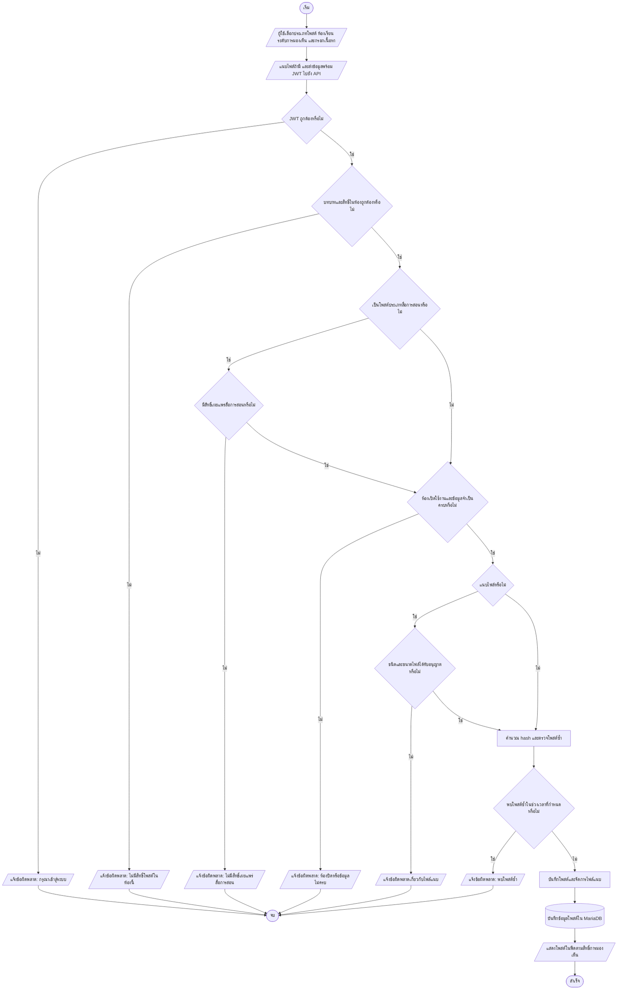
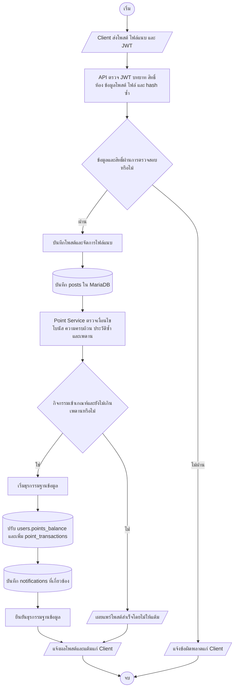

# 3.3 ระบบคอมมูนิตี้และกลไกเกมมิฟิเคชันแต้มสะสม

ระบบคอมมูนิตี้เป็นพื้นที่สำหรับเผยแพร่เนื้อหาทางวิชาการ ตั้งคำถาม แลกเปลี่ยนเรียนรู้ และแบ่งปันเอกสารสรุป โดยมีระบบแต้มเป็นกลไกสนับสนุนการมีส่วนร่วม การออกแบบใช้หลัก RBAC ร่วมกับการตรวจสิทธิ์ระดับโพสต์และห้อง และใช้แนวคิด Earn-and-Burn Loop เชื่อมการสร้างประโยชน์ให้ชุมชนเข้ากับการใช้บริการ AI

**ความหมายของสัญลักษณ์ใน Flowchart:** วงรีคือจุดเริ่ม/จบ สี่เหลี่ยมคือขั้นตอน ข้าวหลามตัดคือเงื่อนไข สี่เหลี่ยมด้านขนานคือข้อมูลเข้า/ออก และทรงกระบอกคือการจัดเก็บข้อมูล

## 3.3.1 การออกแบบกระบวนการทำงานและกลไกของระบบ

### 3.3.1.1 กระบวนการตั้งกระทู้ การแลกเปลี่ยนเรียนรู้ และการแบ่งปันไฟล์เอกสารสรุป

กระบวนการเผยแพร่เนื้อหาเริ่มจากผู้ใช้เลือกประเภทโพสต์และขอบเขตการมองเห็น ก่อนส่งเนื้อหาและไฟล์แนบให้ระบบตรวจสอบสิทธิ์ รูปแบบ และความซ้ำซ้อน การควบคุมดังกล่าวช่วยให้การแลกเปลี่ยนความรู้เป็นไปตามบทบาทและบริบทของห้องเรียน

**รูปที่ 3.6 Flowchart การสร้างโพสต์และแบ่งปันเอกสาร**

- ผู้ใช้เริ่มส่งโพสต์จากส่วนติดต่อ โดยระบุชนิดเนื้อหา เช่น สรุป คำถาม สื่อการสอน หรือผลลัพธ์ Quiz/Roadmap
- API ตรวจสอบตัวตน สิทธิ์ในห้อง ระดับการมองเห็น และข้อกำหนดของไฟล์ก่อนบันทึก
- ระบบคำนวณลายนิ้วมือเพื่อปฏิเสธโพสต์ซ้ำในช่วงเวลาที่กำหนด และใช้ soft delete เพื่อคงร่องรอยของโพสต์
- เมื่อบันทึกสำเร็จ ฟีดจะแสดงโพสต์ตามสิทธิ์; ผู้ใช้รายอื่นสามารถแสดงความคิดเห็น ให้ปฏิกิริยา แชร์ หรือบันทึกโพสต์

### 3.3.1.2 กลไกเกมมิฟิเคชัน โครงสร้างบัญชีแต้มสะสม และวงจรการได้รับและใช้แต้ม

กลไกเกมมิฟิเคชันใช้แนวคิด Earn-and-Burn Loop โดยให้แต้มเป็นหน่วยภายในระบบสำหรับส่งเสริมการร่วมสร้างองค์ความรู้และควบคุมการใช้ทรัพยากร AI แต้มไม่ใช่เงินตราและไม่ใช่ตัวแทนคะแนนผลสัมฤทธิ์ทางการศึกษา ระบบแยกยอดคงเหลือปัจจุบันใน `users.points_balance` ออกจากประวัติธุรกรรมใน `point_transactions`

แนวทางนี้เชื่อมโยงแนวคิดเกมมิฟิเคชันและแรงจูงใจในบทที่ 2 เข้ากับพฤติกรรมการแบ่งปันความรู้ โดยระบบให้คุณค่ากับเนื้อหาที่ผู้สร้างนำเข้าสู่ชุมชนและการตอบสนองของผู้เรียนรายอื่น ไม่ได้ให้รางวัลแก่ทุกการคลิกหรือใช้แต้มแทนการประเมินการเรียนรู้

**รูปที่ 3.7 วงจร Earn-and-Burn Loop**

```mermaid
flowchart LR
    A([เริ่ม]) --> U[/เกิดกิจกรรม Earn: โบนัสต้อนรับ โพสต์ ปฏิกิริยา/แชร์ หรือ Quiz cashback/]
    U --> E1[ตรวจสิทธิ์ ความซ้ำซ้อน และเพดานรายวัน/cashback]
    E1 --> E2{กิจกรรมเข้าเกณฑ์หรือไม่}
    E2 -- ไม่ --> E3[/ไม่ให้แต้มและแจ้งผล/]
    E2 -- ใช่ --> E4[บันทึกรายการ Earn และปรับยอดภายในธุรกรรมฐานข้อมูล]
    E4 --> E5[(point_transactions และ users.points_balance)]
    E5 --> E6[/แสดงยอดแต้มที่ปรับปรุงแล้ว/]
    E6 --> B1{ผู้ใช้เลือกใช้บริการ AI หรือไม่}
    B1 -- ยังไม่ใช้ --> Z([จบ])
    B1 -- ใช้ --> B2[/เลือกบริการ AI เช่น RAG, สร้าง Quiz/Roadmap, ขยาย Roadmap หรือนำเข้า Quiz/]
    B2 --> B3{เป็นผู้สอนหรือผู้ดูแลระบบที่ได้รับยกเว้นหรือไม่}
    B3 -- ใช่ --> B6[เริ่มบริการโดยไม่หักแต้ม]
    B3 -- ไม่ใช่ --> B4{แต้มเพียงพอตามค่าบริการหรือไม่}
    B4 -- ไม่พอ --> B5[/แจ้งแต้มไม่เพียงพอ/]
    B4 -- เพียงพอ --> B7[บันทึกรายการ Burn และปรับยอดในธุรกรรมฐานข้อมูล]
    B7 --> B8[(point_transactions และ users.points_balance)]
    B8 --> B6
    B6 --> B9{ประมวลผลสำเร็จหรือไม่}
    B9 -- สำเร็จ --> B10[/ส่งผลบริการให้ผู้ใช้/]
    B9 -- ล้มเหลว --> B11{มีการหักแต้มแล้วหรือไม่}
    B11 -- มี --> B12[บันทึกรายการคืนโดยอ้างอิงธุรกรรมเดิม]
    B12 --> B13[(point_transactions และ users.points_balance)]
    B13 --> B14[/แจ้งผลล้มเหลวและยอดคืน/]
    B11 -- ไม่มี --> B15[/แจ้งผลล้มเหลวโดยไม่คืนแต้ม/]
    E3 --> Z
    B5 --> Z
    B10 --> Z
    B14 --> Z
    B15 --> Z
```

- **ฝั่ง Earn:** ผู้ใช้ได้รับแต้มจากการเริ่มต้นใช้งานและการเผยแพร่เนื้อหาที่ผ่านเงื่อนไข รวมถึงเมื่อผู้อื่นตอบสนองหรือทำ Quiz ที่แชร์จนเสร็จ
- **ฝั่ง Burn:** บริการ AI หักแต้มตามชนิดงานก่อนเริ่มประมวลผล; ผู้สอนและผู้ดูแลระบบได้รับการยกเว้นการหักตามนโยบายปัจจุบัน
- **หลักการ Ledger:** ทุกการให้ หัก หรือคืนแต้มเพิ่มรายการธุรกรรมพร้อม `delta`, `balance_after` และข้อมูลอ้างอิง โดยไม่ลบประวัติเดิมเพื่อแก้ยอดย้อนหลัง
- ธุรกรรมการปรับยอดและการบันทึกรายการทำภายใต้การจัดการธุรกรรมของฐานข้อมูลเพื่อให้ยอดและประวัติมีความสอดคล้อง

## 3.3.2 การสร้างและการพัฒนาระบบ

### 3.3.2.1 เครื่องมือและเทคโนโลยีที่ใช้ในการพัฒนา

ส่วนติดต่อคอมมูนิตี้พัฒนาด้วย React และ Vite และใช้ Tailwind CSS สำหรับจัดรูปแบบองค์ประกอบและรองรับหน้าจอหลายขนาด ส่วน backend แบ่งโมดูลตามหน้าที่และเปิดความสามารถผ่าน REST API เพื่อให้ส่วนติดต่อเรียกใช้การจัดการโพสต์ ห้องเรียน การแจ้งเตือน และแต้มได้

ข้อมูลกิจกรรมและธุรกรรมจัดเก็บใน MariaDB โดยใช้คีย์หลักแบบประกอบในตารางปฏิสัมพันธ์ เช่น `post_reactions` และ `post_shares` เพื่อจำกัดระเบียนซ้ำตามผู้ใช้/โพสต์ ส่วนการยืนยันตัวตนใช้ JWT และ middleware ตรวจสอบบทบาท RBAC ที่ backend ก่อนดำเนินการ การซ่อนคำสั่งใน UI ช่วยลดความสับสนในการใช้งาน แต่ไม่ทดแทนการตรวจสิทธิ์ฝั่งเซิร์ฟเวอร์

### 3.3.2.2 การพัฒนากลไกความปลอดภัย การคัดกรองเนื้อหา และมาตรการป้องกันการสะสมแต้มผิดปกติ

ระบบตรวจสอบเนื้อหาและกิจกรรมก่อนบันทึกหรือให้แต้ม โดยใช้กลไกหลายชั้นเพื่อป้องกันสแปม การส่งข้อมูลซ้ำ และการเพิ่มยอดด้วยกิจกรรมที่ไม่มีคุณค่าต่อชุมชน

1. **Content Hashing:** สร้างลายนิ้วมือ MD5 จากส่วนสำคัญของโพสต์ เช่น ชื่อ เนื้อหา และรหัสเนื้อหาที่เชื่อมโยง แล้วตรวจโพสต์ซ้ำของผู้เขียนในช่วงเวลาที่กำหนด
2. **Minimum Content Length:** ตรวจความยาวขั้นต่ำหรือความครบถ้วนของเนื้อหาเพื่อไม่ให้โพสต์ว่างหรือสั้นเกินเกณฑ์ได้รับโบนัสผู้สร้าง
3. **Soft Delete:** ใช้ `posts.is_deleted` ระบุสถานะลบ โดยยังเก็บระเบียนไว้เพื่อรักษาความสัมพันธ์และข้อมูลตรวจสอบ
4. **Unique Action Constraints:** ใช้คีย์หลักแบบประกอบใน `post_reactions` และ `post_shares` จำกัดการบันทึกปฏิกิริยาชนิดเดียวกันหรือการแชร์ซ้ำโดยผู้ใช้คนเดิมในโพสต์เดียวกัน
5. **Creator-Oriented Rewarding:** แต้ม `like_bonus` และ `helpful_bonus` มอบแก่ผู้สร้างโพสต์ที่ได้รับการตอบสนอง ไม่ใช่ผู้กดปฏิกิริยา จึงลดแรงจูงใจให้ผู้ใช้สลับกันกดเพื่อปั๊มแต้มโดยตรง
6. **Daily Limits:** จำกัดยอดสะสมต่อประเภทกิจกรรมในแต่ละวัน ได้แก่ `post_bonus` 6 แต้ม, `creator_bonus` 6 แต้ม, `like_bonus` 10 แต้ม, `helpful_bonus` 10 แต้ม, `share_bonus` 10 แต้ม และ `edit_bonus` 2 แต้มตามค่าเริ่มต้น
7. **Quiz Cashback Cap:** ให้ผู้สร้างแบบทดสอบ 1 แต้มต่อผู้เล่นที่ทำแบบทดสอบที่แชร์จนเสร็จ โดยจำกัดไม่เกิน 15 แต้มต่อโพสต์แบบทดสอบ

ค่าตอบแทนและเพดานบางรายการปรับได้ผ่านค่ากำหนดระบบ การตรวจความซ้ำซ้อนและเพดานรายวันเป็นมาตรการร่วมกัน มิได้อาศัยข้อกำหนด unique constraint ใน `point_transactions` เพียงอย่างเดียว

### 3.3.2.3 เกณฑ์และเงื่อนไขการคำนวณแต้มสะสมและการแลกรับสิทธิ์

ตารางต่อไปนี้แสดงอัตราเริ่มต้นของระบบ ค่าจริงอาจเปลี่ยนตามการตั้งค่าระบบ

**ตารางที่ 3.19 เกณฑ์การได้รับแต้ม (Earn)**

| กิจกรรม | ประเภทธุรกรรม | แต้มเริ่มต้น | เงื่อนไข |
|---|---|---:|---|
| โบนัสต้อนรับ | `welcome` | 20 | ให้ครั้งเดียวแก่บัญชีที่ไม่อยู่ในกลุ่มยกเว้น |
| โบนัสผู้สร้างสรุป | `creator_bonus` | 2 | โพสต์สรุปผ่านการตรวจเนื้อหา |
| โบนัสโพสต์ | `post_bonus` | 2 | โพสต์ผ่านข้อกำหนดความครบถ้วน |
| ได้รับ Like | `like_bonus` | 1 | ให้แก่ผู้สร้างเมื่อมีผู้ใช้ตอบสนอง |
| ได้รับ Helpful | `helpful_bonus` | 1 | ให้แก่ผู้สร้างเมื่อมีผู้ใช้ประเมินว่าเป็นประโยชน์ |
| มีผู้แชร์โพสต์ | `share_bonus` | 2 | ให้แก่ผู้สร้างเมื่อมีผู้ใช้แชร์ โดยไม่จ่ายซ้ำผู้แชร์/โพสต์เดิม |
| Quiz cashback | `cashback` | 1 | เมื่อผู้ใช้อื่นทำ Quiz ที่แชร์จนเสร็จ สูงสุด 15 แต้มต่อโพสต์ |
| ปรับปรุงโพสต์ | `edit_bonus` | 1 | เมื่อเนื้อหาที่แก้ไขผ่านเงื่อนไขและยังไม่เกินเพดาน |

**ตารางที่ 3.20 อัตราการใช้แต้ม (Burn) สำหรับบริการและ AI**

| บริการ | ประเภทธุรกรรม | แต้มเริ่มต้น |
|---|---|---:|
| คำถาม KMITL RAG AI แบบเดี่ยว | `rag_question` | 1 |
| เซสชัน KMITL RAG AI จำนวน 5 ข้อความ | `rag_session` | 4 |
| สร้างชุดแบบทดสอบ | `quiz_generate` | 8 |
| สร้างแผนการเรียน | `roadmap_generate` | 15 |
| ขยายหัวข้อในแผนการเรียน | `roadmap_expand` | 2 |
| นำเข้าแบบทดสอบที่แบ่งปัน | `quiz_import` | 1 |

เมื่อการประมวลผลล้มเหลว ระบบบันทึกรายการคืนแต้มโดยอ้างอิงธุรกรรมเดิมแทนการลบประวัติ การตรวจยอดก่อนใช้บริการและการบันทึกการคืนแต้มช่วยให้ผู้ใช้ตรวจสอบการเปลี่ยนแปลงบัญชีได้

## 3.3.3 ขั้นตอนการทำงานของระบบคอมมูนิตี้และระบบแต้มสะสม

### 3.3.3.1 ขั้นตอนการเผยแพร่เนื้อหา การตรวจสอบเงื่อนไข และการบันทึกบัญชีธุรกรรมแต้มอัตโนมัติ

เมื่อผู้ใช้เผยแพร่เนื้อหา ระบบจะตรวจสอบข้อมูลและสิทธิ์ก่อนบันทึกโพสต์ จากนั้นประเมินกฎการให้แต้มและอัปเดตยอดกับสมุดบัญชีในขั้นตอนที่สัมพันธ์กัน

**รูปที่ 3.8 Flowchart การเผยแพร่เนื้อหาและบันทึกแต้ม**

- Client ส่งข้อมูลโพสต์และข้อมูลยืนยันตัวตนไปยัง API Controller
- Controller ตรวจ JWT บทบาท ขอบเขตห้อง ความยาวขั้นต่ำ และ hash ซ้ำ ก่อนบันทึก `posts`
- Point Service ประเมินชนิดโบนัส เพดานรายวัน และเงื่อนไขกิจกรรมโดยไม่ให้รางวัลซ้ำ
- ระบบอัปเดต `users.points_balance` เพิ่มรายการใน `point_transactions` และสร้างการแจ้งเตือนที่เกี่ยวข้องก่อนส่งผลกลับ
