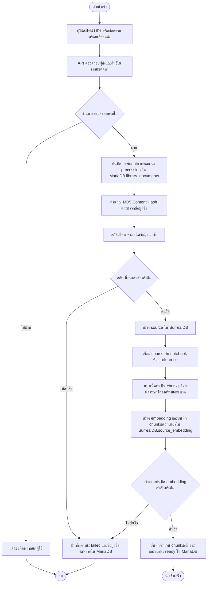
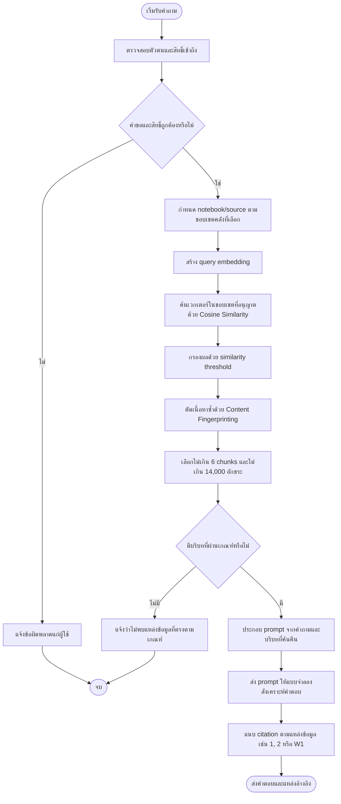
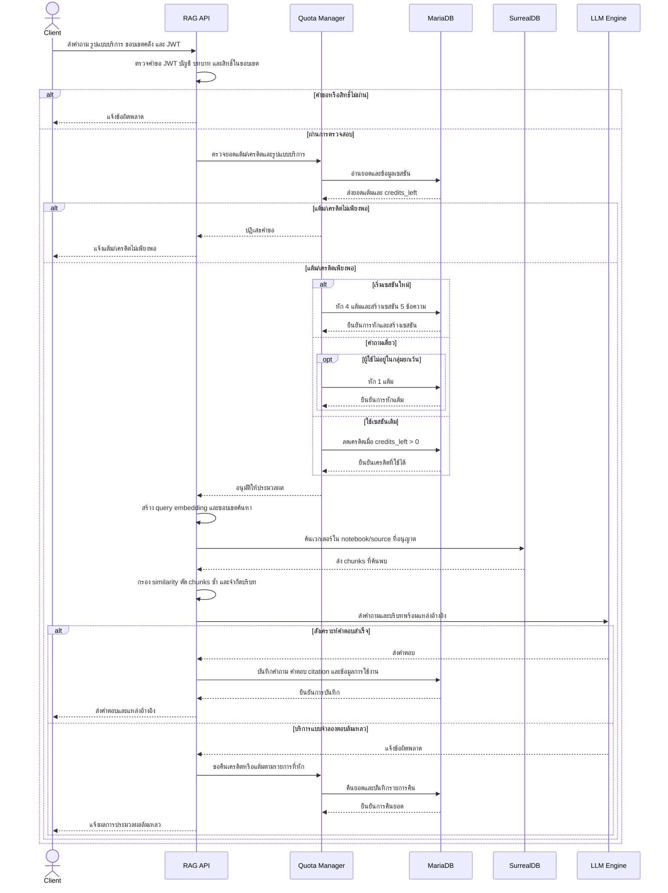

# 3.4 ระบบผู้ช่วยอัจฉริยะ KMITL RAG AI

KMITL RAG AI เป็นระบบถาม–ตอบที่นำเอกสารในคลังความรู้มาใช้เป็นหลักฐานประกอบการสังเคราะห์คำตอบ กระบวนการครอบคลุมการนำเข้าเอกสาร การสร้างเวกเตอร์ การค้นคืนเชิงความหมาย การจัดการบริบท และการเรียกแบบจำลอง ระบบใช้ MariaDB สำหรับข้อมูลกำกับ เอกสาร ธุรกรรม และประวัติสนทนา ใช้ SurrealDB สำหรับ notebook, source, source embedding และข้อมูลที่เกี่ยวข้องกับการสร้างผลลัพธ์ AI

## 3.4.1 การออกแบบสถาปัตยกรรมและไปป์ไลน์ AI

### 3.4.1.1 กระบวนการนำเข้าเอกสารและการแปลงข้อมูลเป็นเวกเตอร์

ผู้ใช้สามารถนำเข้าไฟล์ URL หรือข้อความ โดยระบุว่าจะจัดเก็บในคลังส่วนบุคคลหรือคลังรายวิชา ระบบเริ่มบันทึกระเบียนกำกับใน `library_documents` ด้วยสถานะ `processing` เพื่อให้ติดตามสถานะของเอกสารได้ก่อนเริ่มสกัดและสร้างเวกเตอร์

**รูปที่ 3.9 Ingestion Pipeline**

- API ตรวจสอบผู้ส่งและขอบเขตคลัง จากนั้นบันทึกเจ้าของ ห้อง notebook/source ชนิดข้อมูล และสถานะเริ่มต้นใน MariaDB
- ระบบคำนวณ MD5 Content Hash เพื่อช่วยตรวจไฟล์หรือเนื้อหาที่ซ้ำ แล้วสกัดข้อความเป็น Markdown/ข้อความตามชนิดข้อมูลนำเข้า
- สร้างระเบียน `source` ใน SurrealDB และสร้าง Edge ความสัมพันธ์ `reference` เพื่อเชื่อม source กับ notebook ที่กำหนด
- ตัวแบ่งข้อความพิจารณาโครงสร้างของ Markdown/HTML หรือใช้การแบ่งแบบลำดับชั้นสำหรับข้อความทั่วไป จากนั้นสร้าง embedding และบันทึกชิ้นข้อความกับเวกเตอร์ใน `source_embedding`

ค่าปริยายของ Open Notebook กำหนดขนาดชิ้นข้อความ 400 โทเคน มีส่วนทับซ้อนร้อยละ 15 (ประมาณ 60 โทเคน) และตัดชิ้นที่มีขนาดต่ำกว่า 5 โทเคน โดยสามารถกำหนดขนาดและส่วนทับซ้อนผ่านค่าระบบได้ ส่วนทับซ้อนช่วยรักษาบริบทบริเวณรอยต่อของชิ้นข้อความ

หลังประมวลผลสำเร็จ ระบบบันทึกจำนวนชิ้นข้อความ จำนวนอักขระ และสถานะ `ready` ใน `library_documents` หากสกัดข้อความหรือสร้าง embedding ไม่สำเร็จจะบันทึกสถานะ `failed` และข้อมูลข้อผิดพลาดเพื่อให้ตรวจสอบได้ การนำเข้าใหม่จะจัดการข้อมูลเวกเตอร์เดิมของ source ตามกระบวนการประมวลผลซ้ำ

### 3.4.1.2 กระบวนการสืบค้นข้อมูลเชิงความหมายและการสังเคราะห์คำตอบ

เมื่อผู้ใช้ถามคำถาม ระบบกำหนดแหล่งความรู้ที่ได้รับอนุญาตและสร้าง embedding ของคำถาม จากนั้นเปรียบเทียบเวกเตอร์คำถามกับเวกเตอร์ชิ้นข้อความในขอบเขตที่เลือกด้วยการค้นหา Cosine Similarity

**รูปที่ 3.10 Retrieval and Synthesis Flowchart**

- **Scope-constrained Search:** ระบบค้นเฉพาะ notebook/source ที่ผู้ใช้มีสิทธิ์เข้าถึง และไม่ขยายไปยังคลังอื่นโดยอัตโนมัติเมื่อเลือกขอบเขตเฉพาะ เพื่อป้องกันข้อมูลข้ามรายวิชารั่วไหล
- **Vector Similarity:** ใช้ Cosine Similarity จัดอันดับชิ้นข้อความ และใช้เกณฑ์ความคล้ายคลึงขั้นต่ำตามการตั้งค่ากรองผลที่ไม่เกี่ยวข้อง
- **Content Fingerprinting:** ตรวจลายนิ้วมือข้อความเพื่อตัดเนื้อหาซ้ำ ลดการใช้บริบทซ้ำจาก source หรือ chunk ที่ทับซ้อนกัน
- **Grounded Synthesis:** คัดเลือกไม่เกิน 6 chunks และจำกัดบริบทรวมไม่เกิน 14,000 อักขระตามค่าปริยายก่อนส่งให้แบบจำลอง โดยกำกับที่มาของข้อมูลเป็น `[1]`, `[2]` และแหล่งเว็บเป็น `[W1]` เมื่อมีการค้นเว็บ

เส้นทาง KMITL RAG แบบรวดเร็วควบคุมบริบทด้วยจำนวนชิ้นข้อความและจำนวนอักขระ ส่วนการสนทนากับ notebook/source ของ Open Notebook ใช้ `ContextBuilder` ประเมินขนาดเป็นโทเคน จึงเป็นกระบวนการคนละเส้นทางและไม่ควรรวมข้อจำกัดทั้งสองเป็นกลไกเดียวกัน

การใช้ Cosine Similarity ต่อยอดหลักการวัดความคล้ายคลึงเชิงเวกเตอร์ในบทที่ 2 ส่วนการจำกัดผลค้นคืนตาม notebook/source ประยุกต์ RBAC กับขอบเขตทรัพยากร เพื่อให้คำตอบยึดโยงกับแหล่งข้อมูลที่ผู้ใช้ได้รับอนุญาตกัน

## 3.4.2 การสร้างและการพัฒนาระบบผู้ช่วยอัจฉริยะ

### 3.4.2.1 แบบจำลองภาษาขนาดใหญ่และเครื่องมือประมวลผล

ระบบใช้ Model Abstraction Layer เพื่อลดการผูกการเรียกแบบจำลองกับผู้ให้บริการรายเดียว โดยใช้ Esperanto และ `model_manager` เป็นองค์ประกอบในชั้นกำหนด/สร้างอินเทอร์เฟซแบบจำลองตามการตั้งค่าระบบ การเลือกแบบจำลองและผู้ให้บริการจึงปรับเปลี่ยนได้โดยไม่ต้องเปลี่ยนกระบวนการค้นคืนทั้งหมด

สถาปัตยกรรมข้อมูลเป็น Polyglot Persistence: MariaDB เก็บข้อมูลผู้ใช้ ข้อมูลกำกับเอกสาร ประวัติสนทนา และธุรกรรม ขณะที่ SurrealDB เก็บ notebook, source, source embedding และข้อมูลเชิงกราฟที่ใช้ค้นคืน ส่วน Open Notebook ทำหน้าที่จัดการคลังความรู้และวงจรการประมวลผลที่เกี่ยวข้อง LangChain Splitters ช่วยแบ่งเอกสารตามโครงสร้างและขนาดที่เหมาะสมต่อ embedding

### 3.4.2.2 การบริหารจัดการบริบทและการควบคุมโทเคน

`ContextBuilder` รวบรวมเนื้อหา source, insight และข้อความที่เกี่ยวข้อง พร้อมประเมินจำนวนโทเคนก่อนส่งให้แบบจำลอง หากบริบทเกินงบประมาณ ระบบใช้การตัดทอนและการจัดสรรงบประมาณให้ข้อมูลสรุปตามการตั้งค่า โดยเส้นทางสนทนากับ source รองรับเพดานบริบทสูงสุด 50,000 โทเคนตามค่าที่ส่งจากกราฟการสนทนา

การจัดการบริบทที่มีขนาดใหญ่พิจารณาทั้งการตัดทอน (Truncation) และการสรุป (Summarization) เพื่อรักษาข้อมูลสำคัญภายใต้งบประมาณโทเคน ระบบสามารถใช้ Dynamic Model Routing เลือกหรือเปลี่ยนไปใช้แบบจำลองที่รองรับบริบทขนาดใหญ่เมื่อคำขอเกินขีดจำกัดของแบบจำลองปัจจุบัน โดยคงข้อจำกัดของเส้นทาง API KMITL RAG แบบรวดเร็วซึ่งกำหนดจำนวนชิ้น/จำนวนอักขระแยกต่างหาก

ในเส้นทาง provision ของ Open Notebook ระบบเลือกแบบจำลอง `large_context` โดยอัตโนมัติเมื่อเนื้อหามีขนาดเกิน 105,000 โทเคน ก่อนพิจารณา `model_id` ที่ระบุไว้ ขณะที่เพดาน 50,000 โทเคนเป็นงบประมาณที่กำหนดให้การประกอบ source context ในกราฟ Source Chat จึงเป็นข้อจำกัดคนละระดับกับเกณฑ์การเลือกแบบจำลอง

### 3.4.2.3 การจัดการเซสชันและระบบควบคุมโควตาการใช้งาน

ระบบแยกข้อมูลการใช้เครดิตออกจากประวัติสนทนา ตาราง `rag_credit_sessions` เก็บจำนวนข้อความที่ยังใช้ได้ในเซสชันแบบคิดแต้ม ส่วน `rag_conversations` และ `rag_messages` เก็บหัวข้อ บทสนทนา เนื้อหา และ metadata ของคำตอบเพื่อให้ผู้ใช้กลับมาอ่านหรือดำเนินการต่อได้ การแยกดังกล่าวช่วยให้ตรวจโควตาและอ่านประวัติสนทนาได้โดยไม่ผูกความหมายของข้อมูลเข้าด้วยกัน

| รูปแบบการใช้ | ค่าใช้จ่ายเริ่มต้น | โควตา/การทำงาน |
|---|---:|---|
| คำถามเดี่ยว | 1 แต้ม | หนึ่งคำถาม ไม่ใช้โควตาเซสชัน |
| เริ่มเซสชัน | 4 แต้ม | ครอบคลุม 5 ข้อความและบริบทต่อเนื่อง |

การลดเครดิตดำเนินการด้วยคำสั่งแบบมีเงื่อนไข `WHERE credits_left > 0` เพื่อป้องกันคำขอพร้อมกันใช้เครดิตที่เหลืออยู่ซ้ำ เมื่อบริการแบบจำลองตอบล้มเหลว ระบบคืนเครดิตที่สำรองและคืนแต้มตามธุรกรรมที่เกี่ยวข้อง โดยเพิ่มรายการคืนแทนการลบรายการหักเดิม

## 3.4.3 ขั้นตอนการทำงานของระบบ KMITL RAG AI

### 3.4.3.1 ขั้นตอนการรับคำถาม การตรวจสอบสิทธิ์ การตัดโควตาแต้ม การสืบค้นเวกเตอร์ และการสังเคราะห์คำตอบพร้อมแหล่งอ้างอิง

ลำดับการทำงานเริ่มจาก Client ส่งคำถามและขอบเขตคลังมายัง RAG API ระบบตรวจสอบสิทธิ์และค่าใช้บริการก่อนค้นเวกเตอร์และส่งบริบทให้แบบจำลอง การทำงานแสดงใน Sequence Diagram ดังนี้

**รูปที่ 3.11 Sequence Diagram การถามตอบ KMITL RAG AI**

1. Client ส่งคำถาม รูปแบบคำถาม (เดี่ยวหรือเซสชัน) และตัวเลือกขอบเขตความรู้มายัง RAG API
2. RAG API ตรวจสอบโครงสร้างคำขอและยืนยันตัวตนจาก JWT
3. ระบบตรวจสอบสถานะบัญชีและบทบาทผู้ใช้ก่อนเปิดให้เรียกบริการ
4. ระบบตรวจว่าผู้ใช้มีสิทธิ์เข้าถึงห้อง รายวิชา หรือคลังส่วนบุคคลที่ระบุ
5. API แปลงขอบเขตที่เลือกเป็นรายการ notebook/source ที่อนุญาต
6. ระบบตรวจชนิดบริการและคำนวณค่าใช้จ่ายตามค่าตั้งปัจจุบัน
7. Quota Manager ตรวจยอดแต้มของผู้ใช้ หรือเครดิตที่เหลือในเซสชัน
8. หากเริ่มเซสชันใหม่ ระบบหัก 4 แต้มและสร้างโควตา 5 ข้อความตามค่าปริยาย
9. หากเป็นคำถามเดี่ยว ระบบหัก 1 แต้มตามค่าเริ่มต้น หรือยกเว้นการหักตามบทบาท
10. หากใช้เซสชันเดิม ระบบลดเครดิตด้วยเงื่อนไข `credits_left > 0` ก่อนประมวลผลคำถาม
11. ระบบสร้าง embedding ของคำถามด้วยแบบจำลอง embedding ที่กำหนด
12. SurrealDB ค้นหาเวกเตอร์ใน notebook/source ที่ได้รับอนุญาตโดยใช้ Cosine Similarity
13. ระบบกรองผลด้วย similarity threshold และตัดเนื้อหาซ้ำด้วย content fingerprint
14. API คัดเลือกชิ้นข้อความไม่เกิน 6 chunks และไม่เกิน 14,000 อักขระตามค่าปริยาย
15. ระบบกำหนดหมายเลขอ้างอิงให้แต่ละแหล่ง และประกอบ prompt พร้อมคำถาม/บริบทสนทนาที่เกี่ยวข้อง
16. LLM Engine สร้างคำตอบผ่านชั้นนามธรรมของผู้ให้บริการ โดยยึดข้อมูลที่ค้นคืนเป็นหลักฐาน
17. API จัดรูปแบบคำตอบและ citation `[1]`, `[2]` หรือ `[W1]` แล้วบันทึกลง `rag_conversations`/`rag_messages`
18. ระบบปรับปรุงยอดเครดิตและบันทึกการใช้งาน/ธุรกรรม จากนั้นส่งคำตอบและแหล่งอ้างอิงกลับ Client
19. หากขั้นประมวลผลล้มเหลว ระบบบันทึกข้อผิดพลาด คืนเครดิตหรือแต้มตามกรณี และแจ้งผลแก่ Client
