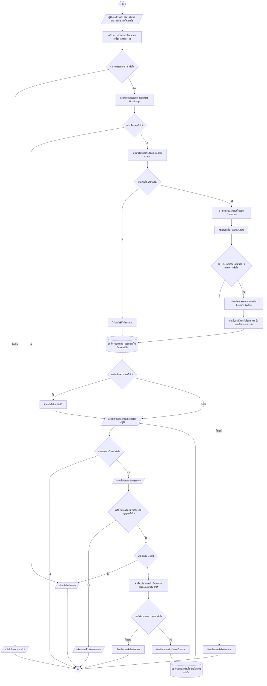

# 3.5 ระบบปัญญาประดิษฐ์เพื่อจัดทำแผนการเรียนรู้ (AI Roadmap)

AI Roadmap เป็นระบบช่วยจัดลำดับหัวข้อและกิจกรรมการเรียนรู้จากเป้าหมายที่ผู้ใช้ระบุ โดยแสดงผลเป็นแผนที่ประกอบด้วยโหนดหลัก โหนดย่อย และเส้นเชื่อมระหว่างหัวข้อ ระบบจึงประยุกต์แนวคิดการกำกับตนเองในการเรียนรู้ (Self-Regulated Learning: SRL) ในหัวข้อ 2.2.2 เพื่อช่วยให้ผู้เรียนเห็นลำดับการเรียน โดยยังคงให้ผู้เรียนเป็นผู้กำหนดเป้าหมายและเลือกแหล่งความรู้

**ความหมายของสัญลักษณ์ใน Flowchart:** วงรีแสดงจุดเริ่มต้นหรือสิ้นสุด สี่เหลี่ยมแสดงขั้นตอน ข้าวหลามตัดแสดงเงื่อนไข สี่เหลี่ยมด้านขนานแสดงข้อมูลเข้า/ออก และทรงกระบอกแสดงการจัดเก็บข้อมูล

## 3.5.1 ข้อมูลนำเข้าและขอบเขตแหล่งความรู้

ผู้ใช้ระบุหัวข้อหรือเป้าหมายที่ต้องการเรียน เลือกภาษาและจำนวนโหนดได้ หรือให้แบบจำลองกำหนดจำนวนตามเนื้อหา พร้อมเลือกขอบเขตแหล่งความรู้ เช่น คลังรายวิชา ไฟล์ส่วนบุคคล เอกสารที่เลือก หรือ Notebook ที่ได้รับอนุญาต ระบบตรวจสอบสิทธิ์ของผู้ใช้และจำกัดการค้นคืนไว้ในขอบเขตที่เลือก ไม่ขยายไปยังคลังที่ผู้ใช้ไม่มีสิทธิ์เข้าถึง

คำขอสร้างแผนส่งผ่าน `POST /api/community/study/roadmap` ส่วนการขยายโหนดของแผนที่บันทึกแล้วใช้ `POST /api/community/roadmaps/mine/{session_id}/expand`

ระบบรองรับการใช้ข้อมูลจากเว็บ 3 โหมด ได้แก่ (1) อัตโนมัติ ซึ่งค้นเว็บเฉพาะหัวข้อที่คลังความรู้ยังไม่ครอบคลุม (2) ค้นเว็บเสริมเสมอ ซึ่งค้นหัวข้อที่ยังไม่มีแหล่งจากคลังและหัวข้อหลักที่มีข้อมูลจากคลังแล้ว และ (3) ปิดการค้นเว็บ การตั้งค่าแหล่งความรู้และโหมดเว็บจะถูกเก็บไว้กับเซสชัน เพื่อใช้ต่อเมื่อผู้ใช้ขยายหัวข้อในแผน

## 3.5.2 การสร้างและตรวจสอบแผนการเรียนรู้

ระบบค้นคืนข้อความที่เกี่ยวข้องจากแหล่งความรู้ที่กำหนด แล้วส่งเป้าหมายและข้อความที่ค้นคืนให้แบบจำลองภาษาเพื่อสร้างผลลัพธ์ในรูปแบบ JSON ประกอบด้วยชื่อแผน คำอธิบาย และรายการโหนด แต่ละโหนดมีชื่อ คำอธิบาย หมวดหมู่ ลำดับ โหนดแม่ และข้อมูลอ้างอิง ระบบจัดแนวทางการเรียนรู้เป็น 5 ระยะ ได้แก่ พื้นฐาน แนวคิดหลัก ฝึกปฏิบัติ ประยุกต์ และทบทวนหรือประเมิน

หลังได้รับผลลัพธ์ ระบบปรับรูปแบบข้อมูลให้เป็นมาตรฐาน กำหนดรหัสโหนดและลำดับใหม่ จัดโหนดหลักตามระยะการเรียนรู้ และสร้างเส้นเชื่อมจากลำดับของโหนดหลักและความสัมพันธ์ระหว่างโหนดแม่กับโหนดย่อย แทนการนำเส้นเชื่อมที่แบบจำลองสร้างมาใช้โดยไม่ตรวจสอบ ในขั้นตอนปรับรูปแบบผลลัพธ์ ระบบกำหนดเพดานไม่เกิน 200 โหนดและต้องมีโหนดหลักอย่างน้อย 3 โหนด

ระบบผูกข้อมูลแหล่งที่มากับโหนดตามหลักฐานที่ใช้ หากเปิดโหมดเว็บ ระบบค้นข้อมูลเพิ่มเติมในหัวข้อที่ยังไม่มีแหล่งจากคลังความรู้ และแสดงสถานะว่าแผนอ้างอิงจากคลังความรู้ เว็บ หรือไม่ได้อ้างอิงจากสองแหล่งดังกล่าว ผู้ใช้จึงตรวจสอบที่มาของเนื้อหาได้ แทนการถือว่าทุกโหนดมีแหล่งอ้างอิงเหมือนกัน

ลำดับการสร้างแผนตั้งแต่การตรวจสอบคำขอและสิทธิ์ การค้นคืนข้อมูล การสร้างและตรวจสอบผลลัพธ์ ไปจนถึงการบันทึกและขยายแผน แสดงดังรูปที่ 3.12

**รูปที่ 3.12 Flowchart การสร้างและขยายแผนการเรียนรู้ด้วย AI Roadmap**

- การค้นคืนข้อมูลจำกัดตามแหล่งความรู้ที่ผู้ใช้เลือกและได้รับอนุญาต ส่วนข้อมูลจากเว็บจะถูกค้นเพิ่มเติมตามโหมดที่กำหนด
- ระบบแปลงผลลัพธ์จากแบบจำลองให้เป็นโครงสร้างโหนดและเส้นเชื่อมที่ตรวจสอบได้ก่อนบันทึกเป็นเซสชัน
- การขยายแผนตรวจสอบระดับของโหนด จำนวนโหนด และแต้มก่อนดำเนินการ หากขยายแผนที่แบ่งปันในคอมมูนิตี้ ระบบจะปรับข้อมูลโพสต์ให้ตรงกับแผนที่อัปเดตแล้ว

## 3.5.3 การจัดเก็บและการใช้งานแผน

ระบบจัดเก็บผลลัพธ์เป็นเซสชันในตาราง `roadmap_session` ของ SurrealDB โดยบันทึกเจ้าของ ชื่อและคำอธิบายแผน ภาษา จำนวนโหนด รายการโหนดและเส้นเชื่อม ตลอดจนการตั้งค่าและข้อมูลแหล่งอ้างอิง โครงสร้างตารางแสดงในตารางที่ 3.18 ผู้ใช้เปิดแผนเดิมและสั่งขยายโหนดเพื่อสร้างหัวข้อย่อยเพิ่มเติมได้ โดยขยายได้ไม่เกิน 2 ระดับจากโหนดหลัก และยังอยู่ภายใต้เพดานจำนวนโหนดของระบบ

Roadmap สามารถนำไปแบ่งปันในคอมมูนิตี้ได้ตามกระบวนการในหัวข้อ 3.3 เมื่อแผนที่แบ่งปันถูกขยาย ระบบจะปรับข้อมูลสำเนาในโพสต์ให้สอดคล้องกับแผนต้นฉบับ ส่วนการสร้างและขยายแผนใช้แต้มตามอัตราที่กำหนดในหัวข้อ 3.3.1.2 และระบบคืนแต้มเมื่อการประมวลผลล้มเหลวหรือใช้ผลลัพธ์จากแคช
