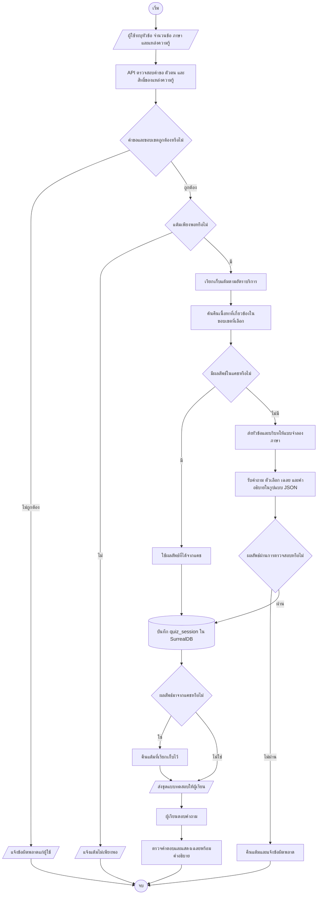

# 3.6 ระบบปัญญาประดิษฐ์เพื่อสร้างแบบทดสอบ (AI Quiz)

AI Quiz เป็นระบบสร้างแบบทดสอบสำหรับทบทวนความรู้จากหัวข้อหรือเนื้อหาในแหล่งความรู้ที่ผู้ใช้เลือก การทำงานเชื่อมโยงแนวคิดเกมมิฟิเคชันและการให้ข้อมูลย้อนกลับในหัวข้อ 2.3.2 เข้ากับการกำหนดผลลัพธ์แบบมีโครงสร้างในหัวข้อ 2.4.6 แบบทดสอบเป็นเครื่องมือช่วยทบทวนและตรวจสอบความเข้าใจเบื้องต้น ไม่ใช่หลักฐานยืนยันผลสัมฤทธิ์ทางการเรียนด้วยตัวเอง

**ความหมายของสัญลักษณ์ใน Flowchart:** วงรีแสดงจุดเริ่มต้นหรือสิ้นสุด สี่เหลี่ยมแสดงขั้นตอน ข้าวหลามตัดแสดงเงื่อนไข สี่เหลี่ยมด้านขนานแสดงข้อมูลเข้า/ออก และทรงกระบอกแสดงการจัดเก็บข้อมูล

## 3.6.1 ข้อมูลนำเข้าและการค้นคืนเนื้อหา

ผู้ใช้ระบุหัวข้อ จำนวนข้อ และภาษาที่ต้องการ พร้อมเลือกขอบเขตแหล่งความรู้ เช่น คลังรายวิชา ไฟล์ส่วนบุคคล หรือเอกสารที่เลือก API ตรวจสอบสิทธิ์ก่อนส่งขอบเขตดังกล่าวไปยังบริการสร้างแบบทดสอบ โดย API สำหรับการสร้างแบบทดสอบจากเนื้อหาการเรียนกำหนดจำนวนข้อได้ตั้งแต่ 1 ถึง 20 ข้อ และใช้ 10 ข้อเป็นค่าเริ่มต้น

คำขอสร้างแบบทดสอบจากแหล่งความรู้ของระบบส่งผ่าน `POST /api/community/study/quiz` ส่วน API `POST /api/features/quiz/generate` รองรับการสร้างแบบทดสอบจากหัวข้อหรือโพสต์ที่ผู้ใช้บันทึกไว้

บริการค้นคืนข้อความที่เกี่ยวข้องจาก Notebook หรือเอกสารในขอบเขตที่อนุญาต แล้วส่งหัวข้อและบริบทที่ค้นคืนให้แบบจำลองภาษา บริบทจากเอกสารถูกใช้เป็นแหล่งข้อมูลหลักสำหรับการสร้างคำถาม หากไม่มีการกำหนดบริบท ระบบยังสามารถสร้างแบบทดสอบจากหัวข้อที่ผู้ใช้ระบุได้ ทั้งนี้ขอบเขตการค้นคืนและผลการสร้างขึ้นอยู่กับแหล่งความรู้และการตั้งค่าของคำขอ

## 3.6.2 การสร้างและตรวจสอบแบบทดสอบ

แบบจำลองได้รับคำสั่งให้ส่งผลลัพธ์เป็น JSON ซึ่งประกอบด้วยคำถาม ตัวเลือก คำตอบที่ถูกต้อง และคำอธิบายประกอบ โดยกำหนดให้แต่ละข้อมีตัวเลือก 4 รายการและคำตอบที่ถูกต้องต้องตรงกับข้อความของตัวเลือก ระบบแยกวิเคราะห์ JSON และตรวจสอบโครงสร้างก่อนนำข้อมูลไปใช้ ได้แก่ ต้องมีรายการคำถาม ตัวเลือกต้องมี 4 รายการ และคำตอบที่ถูกต้องต้องตรงกับตัวเลือกข้อใดข้อหนึ่ง หากผลลัพธ์ไม่ผ่านข้อกำหนด ระบบแจ้งข้อผิดพลาดแทนการบันทึกผลลัพธ์ที่ไม่สมบูรณ์

ลำดับการสร้างแบบทดสอบตั้งแต่การตรวจสอบขอบเขตและค้นคืนเนื้อหา การสร้างและตรวจสอบคำถาม ไปจนถึงการบันทึกและส่งชุดแบบทดสอบให้ผู้เรียน แสดงดังรูปที่ 3.13

**รูปที่ 3.13 Flowchart การสร้างและใช้งานแบบทดสอบด้วย AI Quiz**

- ระบบใช้เนื้อหาที่ค้นคืนจากคลังที่ผู้ใช้ได้รับอนุญาตเป็นบริบทหลักในการสร้างคำถาม
- ก่อนบันทึก ระบบตรวจว่ามีคำถามและตัวเลือกครบ 4 รายการต่อข้อ และคำตอบที่ถูกต้องตรงกับตัวเลือกข้อหนึ่ง
- เมื่อบันทึกแล้ว ชุดแบบทดสอบส่งไปยังส่วนติดต่อผู้ใช้เพื่อให้ผู้เรียนตอบและทบทวนจากเฉลยกับคำอธิบาย

เมื่อผลลัพธ์ผ่านการตรวจสอบ ระบบบันทึกแบบทดสอบเป็นเซสชันในตาราง `quiz_session` ของ SurrealDB โดยจัดเก็บเจ้าของ หัวข้อ ภาษา จำนวนข้อ รายการคำถาม ลายนิ้วมือคำขอ และข้อมูลกำกับที่เกี่ยวข้อง โครงสร้างคำถามมีตัวเลือกพร้อมสถานะคำตอบที่ถูกต้อง คำตอบเฉลย และคำอธิบาย ระบบใช้ Redis สำหรับแคชผลลัพธ์ตามผู้ใช้และข้อมูลคำขอ เพื่อลดการประมวลผลซ้ำ โดยการคิดและคืนแต้มเป็นไปตามอัตราในหัวข้อ 3.3.1.2

## 3.6.3 การใช้งานและการเชื่อมโยงกับคอมมูนิตี้

หลังสร้างแบบทดสอบ ผู้เรียนสามารถตอบคำถามและใช้เฉลยพร้อมคำอธิบายเป็นข้อมูลย้อนกลับเพื่อทบทวนเนื้อหา ระบบจัดเก็บเซสชันเพื่อให้เปิดใช้งานต่อได้ และรองรับการนำแบบทดสอบไปแบ่งปันในคอมมูนิตี้ตามกระบวนการที่อธิบายในหัวข้อ 3.3 การใช้แบบทดสอบในลักษณะนี้มุ่งสนับสนุนการฝึกฝนและการแลกเปลี่ยนความรู้ โดยไม่ตีความคะแนนจากแบบทดสอบที่สร้างโดย AI ว่าเป็นผลการประเมินผลสัมฤทธิ์อย่างเป็นทางการ
