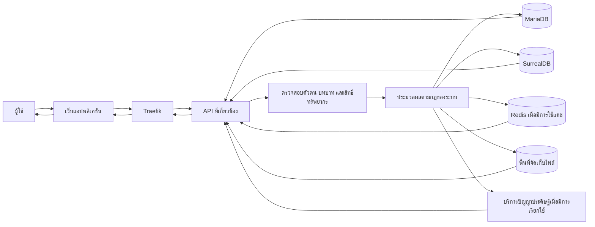

# 3.7 การออกแบบสถาปัตยกรรมระบบและการสื่อสารผ่าน API

แพลตฟอร์มประกอบด้วยส่วนติดต่อผู้ใช้ API และบริการจัดเก็บข้อมูลที่ทำงานร่วมกันผ่าน Docker Compose โดย Traefik ทำหน้าที่เป็น reverse proxy สำหรับกำหนดเส้นทางคำขอไปยังเว็บแอปพลิเคชันหรือ API ที่เกี่ยวข้อง ส่วน `open_notebook_api` ให้บริการ API หลักและเชื่อมการทำงานของแพลตฟอร์ม คอมมูนิตี้ และ KMITL RAG AI ขณะที่ `my_ai_quiz` และ `ai_roadmap_generator` ให้บริการส่วนติดต่อสำหรับสร้างและใช้งานแบบทดสอบและแผนการเรียน

**รูปที่ 3.14 ภาพรวมการสื่อสารระหว่างส่วนติดต่อผู้ใช้ API และบริการข้อมูล**

การสื่อสารแบ่งหน้าที่ขององค์ประกอบหลักดังนี้

| องค์ประกอบ | หน้าที่ในการสื่อสาร |
|---|---|
| ส่วนติดต่อผู้ใช้ | รับข้อมูลและคำสั่งจากผู้ใช้ ส่งคำขอไปยัง API ที่เกี่ยวข้อง และแสดงผลหรือสถานะที่ได้รับกลับ |
| Traefik | รับและกำหนดเส้นทางคำขอไปยังเว็บแอปพลิเคชันหรือ API ตามการตั้งค่าของระบบ |
| API | ตรวจสอบข้อมูลคำขอ ตัวตน บทบาท และสิทธิ์ของผู้ใช้ก่อนเรียกใช้กฎธุรกิจหรือบริการข้อมูล |
| MariaDB | จัดเก็บข้อมูลเชิงสัมพันธ์ เช่น บัญชีผู้ใช้ ห้องเรียน โพสต์ ธุรกรรมแต้ม และข้อมูลกำกับเอกสาร |
| SurrealDB | จัดเก็บ notebook, source, source embedding และข้อมูลที่ใช้ในการค้นคืนเชิงความหมาย |
| Redis และพื้นที่จัดเก็บถาวร | สนับสนุนการแคช และจัดเก็บไฟล์หรือข้อมูลถาวรตามหน้าที่ของบริการ |
| บริการปัญญาประดิษฐ์ | ประมวลผลคำขอที่เกี่ยวข้องกับ AI โดย API เป็นผู้กำหนดข้อมูลและขอบเขตที่ส่งไปประมวลผล |

## 3.7.1 ลำดับการรับและประมวลผลคำขอผ่าน API

เมื่อผู้ใช้ทำรายการ เช่น จัดการเอกสาร สร้างโพสต์ หรือถามคำถามระบบ AI การทำงานโดยทั่วไปมีลำดับดังนี้

1. ส่วนติดต่อผู้ใช้ส่งข้อมูลคำขอไปยัง API ที่รองรับความสามารถนั้น
2. API ตรวจสอบรูปแบบคำขอและยืนยันตัวตนจากข้อมูลรับรองของผู้ใช้
3. API ตรวจสอบบทบาท ความเป็นเจ้าของ หรือสิทธิ์ในห้องเรียนและคลังข้อมูลที่เกี่ยวข้อง โดยไม่ถือว่าการซ่อนปุ่มในหน้าจอเป็นการควบคุมสิทธิ์
4. เมื่อผ่านการตรวจสอบ API เรียกใช้ตรรกะของระบบและอ่านหรือบันทึกข้อมูลในบริการที่เกี่ยวข้อง
5. สำหรับงาน AI ระบบตรวจสอบขอบเขตความรู้และโควตาก่อนค้นคืนข้อมูลหรือเรียกแบบจำลอง โดยรายละเอียดแตกต่างกันตามฟังก์ชันและอธิบายในหัวข้อ 3.4–3.6
6. API ส่งผลลัพธ์หรือสถานะการดำเนินงานกลับไปยังส่วนติดต่อผู้ใช้ หากเกิดข้อผิดพลาด ระบบต้องแจ้งสถานะที่สอดคล้องกับผลจริงและบันทึกข้อมูลที่จำเป็นต่อการตรวจสอบ

การจัดเก็บข้อมูลใน MariaDB และ SurrealDB แยกตามลักษณะข้อมูล โดยการเชื่อมโยงระหว่างฐานข้อมูลอาศัยรหัสอ้างอิงที่จัดการในชั้นแอปพลิเคชัน ไม่ใช่ความสัมพันธ์แบบ foreign key ข้ามฐานข้อมูล การเรียกบริการและการควบคุมสิทธิ์จึงต้องตรวจสอบความสัมพันธ์ของรหัสและขอบเขตทรัพยากรใน API ก่อนส่งข้อมูลกลับผู้ใช้ รายละเอียดการทำงานของ RAG, AI Roadmap และ AI Quiz อธิบายในหัวข้อ 3.4–3.6 ตามลำดับ

การแยกโมดูลตามหน้าที่ในซอร์สโค้ดไม่ได้หมายความว่าทุกโมดูลถูกติดตั้งใช้งานเป็นไมโครเซอร์วิสแยกจากกัน รายละเอียดเส้นทางและข้อกำหนดของ API อาจแตกต่างกันตามฟังก์ชัน จึงควรอ้างอิงการทำงานของแต่ละระบบย่อยในหัวข้อ 3.2–3.6 แทนการเหมารวมว่าใช้ขั้นตอนเดียวกันทั้งหมด
