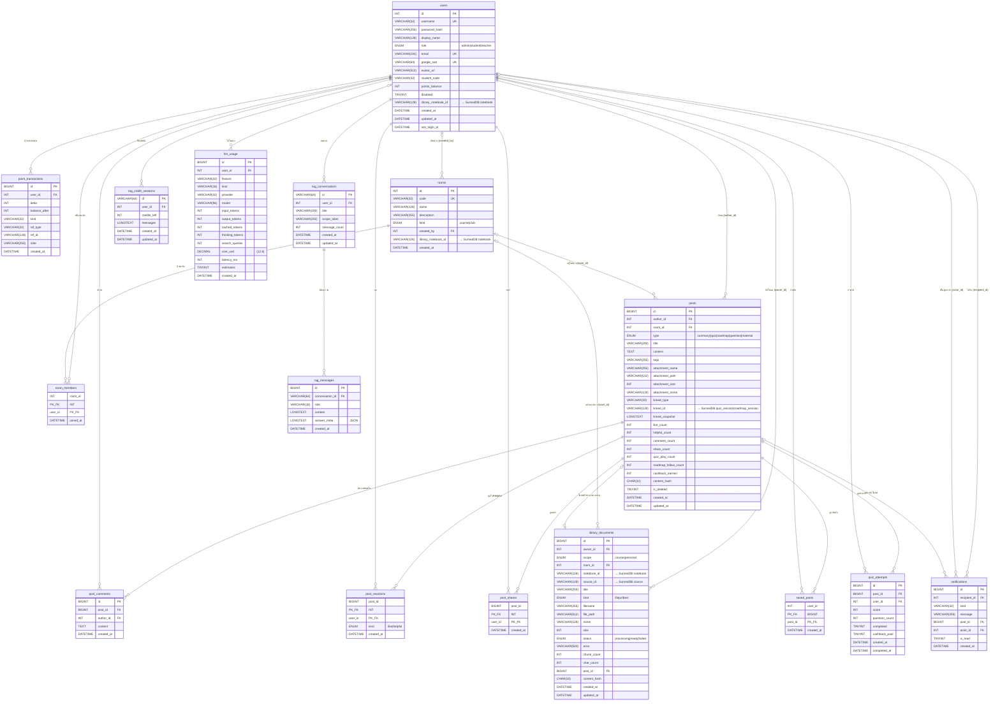
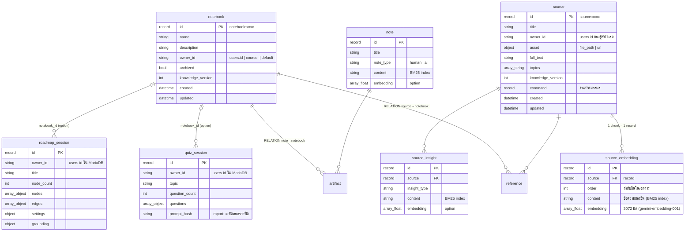

# ผังฐานข้อมูล SIET Space (ER Diagram)

สร้างจากซอร์สของ schema จริง (`open-notebook/open_notebook/community/schema.py` และ
`open_notebook/database/migrations/*.surrealql`) และตรวจกับฐานข้อมูลที่รันอยู่เมื่อ 19 ตุลาคม 2569
ชื่อตารางและคอลัมน์เป็นชื่อ**หลังการเปลี่ยนชื่อเมื่อ 24 กันยายน 2569** (`rooms`, `room_id`, `linked_*`,
`student_code`, `quiz_attempts`, `saved_posts`, `rag_credit_sessions`, `answer_meta`, ฯลฯ)
ผังทั้งสองผ่าน parser ของ Mermaid และ render เป็นภาพไว้ที่ `docs/report/images/fig-4.3-er-diagram.png`
และ `fig-4.4-surreal-collections.png`

คำอธิบายประกอบ (ชนิดความสัมพันธ์ พฤติกรรมเมื่อลบ ดัชนี และพจนานุกรมข้อมูลทุกคอลัมน์) อยู่ใน
[report/4.1-infrastructure-database.md](report/4.1-infrastructure-database.md) หัวข้อ 4.1.2–4.1.3

**สัญลักษณ์ที่ใช้**

| สัญลักษณ์ | ความหมาย |
|---|---|
| `\|\|--o{` | หนึ่ง ต่อ ศูนย์หรือหลาย (ฝั่งขวาต้องมีฝั่งซ้ายเสมอ) |
| `\|o--o{` | ศูนย์หรือหนึ่ง ต่อ ศูนย์หรือหลาย (คอลัมน์นั้นเป็น NULL ได้) |
| `\|o--o\|` | ศูนย์หรือหนึ่ง ต่อ ศูนย์หรือหนึ่ง (1:1 แบบไม่บังคับ) |
| `PK` `FK` `UK` | Primary key · Foreign key เชิงตรรกะ · Unique key |

> **หมายเหตุสำคัญ:** `FK` ในผังนี้เป็นความสัมพันธ์**เชิงตรรกะ** ฐานข้อมูลจริง
> ไม่ได้ประกาศ `FOREIGN KEY` constraint ไว้สักตัว ความถูกต้องของข้อมูลบังคับ
> ด้วยโค้ดแอปพลิเคชันทั้งหมด (ตารางพฤติกรรม cascade / set-null อยู่ในรายงานหัวข้อ 4.1.2 ข้อ 3)

---

## 1. ฐานข้อมูลหลัก — MariaDB (`workspace`, 16 ตาราง)

## 2. SurrealDB — เอกสาร ชิ้นข้อความ เวกเตอร์ และเซสชัน AI

คอลัมน์ใน MariaDB ที่ชี้มาที่นี่: `users.library_notebook_id` และ `rooms.library_notebook_id` → `notebook`,
`library_documents.notebook_id` → `notebook`, `library_documents.source_id` → `source`,
`posts.linked_id` → `quiz_session` / `roadmap_session` ส่วน `owner_id` ใน `quiz_session`/`roadmap_session`
เก็บ `users.id` ของ MariaDB เป็นข้อความ

ตารางอื่นใน SurrealDB ที่ไม่อยู่ในผัง: `chat_session`, `global_chat_session`, `refers_to` (relation),
`transformation`, `credential`, และ record เดี่ยว `open_notebook:default_models`

## 3. ตารางสรุปคีย์

| ตาราง | คีย์หลัก | คีย์อ้างอิงเชิงตรรกะ | Unique |
|---|---|---|---|
| users | id | — | username, email, google_sub |
| point_transactions | id | user_id | — |
| rooms | id | created_by (NULL ได้) | code |
| room_members | (room_id, user_id) | room_id, user_id | — |
| posts | id | author_id, room_id (NULL ได้), linked_id → SurrealDB | — |
| post_comments | id | post_id, author_id | — |
| post_reactions | (post_id, user_id, kind) | post_id, user_id | — |
| post_shares | (post_id, user_id) | post_id, user_id | — |
| saved_posts | (user_id, post_id) | user_id, post_id | — |
| quiz_attempts | id | post_id, user_id | — |
| notifications | id | recipient_id, actor_id (NULL ได้), post_id (NULL ได้) | — |
| library_documents | id | owner_id, room_id (NULL ได้), post_id (NULL ได้), notebook_id/source_id → SurrealDB | — |
| rag_conversations | id (UUID) | user_id | — |
| rag_messages | id | conversation_id | — |
| rag_credit_sessions | id (UUID) | user_id | — |
| llm_usage | id | user_id (NULL ได้) | — |
