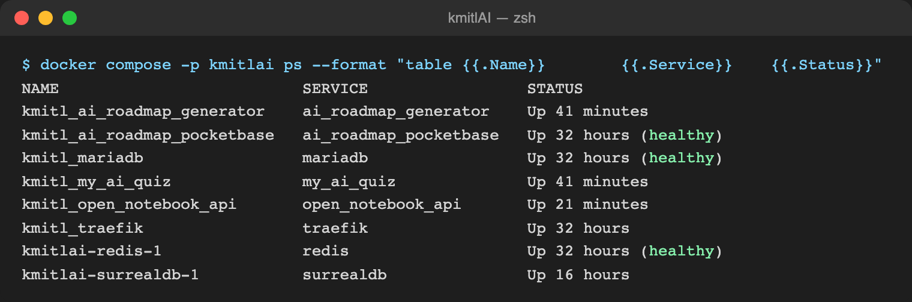
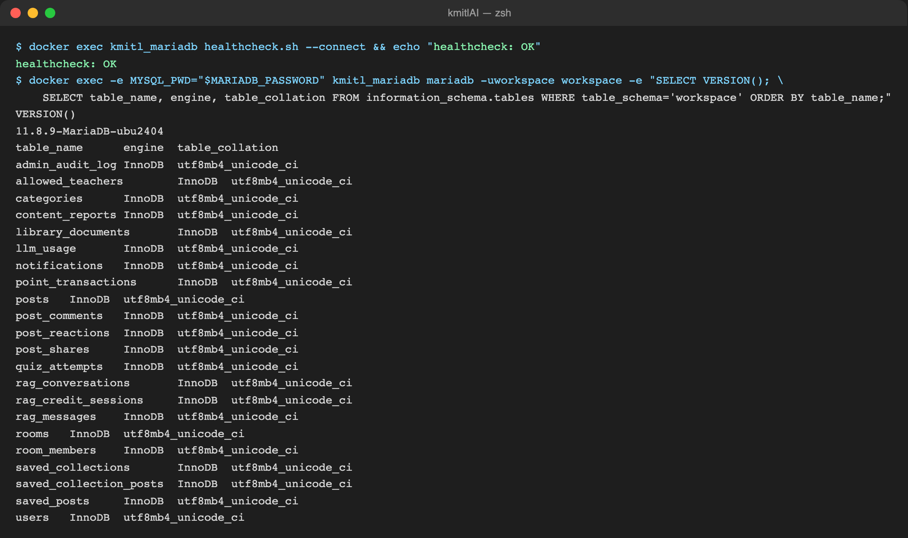
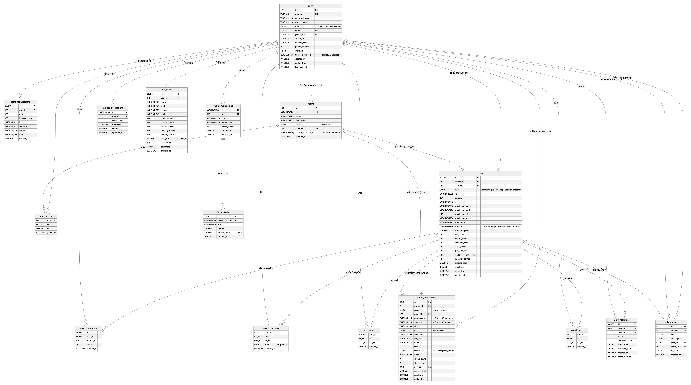
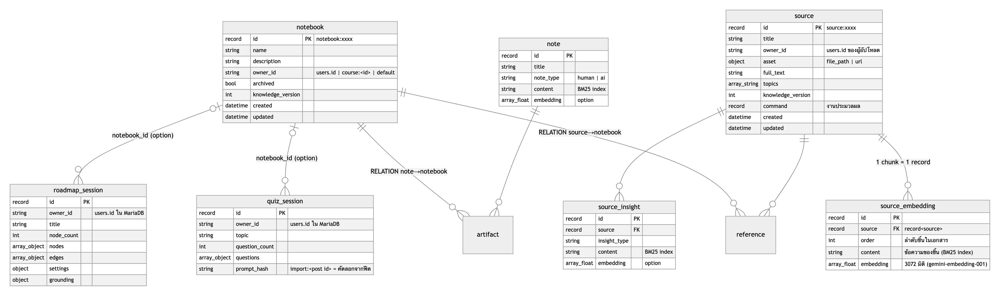
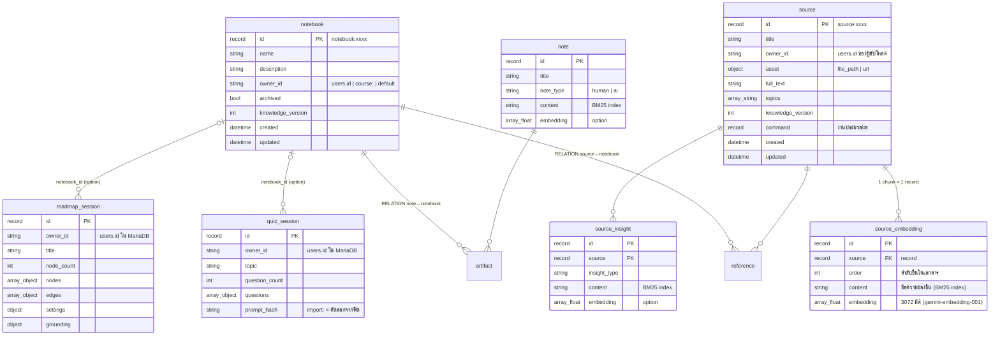
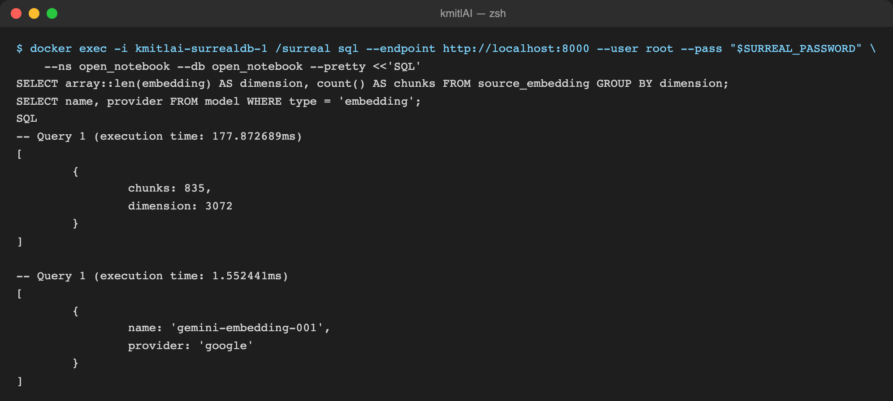

# 4.1 การเตรียมความพร้อมโครงสร้างพื้นฐานและฐานข้อมูล

ระบบ LSP-SIET (SIET Space) ใช้ฐานข้อมูลสองระบบทำงานร่วมกันโดยแบ่งหน้าที่ตามลักษณะข้อมูล
ได้แก่ **MariaDB** สำหรับข้อมูลเชิงสัมพันธ์ (บัญชีผู้ใช้ แต้ม ห้องเรียน โพสต์ และประวัติการใช้งาน)
และ **SurrealDB** สำหรับข้อมูลเอกสาร ชิ้นส่วนข้อความ (chunk) และเวกเตอร์ฝังตัว (vector embedding)
ที่ใช้ในการค้นคืนความรู้แบบ RAG (Retrieval-Augmented Generation) ทั้งสองระบบถูกจัดเตรียมผ่าน
Docker Compose ชุดเดียว (`docker-compose.yml`) ทำให้ติดตั้งได้ด้วยคำสั่งเดียวบนทุกเครื่อง
หัวข้อนี้อธิบายการติดตั้งและการตั้งค่าของแต่ละฐานข้อมูล โครงสร้างตารางและความสัมพันธ์
ตลอดจนวิธีจัดเก็บและค้นหาเวกเตอร์ โดยข้อมูลทุกค่าในหัวข้อนี้อ้างอิงจากไฟล์ตั้งค่าและซอร์สโค้ด
ของระบบจริง (commit `ebaf162` บนสาขา `staging`) และตรวจสอบกับฐานข้อมูลที่รันอยู่เมื่อวันที่ 23 ตุลาคม 2569
(ปรับปรุงจากฉบับวันที่ 19 ตุลาคม 2569 หลังรวมงานของทีม ได้แก่ ระบบสิทธิ์ 4 ระดับและรายชื่ออาจารย์ที่อนุญาต
หมวดหมู่รายวิชา ระดับการมองเห็นของโพสต์ การรายงานเนื้อหาและบันทึกผู้ดูแล คอลเลกชันโพสต์ที่บันทึก และการแยกโค้ด
ส่วนของ KMITL ออกจาก Open Notebook เป็นแพ็กเกจ `siet_platform`, `siet_community` และ `kmitl_rag`)

## 4.1.1 ติดตั้งและตั้งค่า MariaDB

### 1) เวอร์ชันและวิธีติดตั้ง

MariaDB ถูกกำหนดเป็นบริการ `mariadb` ใน `docker-compose.yml` ด้วย image ทางการ `mariadb:11`
ซึ่งเมื่อ build ระบบจริงได้เวอร์ชัน **MariaDB 11.8.9** (ตรวจจาก `SELECT VERSION()` ในรูปที่ 4.2)
ข้อมูลเก็บใน Docker named volume `kmitlai_mariadb_data` (mount ที่ `/var/lib/mysql`) จึงคงอยู่
แม้คอนเทนเนอร์ถูกสร้างใหม่ และมี healthcheck `healthcheck.sh --connect` ทุก 10 วินาที
ซึ่งบริการ API ถูกตั้งให้รอจนสถานะเป็น `healthy` ก่อนจึงเริ่มทำงาน (`depends_on: condition: service_healthy`)

การสร้างตารางแบ่งเป็นสองชั้น

1. **ชั้น seed ครั้งแรก** — `docker/mariadb-init.sql` ถูก mount เข้า `/docker-entrypoint-initdb.d/`
   ซึ่ง image จะรันเฉพาะครั้งที่ volume ยังว่าง เพื่อสร้างตาราง `users` และ `allowed_teachers`
   (รายชื่ออีเมลอาจารย์ที่อนุญาต) สองตารางแรก
2. **ชั้น schema อัตโนมัติ** — ทุกครั้งที่ API เริ่มทำงาน ฟังก์ชัน `ensure_schema()` ใน
   `siet-platform/siet_platform/schema.py` (แพ็กเกจ `siet_platform` ที่รวมโค้ดส่วนของ KMITL
   ซึ่งแยกออกจาก Open Notebook) จะรันชุดคำสั่ง `CREATE TABLE IF NOT EXISTS` และ
   `ALTER TABLE … ADD COLUMN IF NOT EXISTS` ทั้งหมด (idempotent) ทำให้ตารางที่เหลืออีก 20 ตาราง
   (รวม 22 ตาราง ณ 23 ตุลาคม 2569) และคอลัมน์ที่เพิ่มภายหลัง เช่น `users.suspended_until`,
   `rooms.category_id`, `posts.visibility` ถูกสร้างหรืออัปเกรดโดยไม่ต้องรันคำสั่ง migration ด้วยมือ

### 2) ชุดอักขระและ Collation

ทุกตารางประกาศ `ENGINE=InnoDB DEFAULT CHARSET=utf8mb4 COLLATE=utf8mb4_unicode_ci`
(ค่าคงที่ `_TABLE_OPTS` ใน `schema.py`) เหตุผลที่เลือก

- `utf8mb4` รองรับอักษรไทย อีโมจิ และอักขระ 4 ไบต์ทั้งหมด (`utf8` ของ MySQL/MariaDB รองรับเพียง 3 ไบต์)
- `utf8mb4_unicode_ci` เปรียบเทียบข้อความแบบไม่สนตัวพิมพ์ (case-insensitive) ตามมาตรฐาน Unicode
  ทำให้ค้นหาชื่อผู้ใช้และหัวข้อโพสต์ได้โดยไม่ต้องแปลงตัวพิมพ์ก่อน

ระบบไม่ได้ตั้งค่าระดับเซิร์ฟเวอร์ (`character_set_server`) ทับค่าเริ่มต้นของ image แต่กำหนดที่ระดับตาราง
ทุกตารางแทน เพื่อให้ schema พกพาได้โดยไม่ผูกกับการตั้งค่าของเครื่องที่ติดตั้ง

### 3) การเชื่อมต่อและ Connection Pool

API (FastAPI) เชื่อมต่อผ่าน SQLAlchemy 2.0 แบบ asynchronous ด้วยไดรเวอร์ `aiomysql`
URL ประกอบจากตัวแปรแวดล้อมในรูป `mysql+aiomysql://<user>:<password>@mariadb:3306/workspace`
(`siet_platform/config.py` → `get_mariadb_url()`) และสร้าง engine ครั้งเดียวต่อโปรเซสใน
`siet_platform/users.py` ด้วยค่าดังตารางที่ 4.1

**ตารางที่ 4.1** ค่าตั้งค่า Connection Pool ของ MariaDB (`create_async_engine`)

| พารามิเตอร์ | ค่า | ความหมาย |
|---|---|---|
| `pool_size` | 5 | จำนวน connection ที่เปิดค้างไว้ใน pool |
| `max_overflow` | 10 | connection เพิ่มเติมชั่วคราวเมื่อ pool เต็ม (รวมสูงสุด 15 ต่อโปรเซส) |
| `pool_pre_ping` | `True` | ทดสอบ connection ก่อนใช้ทุกครั้ง ป้องกันข้อผิดพลาด "MySQL server has gone away" หลังฐานข้อมูลรีสตาร์ต |
| `pool_recycle` | ไม่กำหนด (ค่าเริ่มต้น −1) | ไม่บังคับรีไซเคิล connection ตามเวลา เพราะ `pool_pre_ping` ครอบคลุมกรณี connection ขาดแล้ว |
| `echo` | `False` | ไม่พิมพ์ SQL ลง log |

ทุกคำสั่งฐานข้อมูลทำผ่าน `_mariadb_session()` ซึ่งเป็น context manager ที่ `commit` เมื่อสำเร็จ
และ `rollback` เมื่อเกิดข้อยกเว้น ทำให้คำสั่งหลายคำสั่งในหนึ่ง request (เช่น การลบบัญชีที่ต้องแก้
10 ตาราง) อยู่ใน transaction เดียวกัน

### 4) พอร์ตการเชื่อมต่อและความปลอดภัย

- MariaDB ฟังที่พอร์ต **3306** ภายในเครือข่าย Docker `kmitlai_default` เท่านั้น บริการนี้
  **ไม่ประกาศ `ports:`** จึงไม่สามารถเชื่อมต่อจากภายนอกเครื่องหรือจากพอร์ตของเครื่องโฮสต์ได้
  มีเพียงคอนเทนเนอร์ในเครือข่ายเดียวกัน (API) ที่เข้าถึงโดยชื่อโฮสต์ `mariadb`
- แอปพลิเคชันใช้บัญชี **`workspace`** ซึ่ง image สร้างให้จากตัวแปร `MARIADB_USER`/`MARIADB_PASSWORD`
  และมีสิทธิ์เฉพาะฐานข้อมูล `workspace` ไม่ใช่บัญชี root
- บัญชี **root** ตั้งรหัสผ่านผ่าน `MARIADB_ROOT_PASSWORD` และไม่ถูกใช้โดยโค้ดส่วนใด ใช้เฉพาะ
  งานดูแลระบบด้วยมือผ่าน `docker exec` ซึ่งต้องมีสิทธิ์บนเครื่องโฮสต์อยู่แล้ว
- รหัสผ่านทั้งหมดอ่านจากไฟล์ `.env` ซึ่งอยู่ใน `.gitignore` ไม่ถูกเก็บในซอร์สโค้ด และไฟล์
  `.env.example` ที่อยู่ในระบบควบคุมเวอร์ชันมีเพียงค่าตัวอย่างซึ่งคู่มือติดตั้งกำหนดให้เปลี่ยนก่อนใช้งานจริง

**ตารางที่ 4.2** คุณสมบัติ Environment Config (`.env`) ส่วนฐานข้อมูลและการกำหนดบทบาทผู้ใช้

| ตัวแปร | ค่าตัวอย่าง / ค่าเริ่มต้น | ใช้โดย | ความหมาย |
|---|---|---|---|
| `MARIADB_DATABASE` | `workspace` | mariadb, API | ชื่อฐานข้อมูลที่สร้างและเชื่อมต่อ |
| `MARIADB_USER` | `workspace` | mariadb, API | บัญชีของแอปพลิเคชัน (สิทธิ์เฉพาะฐานข้อมูลนี้) |
| `MARIADB_PASSWORD` | `<รหัสผ่าน>` | mariadb, API | รหัสผ่านของบัญชีแอปพลิเคชัน |
| `MARIADB_ROOT_PASSWORD` | `<รหัสผ่าน>` | mariadb | รหัสผ่าน root ใช้เฉพาะงานดูแลระบบ |
| `MARIADB_HOST` / `MARIADB_PORT` | `mariadb` / `3306` | API | ชื่อโฮสต์ในเครือข่าย Docker และพอร์ต (ไม่เปิดสู่ภายนอก) |
| `SURREAL_URL` | `ws://surrealdb:8000/rpc` | API | ที่อยู่ SurrealDB แบบ WebSocket RPC |
| `SURREAL_USER` / `SURREAL_PASSWORD` | `root` / `<รหัสผ่าน>` | surrealdb, API | บัญชี root ของ SurrealDB (ใช้ภายในเครือข่าย Docker เท่านั้น) |
| `SURREAL_NAMESPACE` / `SURREAL_DATABASE` | `open_notebook` / `open_notebook` | API | namespace และ database ที่ใช้ |
| `REDIS_URL` | `redis://redis:6379/0` | API | แคชและคิวงาน (Redis 7, `maxmemory 256mb`, `allkeys-lru`) |
| `OPEN_NOTEBOOK_ENCRYPTION_KEY` | `<ข้อความสุ่ม ≥16 ตัว>` | API | คีย์เข้ารหัส API key ของผู้ให้บริการ AI ที่เก็บใน SurrealDB และใช้เซ็น JWT เมื่อ `JWT_SECRET` ว่าง — ห้ามเปลี่ยนหลังใช้งาน |
| `JWT_SECRET` | ว่าง (ใช้คีย์ข้างต้น) | API | คีย์เซ็น token เข้าสู่ระบบ |
| `OPEN_NOTEBOOK_CHUNK_SIZE` / `OPEN_NOTEBOOK_CHUNK_OVERLAP` | `400` / `60` (โทเค็น) | API | ขนาดชิ้นข้อความและส่วนซ้อนทับก่อนทำ embedding (ดู 4.1.3) |
| `GOOGLE_OAUTH_CLIENT_ID` / `GOOGLE_OAUTH_CLIENT_SECRET` / `GOOGLE_OAUTH_REDIRECT_URI` | `<จาก Google Cloud Console>` | API | เข้าสู่ระบบด้วยบัญชี Google (OAuth 2.0) |
| `GOOGLE_OAUTH_ALLOWED_DOMAINS` | `kmitl.ac.th` | API | โดเมนอีเมลที่รับเข้าสู่ระบบ (อีเมลใน `ADMIN_EMAILS`/`TEACHER_EMAILS`/`allowed_teachers` ได้รับยกเว้น) |
| `ADMIN_EMAILS` / `WORKSPACE_ADMIN_EMAILS` | `<อีเมล,อีเมล>` | API | อีเมลที่ได้บทบาท `admin` ทันทีเมื่อเข้าสู่ระบบ |
| `TEACHER_EMAILS` | `<อีเมล,อีเมล>` | API | อีเมลอาจารย์เพิ่มเติมจากตาราง `allowed_teachers` → บทบาท `teacher` |
| `KMITL_FACULTY_CODE` | `030,03` | API | รหัสคณะในรหัสนักศึกษา 8 หลักของอีเมล `@kmitl.ac.th` (หลักที่ 3 เป็นต้นไป) ที่ได้บทบาท `student`; อีเมลอื่นได้ `pending` จนกว่าผู้ดูแลจะกำหนด |

### 5) การตรวจสอบสถานะบริการ

หลังสั่ง `make up` (หรือ `docker compose -p kmitlai up -d --build`) ตรวจสอบได้สามชั้น ได้แก่
สถานะคอนเทนเนอร์ สถานะ healthcheck และการเชื่อมต่อจริงพร้อมเวอร์ชันและ collation ดังรูปที่ 4.1 และ 4.2

```bash
docker compose -p kmitlai ps
docker exec kmitl_mariadb healthcheck.sh --connect && echo "healthcheck: OK"
docker exec -e MYSQL_PWD="$MARIADB_PASSWORD" kmitl_mariadb \
  mariadb -uworkspace workspace -e "SELECT VERSION(); \
  SELECT table_name, engine, table_collation FROM information_schema.tables \
   WHERE table_schema='workspace' ORDER BY table_name;"
```



**รูปที่ 4.1** ผลคำสั่งตรวจสอบสถานะคอนเทนเนอร์ทั้ง 8 ตัวผ่าน Terminal (MariaDB และ Redis แสดง `healthy`)



**รูปที่ 4.2** ผลคำสั่งตรวจสอบ healthcheck เวอร์ชัน MariaDB และ collation ของทุกตารางในฐานข้อมูล `workspace`

---

## 4.1.2 สร้างตารางและความสัมพันธ์ตาม ER-Diagram

### 1) ภาพรวม

ฐานข้อมูล `workspace` ใน MariaDB ประกอบด้วย **22 ตาราง** แบ่งเป็น 6 กลุ่มตามหน้าที่ ดังรูปที่ 4.3
ตารางในกลุ่ม "เชื่อมข้าม" เก็บรหัสอ้างอิงไปยังระเบียนใน SurrealDB (เช่น `library_documents.notebook_id`
→ `notebook:<id>`) ซึ่งเป็นความสัมพันธ์ข้ามระบบฐานข้อมูลที่บังคับด้วยโค้ดเท่านั้น

| กลุ่ม | ตาราง |
|---|---|
| ผู้ใช้ สิทธิ์ และแต้ม | `users`, `allowed_teachers`, `point_transactions` |
| ห้องเรียน | `categories`, `rooms`, `room_members` |
| ฟีดและปฏิสัมพันธ์ | `posts`, `post_comments`, `post_reactions`, `post_shares`, `saved_posts`, `saved_collections`, `saved_collection_posts`, `quiz_attempts`, `notifications` |
| AI และคลังความรู้ | `library_documents`, `rag_conversations`, `rag_messages`, `rag_credit_sessions` |
| การกำกับดูแล (moderation) | `content_reports`, `admin_audit_log` |
| บันทึกการใช้งาน | `llm_usage` |



**รูปที่ 4.3** ER Diagram ของฐานข้อมูล `workspace` (สัญลักษณ์ crow's foot; `FK` คือคีย์อ้างอิงเชิงตรรกะ)

```mermaid
erDiagram
    users ||--o{ point_transactions : "มีรายการแต้ม"
    users |o--o{ rooms : "เปิดห้อง (created_by)"
    users ||--o{ room_members : "เป็นสมาชิก"
    rooms ||--o{ room_members : "มีสมาชิก"
    users ||--o{ posts : "เขียน (author_id)"
    rooms |o--o{ posts : "อยู่ในห้อง (room_id)"
    posts ||--o{ post_comments : "มีความคิดเห็น"
    users ||--o{ post_comments : "เขียน"
    posts ||--o{ post_reactions : "ถูกใจ/Helpful"
    users ||--o{ post_reactions : "กด"
    posts ||--o{ post_shares : "ถูกแชร์"
    users ||--o{ post_shares : "แชร์"
    posts ||--o{ saved_posts : "ถูกบันทึก"
    users ||--o{ saved_posts : "บันทึก"
    posts ||--o{ quiz_attempts : "ถูกทำควิซ"
    users ||--o{ quiz_attempts : "ทำควิซ"
    users ||--o{ notifications : "ได้รับ (recipient_id)"
    users |o--o{ notifications : "เป็นผู้กระทำ (actor_id)"
    posts |o--o{ notifications : "เกี่ยวกับโพสต์"
    users ||--o{ library_documents : "อัปโหลด (owner_id)"
    rooms |o--o{ library_documents : "คลังของห้อง (room_id)"
    posts |o--o| library_documents : "โพสต์ที่สร้างจากเอกสาร"
    users ||--o{ rag_conversations : "สนทนา"
    rag_conversations ||--o{ rag_messages : "มีข้อความ"
    users ||--o{ rag_credit_sessions : "ซื้อเซสชัน"
    users |o--o{ llm_usage : "ใช้โมเดล"
    categories |o--o{ rooms : "จัดหมวด (category_id)"
    users ||--o{ saved_collections : "สร้างคอลเลกชัน"
    saved_collections ||--o{ saved_collection_posts : "มีโพสต์"
    posts ||--o{ saved_collection_posts : "อยู่ในคอลเลกชัน"
    post_comments |o--o{ post_comments : "ตอบกลับ (parent_id)"
    users ||--o{ content_reports : "รายงาน (reporter_id)"
    users |o--o{ content_reports : "ตรวจสอบ (reviewed_by)"
    rooms |o--o{ content_reports : "เกิดในห้อง (room_id)"
    users ||--o{ admin_audit_log : "กระทำ (actor_id)"

    users {
        INT id PK
        VARCHAR(32) username UK
        VARCHAR(255) password_hash
        VARCHAR(128) display_name
        ENUM role "admin|student|teacher|pending"
        VARCHAR(191) email UK
        VARCHAR(64) google_sub UK
        TEXT avatar_url
        VARCHAR(32) student_code
        INT points_balance
        TINYINT disabled
        VARCHAR(255) suspend_reason
        DATETIME suspended_until
        DATETIME pdpa_consented_at
        VARCHAR(128) library_notebook_id "→ SurrealDB notebook"
        DATETIME created_at
        DATETIME updated_at
        DATETIME last_login_at
    }
    point_transactions {
        BIGINT id PK
        INT user_id FK
        INT delta
        INT balance_after
        VARCHAR(32) kind
        VARCHAR(32) ref_type
        VARCHAR(128) ref_id
        VARCHAR(255) note
        DATETIME created_at
    }
    rooms {
        INT id PK
        VARCHAR(32) code UK
        VARCHAR(128) name
        VARCHAR(255) description
        ENUM kind "course|club"
        INT created_by FK
        INT category_id FK
        VARCHAR(16) term
        VARCHAR(32) join_code
        ENUM status "active|archived"
        DATETIME archived_at
        TINYINT is_private
        VARCHAR(128) library_notebook_id "→ SurrealDB notebook"
        DATETIME created_at
    }
    room_members {
        INT room_id PK, FK
        INT user_id PK, FK
        ENUM role "member|ta"
        DATETIME joined_at
    }
    posts {
        BIGINT id PK
        INT author_id FK
        INT room_id FK
        ENUM type "summary|quiz|roadmap|question|material"
        ENUM visibility "public|course|private"
        VARCHAR(200) title
        TEXT content
        VARCHAR(255) tags
        VARCHAR(255) attachment_name
        VARCHAR(512) attachment_path
        INT attachment_size
        VARCHAR(128) attachment_mime
        VARCHAR(32) linked_type
        VARCHAR(128) linked_id "→ SurrealDB quiz_session|roadmap_session"
        LONGTEXT linked_snapshot
        INT like_count
        INT helpful_count
        INT comment_count
        INT share_count
        INT quiz_play_count
        INT roadmap_follow_count
        INT cashback_earned
        CHAR(32) content_hash
        TINYINT is_deleted
        DATETIME created_at
        DATETIME updated_at
    }
    post_comments {
        BIGINT id PK
        BIGINT post_id FK
        INT author_id FK
        BIGINT parent_id FK
        TEXT content
        DATETIME created_at
    }
    post_reactions {
        BIGINT post_id PK, FK
        INT user_id PK, FK
        ENUM kind "like|helpful"
        DATETIME created_at
    }
    post_shares {
        BIGINT post_id PK, FK
        INT user_id PK, FK
        DATETIME created_at
    }
    saved_posts {
        INT user_id PK, FK
        BIGINT post_id PK, FK
        DATETIME created_at
    }
    quiz_attempts {
        BIGINT id PK
        BIGINT post_id FK
        INT user_id FK
        INT score
        INT question_count
        TINYINT completed
        TINYINT cashback_paid
        DATETIME created_at
        DATETIME completed_at
    }
    notifications {
        BIGINT id PK
        INT recipient_id FK
        VARCHAR(32) kind
        VARCHAR(255) message
        BIGINT post_id FK
        INT actor_id FK
        TINYINT is_read
        DATETIME created_at
    }
    library_documents {
        BIGINT id PK
        INT owner_id FK
        ENUM scope "course|personal"
        INT room_id FK
        VARCHAR(128) notebook_id "→ SurrealDB notebook"
        VARCHAR(128) source_id "→ SurrealDB source"
        VARCHAR(200) title
        ENUM kind "file|url|text"
        VARCHAR(255) filename
        VARCHAR(512) file_path
        VARCHAR(128) mime
        INT size
        ENUM status "processing|ready|failed"
        VARCHAR(500) error
        INT chunk_count
        INT char_count
        BIGINT post_id FK
        CHAR(32) content_hash
        DATETIME created_at
        DATETIME updated_at
    }
    rag_conversations {
        VARCHAR(64) id PK
        INT user_id FK
        VARCHAR(200) title
        VARCHAR(255) scope_label
        INT message_count
        DATETIME created_at
        DATETIME updated_at
    }
    rag_messages {
        BIGINT id PK
        VARCHAR(64) conversation_id FK
        VARCHAR(16) role
        LONGTEXT content
        LONGTEXT answer_meta "JSON"
        DATETIME created_at
    }
    rag_credit_sessions {
        VARCHAR(64) id PK
        INT user_id FK
        INT credits_left
        LONGTEXT messages
        DATETIME created_at
        DATETIME updated_at
    }
    llm_usage {
        BIGINT id PK
        INT user_id FK
        VARCHAR(32) feature
        VARCHAR(16) kind
        VARCHAR(32) provider
        VARCHAR(96) model
        INT input_tokens
        INT output_tokens
        INT cached_tokens
        INT thinking_tokens
        INT search_queries
        DECIMAL cost_usd "(12,6)"
        INT latency_ms
        TINYINT estimated
        DATETIME created_at
    }
    categories {
        INT id PK
        VARCHAR(64) slug UK
        VARCHAR(128) name
        VARCHAR(128) name_en
        INT sort_order
        DATETIME created_at
    }
    allowed_teachers {
        INT id PK
        VARCHAR(191) email UK "จับคู่กับ users.email"
        VARCHAR(32) role
        VARCHAR(128) department
        DATETIME created_at
    }
    saved_collections {
        BIGINT id PK
        INT user_id FK
        VARCHAR(80) name
        DATETIME created_at
    }
    saved_collection_posts {
        BIGINT collection_id PK, FK
        INT user_id FK
        BIGINT post_id PK, FK
        DATETIME created_at
    }
    content_reports {
        BIGINT id PK
        INT reporter_id FK
        ENUM target_type "post|comment|user|document"
        BIGINT target_id "polymorphic"
        INT room_id FK
        ENUM reason "spam|harassment|inappropriate|copyright|other"
        VARCHAR(500) detail
        ENUM status "open|dismissed|actioned"
        VARCHAR(32) action
        VARCHAR(255) note
        INT reviewed_by FK
        DATETIME reviewed_at
        DATETIME created_at
    }
    admin_audit_log {
        BIGINT id PK
        INT actor_id FK
        VARCHAR(64) action
        VARCHAR(32) target_type
        VARCHAR(64) target_id
        TEXT detail
        DATETIME created_at
    }
```

<details>
<summary>ซอร์ส Mermaid ของรูปที่ 4.3</summary>



</details>

### 2) กฎความสัมพันธ์

**ตารางที่ 4.3** ความสัมพันธ์ระหว่างตารางและชนิดความสัมพันธ์

| ความสัมพันธ์ | ชนิด | คอลัมน์ที่เชื่อม | คำอธิบาย |
|---|---|---|---|
| users → point_transactions | 1:N | `point_transactions.user_id` | ผู้ใช้หนึ่งคนมีรายการแต้มหลายรายการ (ledger) |
| users → rooms | 1:N (ไม่บังคับ) | `rooms.created_by` NULL ได้ | ห้องอาจไม่มีเจ้าของ (ห้องตัวอย่าง หรือเจ้าของถูกลบ) |
| users ↔ rooms | N:M | `room_members(room_id, user_id)` | ตารางเชื่อม; คีย์หลักประกอบ กันสมัครซ้ำ |
| users → posts | 1:N | `posts.author_id` | |
| rooms → posts | 1:N (ไม่บังคับ) | `posts.room_id` NULL ได้ | โพสต์ที่ไม่ระบุห้องอยู่ในฟีดรวม |
| users ↔ posts (ถูกใจ/Helpful) | N:M | `post_reactions(post_id, user_id, kind)` | คีย์หลักรวม `kind` ทำให้คนเดียวกดได้ทั้งถูกใจและ Helpful แต่อย่างละครั้ง |
| users ↔ posts (แชร์) | N:M | `post_shares(post_id, user_id)` | แชร์ได้ครั้งเดียวต่อคน (`INSERT IGNORE` ตัดสินว่าเป็นครั้งแรก) |
| users ↔ posts (บันทึก) | N:M | `saved_posts(user_id, post_id)` | |
| posts → post_comments | 1:N | `post_comments.post_id` | |
| posts → quiz_attempts | 1:N | `quiz_attempts.post_id` | ควิซหนึ่งโพสต์ทำได้หลายครั้ง (ไม่ใช่ N:M แบบคีย์ประกอบ เพราะเก็บทุกครั้ง) |
| users → notifications | 1:N | `recipient_id` (บังคับ), `actor_id` (ไม่บังคับ) | ผู้รับและผู้กระทำ |
| users → library_documents | 1:N | `library_documents.owner_id` | |
| rooms → library_documents | 1:N (ไม่บังคับ) | `library_documents.room_id` | เฉพาะเอกสาร `scope='course'` |
| library_documents → posts | 1:1 (ไม่บังคับ) | `library_documents.post_id` | เอกสารที่ถูกโพสต์ลงฟีดพร้อมกัน |
| users → rag_conversations → rag_messages | 1:N, 1:N | `user_id`, `conversation_id` | ประวัติแชตส่วนตัว |
| users → rag_credit_sessions | 1:N | `user_id` | เซสชันถาม 5 ข้อความที่ซื้อด้วยแต้ม |
| users → llm_usage | 1:N (ไม่บังคับ) | `llm_usage.user_id` NULL ได้ | งานเบื้องหลังที่ไม่มีผู้ใช้ (เช่น ทำดัชนี) บันทึกเป็น NULL |
| categories → rooms | 1:N (ไม่บังคับ) | `rooms.category_id` NULL ได้ | หมวดหมู่ (หลักสูตร/สาขา) ของห้องวิชา ลบหมวดแล้วห้องกลับเป็น "ไม่มีหมวด" |
| users ↔ rooms (บทบาทในห้อง) | แอตทริบิวต์ของ N:M | `room_members.role` | `ta` (ผู้ช่วยสอน) จัดการคลังและสมาชิกแทนเจ้าของได้; เจ้าของคือ `rooms.created_by` ไม่ใช่สมาชิก |
| users → saved_collections → saved_collection_posts | 1:N, 1:N | `user_id`, `collection_id` | คอลเลกชันโพสต์ที่บันทึก ชื่อไม่ซ้ำต่อผู้ใช้ |
| posts → saved_collection_posts | 1:N | `saved_collection_posts.post_id` | โพสต์หนึ่งอยู่ได้หลายคอลเลกชัน (คีย์หลัก `(collection_id, post_id)`) |
| post_comments → post_comments | 1:N (ไม่บังคับ, สะท้อนตัวเอง) | `parent_id` NULL ได้ | ความคิดเห็นตอบกลับหนึ่งชั้น; NULL = ความคิดเห็นระดับบนสุด |
| users → content_reports | 1:N | `reporter_id` (บังคับ), `reviewed_by` (ไม่บังคับ) | ผู้รายงานและผู้ตรวจ; `(reporter_id, target_type, target_id)` ไม่ซ้ำ จึงรายงานสิ่งเดียวได้ครั้งเดียว |
| content_reports → เป้าหมาย | polymorphic | `target_type` + `target_id` | ชี้ไป `posts`, `post_comments`, `users` หรือ `library_documents` ตามชนิด (บังคับที่โค้ดเท่านั้น) |
| rooms → content_reports | 1:N (ไม่บังคับ) | `content_reports.room_id` | รายงานที่เกิดในห้อง ผู้สอนของห้องจัดการเองได้ก่อนถึงผู้ดูแล |
| users → admin_audit_log | 1:N | `admin_audit_log.actor_id` | ผู้ดูแล/ผู้สอนที่กระทำ; `target_type`/`target_id` เป็นข้อความอ้างอิงอิสระ (เช่น `user`/`17`, `roadmap`/`roadmap_session:…`) |
| allowed_teachers ↔ users | จับคู่ด้วยอีเมล (ไม่ใช่คีย์) | `allowed_teachers.email` = `users.email` | รายชื่ออีเมลที่ได้บทบาท `teacher` ตอนเข้าสู่ระบบด้วย Google |
| MariaDB → SurrealDB | อ้างอิงข้ามระบบ | `users.library_notebook_id`, `rooms.library_notebook_id`, `library_documents.notebook_id/source_id`, `posts.linked_id` | เก็บ record id ของ SurrealDB เป็นข้อความ |

ไม่มีความสัมพันธ์ 1:1 แบบบังคับในระบบ ความสัมพันธ์ 1:1 ที่มีคือ `library_documents.post_id`
ซึ่งเป็นแบบเลือกได้ (optional)

### 3) การบังคับ Foreign Key Constraint

ฐานข้อมูลนี้**ไม่ประกาศ `FOREIGN KEY … REFERENCES`** ไว้ในระดับฐานข้อมูล ความสัมพันธ์ทั้งหมดใน
ตารางที่ 4.3 เป็น**คีย์อ้างอิงเชิงตรรกะ** ที่บังคับโดยชั้นแอปพลิเคชัน ด้วยเหตุผลสามข้อ

1. **ระบบใช้การลบแบบอ่อน (soft delete)** — โพสต์ถูก "ซ่อน" ด้วยธง `is_deleted` เพื่อให้ผู้ดูแลกู้คืนได้
   หาก `ON DELETE CASCADE` ทำงานกับโพสต์ ข้อมูลความคิดเห็นและแต้มที่เกี่ยวข้องจะหายอย่างถาวร
2. **ห้องต้องอยู่ต่อแม้เจ้าของถูกลบ** และ **โพสต์ต้องอยู่ต่อแม้ห้องถูกปิด** — พฤติกรรม `SET NULL`
   ถูกเลือกเฉพาะจุดและทำพร้อมกับการคำนวณตัวนับ (เช่น `comment_count`) ใหม่ ซึ่ง constraint ของฐานข้อมูลทำให้ไม่ได้
3. **คีย์บางตัวชี้ข้ามไป SurrealDB** ซึ่งฐานข้อมูลเชิงสัมพันธ์บังคับไม่ได้อยู่แล้ว การบังคับทุกความสัมพันธ์
   ที่ชั้นเดียวกันทำให้กฎอยู่ที่เดียวและทดสอบได้

พฤติกรรมเมื่อระเบียนต้นทางถูกลบ (ทำใน transaction เดียวโดยฟังก์ชันในโค้ด) สรุปในตารางที่ 4.4

**ตารางที่ 4.4** พฤติกรรมเทียบเท่า Foreign Key Constraint ที่ชั้นแอปพลิเคชัน

| เหตุการณ์ | ตารางที่ได้รับผล | พฤติกรรม | ฟังก์ชัน |
|---|---|---|---|
| ลบบัญชีผู้ใช้ | `posts` | **ซ่อน** (`is_deleted = 1`) ไม่ลบ | `siet_platform/users.py::admin_delete_user` |
| | `post_comments`, `post_reactions`, `post_shares`, `saved_posts`, `saved_collections`, `saved_collection_posts`, `quiz_attempts`, `room_members`, `rag_credit_sessions`, `rag_conversations`, `rag_messages`, `content_reports` (ที่ยื่น), `notifications`, `point_transactions` | **CASCADE** (ลบแถว) แล้วคำนวณ `comment_count`/`like_count`/`helpful_count`/`share_count` ของโพสต์ที่กระทบใหม่ | เดียวกัน |
| | `library_documents` | เอกสารส่วนตัว **CASCADE ข้ามระบบ** (ลบแถว ไฟล์ `source`/`source_embedding` ใน SurrealDB และ notebook ส่วนตัว); เอกสารของห้องวิชา **โอน** `owner_id` ให้ผู้สอนของห้อง (ลบเฉพาะเมื่อห้องไม่มีเจ้าของ) | `siet_platform/library.py::purge_user_library` |
| | `rooms.created_by` | **SET NULL** (ห้องกลายเป็น "ไม่มีเจ้าของ") | เดียวกัน |
| | `llm_usage`, `admin_audit_log` | **คงไว้** — บันทึกค่าใช้จ่ายและบันทึกการกระทำของผู้ดูแลต้องตรวจสอบย้อนหลังได้ (`user_id`/`actor_id` ชี้ไปบัญชีที่ไม่มีแล้ว) | — |
| เก็บถาวรห้อง (เจ้าของ) | ทุกตารางลูก | **ไม่กระทบ** — เปลี่ยนเฉพาะ `rooms.status`/`archived_at`; โพสต์และคลังยังอ่านได้ และกู้คืนได้ | `siet_community/repository.py::set_course_status` |
| ลบห้องถาวร (ผู้ดูแล) | `posts.room_id` | **SET NULL** (โพสต์ย้ายไปฟีดรวม) | `siet_community/repository.py::delete_course` |
| | `room_members` | **CASCADE** | เดียวกัน |
| | `library_documents` ของห้อง | **CASCADE ข้ามระบบ** (ไฟล์ `source` และ notebook ของห้องใน SurrealDB) | `siet_platform/library.py::purge_course_library` |
| ลบหมวดหมู่ | `rooms.category_id` | **SET NULL** (ห้องกลับเป็นไม่มีหมวด) | `siet_community/repository.py::delete_category` |
| ซ่อน/กู้คืนโพสต์ | ทุกตารางลูก | **ไม่กระทบ** (เปลี่ยนเฉพาะธง) | `soft_delete_post` / `restore_post` |
| ลบความคิดเห็น | `posts.comment_count` | คำนวณใหม่จาก `COUNT(*)` ไม่ใช่ลบ 1 (กันค่าติดลบ) | `delete_comment` |
| ลบบทสนทนา RAG | `rag_messages` | **CASCADE** | `delete_conversation` |
| ลบ quiz/roadmap ต้นฉบับใน SurrealDB | `posts.linked_snapshot` | **ไม่กระทบ** — โพสต์เก็บสำเนาของตัวเอง | — |
| ลบเอกสารในคลัง | SurrealDB `source`, `source_embedding` และไฟล์บนดิสก์ | **CASCADE ข้ามระบบ** | `siet_platform/library.py::delete_document` |
| ลบ `source` ใน SurrealDB | `source_embedding`, `source_insight` | **CASCADE** ด้วย `DEFINE EVENT source_delete` (บังคับที่ฐานข้อมูล) | migration 1 |

### 4) ชนิดข้อมูลที่ใช้

| ชนิด | ใช้กับ | เหตุผล |
|---|---|---|
| `INT AUTO_INCREMENT` | คีย์หลักของ `users`, `rooms` | จำนวนระเบียนจำกัด (หลักพัน) |
| `BIGINT AUTO_INCREMENT` | คีย์หลักของตารางที่โตเร็ว (`posts`, `post_comments`, `point_transactions`, `llm_usage`, …) | กันล้นในระยะยาว |
| `VARCHAR(64)` | คีย์หลัก `rag_conversations`, `rag_credit_sessions` | เป็น UUID ที่แอปสร้าง ไม่ใช่เลขรัน |
| `VARCHAR(128)` | รหัสอ้างอิงข้ามไป SurrealDB (`notebook:xxxx`) | record id เป็นข้อความ |
| `ENUM` | `role`, `kind`, `type`, `scope`, `status`, `visibility`, `target_type`, `reason` | จำกัดค่าให้ถูกต้องที่ฐานข้อมูล และเก็บเล็กกว่า VARCHAR |
| `TINYINT(1)` | ธง `disabled`, `is_deleted`, `completed`, `is_read`, `estimated` | boolean ของ MariaDB |
| `TEXT` / `LONGTEXT` | เนื้อหาโพสต์, ความคิดเห็น, ข้อความแชต, `avatar_url`, `admin_audit_log.detail`, `linked_snapshot` และ `answer_meta` (JSON) | ความยาวไม่จำกัด; JSON เก็บเป็นข้อความเพราะอ่าน/เขียนทั้งก้อนเสมอ |
| `CHAR(32)` | `content_hash` | MD5 ความยาวคงที่ |
| `DECIMAL(12,6)` | `llm_usage.cost_usd` | เงินต้องไม่ใช้ FLOAT |
| `DATETIME` | เวลาทั้งหมด เก็บเป็น UTC แบบไม่มีโซน; `suspended_until`, `archived_at`, `pdpa_consented_at` เป็น NULL ได้ | แปลงเป็นเวลาท้องถิ่นที่ชั้นแสดงผล; NULL หมายถึง "ไม่มีกำหนด" หรือ "ยังไม่เกิดเหตุการณ์" |

### 5) การทำดัชนี (Indexing)

ดัชนีออกแบบจากรูปแบบ query ที่ใช้จริง โดยให้คอลัมน์ที่กรองก่อนอยู่หน้า และตามด้วยคอลัมน์ที่ใช้เรียง
(`id` แทน `created_at` ในหลายดัชนี เพราะ `AUTO_INCREMENT` เรียงตามเวลาอยู่แล้วและเล็กกว่า)

**ตารางที่ 4.5** ดัชนีทั้งหมดในฐานข้อมูล `workspace`

| ตาราง | ดัชนี | คอลัมน์ | รองรับ query |
|---|---|---|---|
| users | PK; `idx_username`; `idx_role`; UNIQUE `idx_users_email`; UNIQUE `idx_users_google_sub` | `id`; `username`; `role`; `email`; `google_sub` | ล็อกอินด้วยชื่อ/อีเมล/Google, นับตามบทบาท, กันอีเมลซ้ำ |
| point_transactions | `idx_pt_user`; `idx_pt_kind` | `(user_id, created_at)`; `(kind, created_at)` | ประวัติแต้มรายคน, สถิติตามประเภทในช่วงเวลา |
| rooms | PK; UNIQUE `code`; `idx_courses_creator`; `idx_rooms_category` | `id`; `code`; `(created_by, created_at)`; `(category_id, status)` | หา/กันรหัสวิชาซ้ำ, ห้องที่ผู้ใช้เปิด, ห้องในหมวดที่ยังเปิดอยู่ |
| room_members | PK; `idx_cm_user` | `(room_id, user_id)`; `(user_id)` | สมาชิกของห้อง, ห้องของผู้ใช้ |
| posts | PK; `idx_posts_created`; `idx_posts_course`; `idx_posts_author`; `idx_posts_type`; `idx_posts_embed`; `idx_posts_dupe`; `idx_posts_author_time`; `idx_posts_visibility` | `(is_deleted, id)`; `(room_id, id)`; `(author_id, id)`; `(type, id)`; `(linked_type, linked_id)`; `(author_id, content_hash, created_at)`; `(author_id, created_at)`; `(visibility, id)` | ฟีดรวม, ฟีดห้อง, โพสต์ของฉัน, กรองชนิด, หาโพสต์ของควิซ/roadmap, กันโพสต์ซ้ำ, นับโควตาต่อชั่วโมง/วัน, กรองระดับการมองเห็น |
| post_comments | PK; `idx_pc_post`; `idx_pc_author_time`; `idx_pc_parent` | `(post_id, id)`; `(author_id, created_at)`; `(post_id, parent_id, id)` | ความคิดเห็นของโพสต์, โควตากันสแปม, ความคิดเห็นตอบกลับของแต่ละ thread |
| post_reactions | PK | `(post_id, user_id, kind)` | กด/ยกเลิก, นับ |
| post_shares | PK; `idx_ps_user` | `(post_id, user_id)`; `(user_id, created_at)` | แชร์ครั้งแรก, สถิติ |
| saved_posts | PK | `(user_id, post_id)` | รายการที่บันทึก |
| quiz_attempts | PK; `idx_qp_post_user` | `(post_id, user_id)` | จำนวนครั้งที่ทำต่อคน, cashback |
| rag_credit_sessions | PK; `idx_rs_user` | `id`; `(user_id, updated_at)` | เซสชันล่าสุดของผู้ใช้ |
| rag_conversations | PK; `idx_rc_user` | `id`; `(user_id, updated_at)` | ประวัติแชตเรียงล่าสุด |
| rag_messages | PK; `idx_rm_conv` | `id`; `(conversation_id, id)` | ข้อความในบทสนทนาตามลำดับ |
| llm_usage | PK; `idx_usage_time`; `idx_usage_user`; `idx_usage_feature` | `created_at`; `(user_id, created_at)`; `(feature, created_at)` | สถิติรายวัน, ต่อผู้ใช้, ต่อฟีเจอร์ |
| library_documents | PK; `idx_lib_owner`; `idx_lib_course`; `idx_lib_status`; `idx_lib_dupe`; `idx_lib_owner_time` | `(owner_id, id)`; `(room_id, scope, id)`; `(status)`; `(owner_id, content_hash)`; `(owner_id, created_at)` | คลังส่วนตัว, คลังวิชา, งานค้าง/ล้มเหลว, กันอัปโหลดซ้ำ, โควตา |
| notifications | PK; `idx_notif_user` | `(recipient_id, is_read, id)` | แจ้งเตือนที่ยังไม่อ่านของผู้ใช้ |
| categories | PK; UNIQUE `slug` | `id`; `slug` | หาหมวดจาก slug (เช่น `computer-technology`), กันชื่อซ้ำ |
| allowed_teachers | PK; UNIQUE `email`; `idx_teacher_email` | `id`; `email`; `(email)` | ตรวจรายชื่ออาจารย์ตอนเข้าสู่ระบบ |
| saved_collections | PK; UNIQUE `idx_saved_collection_name`; `idx_saved_collection_owner` | `id`; `(user_id, name)`; `(user_id, created_at)` | กันชื่อคอลเลกชันซ้ำต่อคน, คอลเลกชันของผู้ใช้เรียงเวลา |
| saved_collection_posts | PK; `idx_saved_collection_post_owner` | `(collection_id, post_id)`; `(user_id, post_id)` | โพสต์ในคอลเลกชัน, โพสต์นี้ถูกบันทึกไว้ในคอลเลกชันใดของฉัน |
| content_reports | PK; UNIQUE `uq_report`; `idx_reports_status`; `idx_reports_target`; `idx_reports_room` | `id`; `(reporter_id, target_type, target_id)`; `(status, created_at)`; `(target_type, target_id)`; `(room_id, status)` | กันรายงานซ้ำ, คิวรายงานที่ยังเปิด, จำนวนรายงานต่อเป้าหมาย, คิวของห้อง |
| admin_audit_log | PK; `idx_audit_time`; `idx_audit_actor`; `idx_audit_action` | `id`; `created_at`; `(actor_id, created_at)`; `(action, created_at)` | บันทึกล่าสุด, ตามผู้กระทำ, ตามชนิดการกระทำ |

### 6) พจนานุกรมข้อมูล (Data Dictionary)

คอลัมน์ `created_at` ทุกตารางเป็น `DATETIME DEFAULT CURRENT_TIMESTAMP` และ `updated_at` เพิ่ม
`ON UPDATE CURRENT_TIMESTAMP`; "Null" = `Y` หมายถึงเป็น NULL ได้

**ตารางที่ 4.6** พจนานุกรมข้อมูลตาราง `users` — บัญชีผู้ใช้ทุกบทบาท

| Field | Type | Null | Description |
|---|---|---|---|
| id | INT AUTO_INCREMENT | N | คีย์หลัก |
| username | VARCHAR(32) UNIQUE | N | ชื่อผู้ใช้สำหรับล็อกอิน (บัญชี Google ใช้ส่วนหน้าของอีเมล) |
| password_hash | VARCHAR(255) | Y | แฮชรหัสผ่าน; NULL สำหรับบัญชีที่เข้าด้วย Google เท่านั้น |
| display_name | VARCHAR(128) | Y | ชื่อที่แสดง |
| role | ENUM('admin','student','teacher','pending') | N | บทบาท ค่าเริ่มต้น `student`; `pending` = บัญชี Google ที่ยังไม่เข้าเกณฑ์ใด (นอกคณะ/ไม่อยู่ในรายชื่ออาจารย์) รอผู้ดูแลกำหนด |
| email | VARCHAR(191) UNIQUE | Y | อีเมล (จาก Google SSO) |
| google_sub | VARCHAR(64) UNIQUE | Y | รหัสประจำตัวจาก Google |
| avatar_url | TEXT | Y | รูปโปรไฟล์ (ขยายจาก VARCHAR(512) เป็น TEXT เพื่อรองรับ URL ยาวจากหน้าแก้ไขโปรไฟล์) |
| student_code | VARCHAR(32) | Y | รหัสนักศึกษา 8 หลักจากอีเมล (ไม่ใช่คีย์อ้างอิง) |
| points_balance | INT | N | แต้มคงเหลือ (เท่ากับผลรวม `point_transactions.delta`) |
| disabled | TINYINT(1) | N | 1 = ระงับบัญชี ล็อกอินไม่ได้และ token เดิมใช้ไม่ได้ |
| suspend_reason | VARCHAR(255) | Y | เหตุผลที่ระงับ แสดงให้ผู้ใช้เห็นเมื่อพยายามเข้าสู่ระบบ |
| suspended_until | DATETIME | Y | วันสิ้นสุดการระงับ; NULL = ไม่มีกำหนด; เมื่อเลยเวลา ระบบปลดระงับเองในการเข้าสู่ระบบครั้งถัดไป |
| pdpa_consented_at | DATETIME | Y | เวลาที่ยอมรับนโยบายคุ้มครองข้อมูลส่วนบุคคล (PDPA); NULL = ระบบแสดงกล่องขอความยินยอมก่อนใช้งาน |
| library_notebook_id | VARCHAR(128) | Y | รหัส notebook ส่วนตัวใน SurrealDB |
| created_at / updated_at / last_login_at | DATETIME | N/N/Y | เวลาสร้าง แก้ไข และล็อกอินล่าสุด |

**ตารางที่ 4.7** พจนานุกรมข้อมูลตาราง `point_transactions` — สมุดบัญชีแต้ม (append-only)

| Field | Type | Null | Description |
|---|---|---|---|
| id | BIGINT AUTO_INCREMENT | N | คีย์หลัก |
| user_id | INT | N | เจ้าของแต้ม → `users.id` |
| delta | INT | N | จำนวนแต้มที่เปลี่ยน (บวก = ได้รับ, ลบ = ใช้) |
| balance_after | INT | N | ยอดคงเหลือหลังรายการนี้ |
| kind | VARCHAR(32) | N | ประเภท เช่น `welcome`, `rag_question`, `quiz_generate`, `roadmap_generate`, `cashback`, `admin_grant`, `refund` |
| ref_type / ref_id | VARCHAR(32) / VARCHAR(128) | Y | สิ่งที่รายการอ้างถึง (เช่น `post`/`<id>`, `point_transaction`/`<id>` สำหรับ refund) |
| note | VARCHAR(255) | Y | หมายเหตุ ใช้กันให้แต้มซ้ำต่อ (โพสต์, ผู้กระทำ) |
| created_at | DATETIME | N | |

**ตารางที่ 4.8** พจนานุกรมข้อมูลตาราง `rooms` — ห้องวิชาและห้องพูดคุย

| Field | Type | Null | Description |
|---|---|---|---|
| id | INT AUTO_INCREMENT | N | คีย์หลัก |
| code | VARCHAR(32) UNIQUE | N | รหัสวิชา (เช่น `CS101`) หรือ `TALK-xxxxxx` สำหรับห้องพูดคุย |
| name | VARCHAR(128) | N | ชื่อห้อง |
| description | VARCHAR(255) | Y | คำอธิบาย |
| kind | ENUM('course','club') | N | `course` = ห้องวิชา (เปิดโดยอาจารย์ มีคลังความรู้), `club` = ห้องพูดคุย (ใครก็เปิดได้ ไม่มีคลัง) |
| created_by | INT | Y | ผู้เปิดห้อง → `users.id`; NULL เมื่อไม่มีเจ้าของ |
| category_id | INT | Y | หมวดหมู่ (หลักสูตร/สาขา) → `categories.id`; NULL = ไม่มีหมวด |
| term | VARCHAR(16) | Y | ภาคการศึกษา เช่น `1/2569` |
| join_code | VARCHAR(32) | Y | รหัสเข้าห้อง; NULL = เข้าร่วมได้ทันที |
| status | ENUM('active','archived') | N | `archived` = เก็บถาวร ไม่รับสมาชิกใหม่และหายจากตัวเลือก แต่โพสต์และคลังยังอ่านได้ (กู้คืนได้) |
| archived_at | DATETIME | Y | เวลาเก็บถาวร |
| is_private | TINYINT(1) | N | 1 = ห้องส่วนตัว โพสต์และคลังเห็นเฉพาะสมาชิกและผู้ดูแลห้อง |
| library_notebook_id | VARCHAR(128) | Y | รหัส notebook คลังความรู้ของห้องใน SurrealDB |
| created_at | DATETIME | N | |

**ตารางที่ 4.9** พจนานุกรมข้อมูลตาราง `room_members` — สมาชิกห้อง (ตารางเชื่อม N:M)

| Field | Type | Null | Description |
|---|---|---|---|
| room_id | INT (PK) | N | → `rooms.id` |
| user_id | INT (PK) | N | → `users.id` |
| role | ENUM('member','ta') | N | `ta` = ผู้ช่วยสอน จัดการคลังเอกสารและสมาชิกแทนเจ้าของห้องได้ |
| joined_at | DATETIME | N | เวลาเข้าร่วม |

**ตารางที่ 4.10** พจนานุกรมข้อมูลตาราง `posts` — โพสต์ทุกชนิดในฟีด

| Field | Type | Null | Description |
|---|---|---|---|
| id | BIGINT AUTO_INCREMENT | N | คีย์หลัก |
| author_id | INT | N | ผู้เขียน → `users.id` |
| room_id | INT | Y | ห้องที่โพสต์ → `rooms.id`; NULL = ฟีดรวม |
| type | ENUM('summary','quiz','roadmap','question','material') | N | ชนิดโพสต์ |
| visibility | ENUM('public','course','private') | N | ระดับการมองเห็น: ทุกคนที่เข้าสู่ระบบ / เฉพาะสมาชิกห้อง / เฉพาะผู้เขียนและผู้ดูแล (ค่าเริ่มต้น `public`) |
| title | VARCHAR(200) | Y | หัวข้อ |
| content | TEXT | Y | เนื้อหา |
| tags | VARCHAR(255) | Y | แท็กคั่นด้วยจุลภาค |
| attachment_name / attachment_path / attachment_size / attachment_mime | VARCHAR(255) / VARCHAR(512) / INT / VARCHAR(128) | Y | ไฟล์แนบ (PDF) |
| linked_type | VARCHAR(32) | Y | ชนิดสิ่งที่แนบ: `quiz` หรือ `roadmap` |
| linked_id | VARCHAR(128) | Y | record id ใน SurrealDB (`quiz_session:…` / `roadmap_session:…`) |
| linked_snapshot | LONGTEXT | Y | สำเนา JSON ของควิซ/roadmap ณ เวลาที่แชร์ (โพสต์จึงอยู่ได้แม้ต้นฉบับถูกลบ) |
| like_count / helpful_count / comment_count / share_count | INT | N | ตัวนับ (denormalized) |
| quiz_play_count | INT | N | จำนวนครั้งที่มีคนเริ่มทำควิซของโพสต์นี้ |
| roadmap_follow_count | INT | N | จำนวนคนที่คัดลอก roadmap ไปใช้ |
| cashback_earned | INT | N | แต้มที่เจ้าของได้คืนจากคนทำควิซจบ (สูงสุด 15) |
| content_hash | CHAR(32) | Y | MD5 ของหัวข้อ+เนื้อหา+linked_id กันโพสต์ซ้ำ |
| is_deleted | TINYINT(1) | N | 1 = ซ่อนจากฟีด (กู้คืนได้) |
| created_at / updated_at | DATETIME | N | |

**ตารางที่ 4.11** พจนานุกรมข้อมูลตาราง `post_comments`

| Field | Type | Null | Description |
|---|---|---|---|
| id | BIGINT AUTO_INCREMENT | N | คีย์หลัก |
| post_id | BIGINT | N | → `posts.id` |
| author_id | INT | N | → `users.id` |
| parent_id | BIGINT | Y | ความคิดเห็นที่ตอบกลับ → `post_comments.id`; NULL = ความคิดเห็นระดับบนสุด |
| content | TEXT | N | ข้อความ (ตัดที่ 4,000 ตัวอักษร) |
| created_at | DATETIME | N | |

**ตารางที่ 4.12** พจนานุกรมข้อมูลตาราง `post_reactions`

| Field | Type | Null | Description |
|---|---|---|---|
| post_id | BIGINT (PK) | N | → `posts.id` |
| user_id | INT (PK) | N | → `users.id` |
| kind | ENUM('like','helpful') (PK) | N | ชนิดปฏิกิริยา |
| created_at | DATETIME | N | |

**ตารางที่ 4.13** พจนานุกรมข้อมูลตาราง `post_shares`

| Field | Type | Null | Description |
|---|---|---|---|
| post_id | BIGINT (PK) | N | → `posts.id` |
| user_id | INT (PK) | N | → `users.id` |
| created_at | DATETIME | N | หนึ่งแถวต่อคนต่อโพสต์ (ตัดสินว่าเป็นการแชร์ครั้งแรกหรือไม่) |

**ตารางที่ 4.14** พจนานุกรมข้อมูลตาราง `saved_posts`

| Field | Type | Null | Description |
|---|---|---|---|
| user_id | INT (PK) | N | → `users.id` |
| post_id | BIGINT (PK) | N | → `posts.id` |
| created_at | DATETIME | N | |

**ตารางที่ 4.15** พจนานุกรมข้อมูลตาราง `quiz_attempts` — การทำควิซแต่ละครั้ง

| Field | Type | Null | Description |
|---|---|---|---|
| id | BIGINT AUTO_INCREMENT | N | คีย์หลัก |
| post_id | BIGINT | N | โพสต์ควิซ → `posts.id` |
| user_id | INT | N | ผู้ทำ → `users.id` |
| score | INT | Y | คะแนนที่ได้ (NULL จนกว่าจะส่ง) |
| question_count | INT | Y | จำนวนข้อทั้งหมด |
| completed | TINYINT(1) | N | 1 = ส่งคำตอบแล้ว |
| cashback_paid | TINYINT(1) | N | 1 = จ่ายแต้มคืนให้เจ้าของควิซแล้ว |
| created_at / completed_at | DATETIME | N / Y | เวลาเริ่มและเวลาส่ง |

**ตารางที่ 4.16** พจนานุกรมข้อมูลตาราง `notifications`

| Field | Type | Null | Description |
|---|---|---|---|
| id | BIGINT AUTO_INCREMENT | N | คีย์หลัก |
| recipient_id | INT | N | ผู้รับ → `users.id` |
| kind | VARCHAR(32) | N | ประเภท: `like`, `helpful`, `comment`, `share`, `follow`, `cashback`, `import` |
| message | VARCHAR(255) | N | ข้อความภาษาไทย |
| post_id | BIGINT | Y | โพสต์ที่เกี่ยวข้อง |
| actor_id | INT | Y | ผู้กระทำ → `users.id` |
| is_read | TINYINT(1) | N | 0 = ยังไม่อ่าน |
| created_at | DATETIME | N | |

**ตารางที่ 4.17** พจนานุกรมข้อมูลตาราง `library_documents` — เอกสารที่ให้ AI อ่าน

| Field | Type | Null | Description |
|---|---|---|---|
| id | BIGINT AUTO_INCREMENT | N | คีย์หลัก |
| owner_id | INT | N | ผู้อัปโหลด → `users.id` |
| scope | ENUM('course','personal') | N | คลังวิชา (ทุกคนค้นได้) หรือคลังส่วนตัว |
| room_id | INT | Y | ห้องวิชา → `rooms.id` (เฉพาะ `scope='course'`) |
| notebook_id | VARCHAR(128) | N | notebook ใน SurrealDB ที่เก็บเอกสาร |
| source_id | VARCHAR(128) | Y | `source` ใน SurrealDB หลังทำดัชนีเสร็จ |
| title | VARCHAR(200) | N | ชื่อเอกสาร |
| kind | ENUM('file','url','text') | N | ไฟล์ ลิงก์ หรือข้อความที่วาง |
| filename / file_path / mime / size | VARCHAR(255) / VARCHAR(512) / VARCHAR(128) / INT | Y | ข้อมูลไฟล์ (`file_path` ไม่ถูกส่งออกทาง API) |
| status | ENUM('processing','ready','failed') | N | สถานะการทำดัชนี |
| error | VARCHAR(500) | Y | ข้อความผิดพลาดเมื่อ `failed` |
| chunk_count / char_count | INT | N | จำนวนชิ้นข้อความและอักขระที่ฝังตัว |
| post_id | BIGINT | Y | โพสต์ในฟีดที่สร้างพร้อมเอกสาร |
| content_hash | CHAR(32) | Y | MD5 ของเนื้อหา กันอัปโหลดซ้ำ |
| created_at / updated_at | DATETIME | N | |

**ตารางที่ 4.18** พจนานุกรมข้อมูลตาราง `rag_conversations` และ `rag_messages` — ประวัติแชต RAG (ส่วนตัวของเจ้าของ)

| ตาราง | Field | Type | Null | Description |
|---|---|---|---|---|
| rag_conversations | id | VARCHAR(64) | N | UUID คีย์หลัก |
| | user_id | INT | N | เจ้าของ → `users.id` |
| | title | VARCHAR(200) | N | ชื่อบทสนทนา (ตั้งจากคำถามแรก) |
| | scope_label | VARCHAR(255) | Y | ขอบเขตความรู้ที่ใช้ค้น (ข้อความแสดงผล) |
| | message_count | INT | N | จำนวนข้อความ |
| | created_at / updated_at | DATETIME | N | |
| rag_messages | id | BIGINT AUTO_INCREMENT | N | คีย์หลัก |
| | conversation_id | VARCHAR(64) | N | → `rag_conversations.id` |
| | role | VARCHAR(16) | N | `user` หรือ `assistant` |
| | content | LONGTEXT | N | ข้อความ |
| | answer_meta | LONGTEXT | Y | JSON ของคำตอบ: `citations`, `web_sources`, `coverage`, `cached`, `charged` ฯลฯ |
| | created_at | DATETIME | N | |

**ตารางที่ 4.19** พจนานุกรมข้อมูลตาราง `rag_credit_sessions` — เซสชันถาม 5 ข้อความ

| Field | Type | Null | Description |
|---|---|---|---|
| id | VARCHAR(64) | N | UUID คีย์หลัก |
| user_id | INT | N | → `users.id` |
| credits_left | INT | N | จำนวนข้อความที่ยังถามได้ในเซสชัน |
| messages | LONGTEXT | Y | บริบทการสนทนาของเซสชัน (JSON) |
| created_at / updated_at | DATETIME | N | |

**ตารางที่ 4.20** พจนานุกรมข้อมูลตาราง `llm_usage` — บันทึกการเรียกโมเดล AI หนึ่งแถวต่อหนึ่งครั้ง

| Field | Type | Null | Description |
|---|---|---|---|
| id | BIGINT AUTO_INCREMENT | N | คีย์หลัก |
| created_at | DATETIME | N | เวลาเรียก |
| user_id | INT | Y | ผู้ใช้ที่ทำให้เกิดการเรียก; NULL สำหรับงานเบื้องหลัง |
| feature | VARCHAR(32) | N | ฟีเจอร์: `ask`, `quiz`, `roadmap`, `roadmap_expand`, `ingest`, `chat`, … |
| kind | VARCHAR(16) | N | `chat` หรือ `embedding` |
| provider / model | VARCHAR(32) / VARCHAR(96) | Y | ผู้ให้บริการและชื่อโมเดล (เช่น `google` / `gemini-embedding-001`) |
| input_tokens / output_tokens / cached_tokens / thinking_tokens | INT | N | จำนวนโทเค็น |
| search_queries | INT | N | จำนวนครั้งที่ใช้เครื่องมือค้นเว็บ |
| cost_usd | DECIMAL(12,6) | N | ค่าใช้จ่ายประมาณการจากตารางราคา |
| latency_ms | INT | Y | เวลาตอบของผู้ให้บริการ |
| estimated | TINYINT(1) | N | 1 = จำนวนโทเค็นเป็นค่าประมาณ (กรณี embedding) |

**ตารางที่ 4.21** พจนานุกรมข้อมูลตาราง `categories` — หมวดหมู่ของห้องวิชา (หลักสูตร/สาขา)

| Field | Type | Null | Description |
|---|---|---|---|
| id | INT AUTO_INCREMENT | N | คีย์หลัก |
| slug | VARCHAR(64) UNIQUE | N | รหัสอ่านได้ เช่น `computer-technology`, `general` |
| name / name_en | VARCHAR(128) | N / Y | ชื่อไทยและชื่ออังกฤษ |
| sort_order | INT | N | ลำดับแสดงผล |
| created_at | DATETIME | N | |

ระบบ seed หมวดหมู่ 13 หลักสูตรของคณะครุศาสตร์อุตสาหกรรมและเทคโนโลยี พร้อมหมวด "ทั่วไป" และรายวิชาตัวอย่าง
ตอน API เริ่มทำงาน (`siet_community/catalog.py::seed_catalog`) โดยข้ามรายการที่มีอยู่แล้ว

**ตารางที่ 4.22** พจนานุกรมข้อมูลตาราง `allowed_teachers` — รายชื่ออีเมลอาจารย์ที่อนุญาต (whitelist)

| Field | Type | Null | Description |
|---|---|---|---|
| id | INT AUTO_INCREMENT | N | คีย์หลัก |
| email | VARCHAR(191) UNIQUE | N | อีเมลที่เมื่อเข้าสู่ระบบด้วย Google จะได้บทบาท `teacher` (จับคู่กับ `users.email` ไม่ใช่คีย์อ้างอิง) |
| role | VARCHAR(32) | N | บทบาทที่จะมอบ ค่าเริ่มต้น `teacher` |
| department | VARCHAR(128) | Y | ภาควิชา/สาขา (ข้อมูลประกอบ) |
| created_at | DATETIME | N | |

**ตารางที่ 4.23** พจนานุกรมข้อมูลตาราง `saved_collections` และ `saved_collection_posts` — คอลเลกชันโพสต์ที่บันทึก

| ตาราง | Field | Type | Null | Description |
|---|---|---|---|---|
| saved_collections | id | BIGINT AUTO_INCREMENT | N | คีย์หลัก |
| | user_id | INT | N | เจ้าของ → `users.id` |
| | name | VARCHAR(80) | N | ชื่อคอลเลกชัน (ไม่ซ้ำต่อผู้ใช้) |
| | created_at | DATETIME | N | |
| saved_collection_posts | collection_id | BIGINT (PK) | N | → `saved_collections.id` |
| | post_id | BIGINT (PK) | N | → `posts.id` |
| | user_id | INT | N | เจ้าของ (ซ้ำกับคอลเลกชันเพื่อให้ค้น "โพสต์นี้อยู่ในคอลเลกชันใดของฉัน" ได้โดยไม่ join) |
| | created_at | DATETIME | N | |

**ตารางที่ 4.24** พจนานุกรมข้อมูลตาราง `content_reports` — รายงานเนื้อหาจากผู้ใช้

| Field | Type | Null | Description |
|---|---|---|---|
| id | BIGINT AUTO_INCREMENT | N | คีย์หลัก |
| reporter_id | INT | N | ผู้รายงาน → `users.id` |
| target_type | ENUM('post','comment','user','document') | N | ชนิดของสิ่งที่ถูกรายงาน |
| target_id | BIGINT | N | รหัสของสิ่งนั้นในตารางตาม `target_type` (polymorphic) |
| room_id | INT | Y | ห้องที่เนื้อหาอยู่ → `rooms.id`; ผู้สอนของห้องจัดการรายงานในห้องตนได้ |
| reason | ENUM('spam','harassment','inappropriate','copyright','other') | N | เหตุผล |
| detail | VARCHAR(500) | Y | คำอธิบายเพิ่มเติม |
| status | ENUM('open','dismissed','actioned') | N | สถานะคิว ค่าเริ่มต้น `open` |
| action | VARCHAR(32) | Y | การจัดการเมื่อ `actioned` เช่น `hide_post`, `delete_comment`, `suspend_user` |
| note | VARCHAR(255) | Y | บันทึกของผู้ตรวจ |
| reviewed_by / reviewed_at | INT / DATETIME | Y | ผู้ตรวจ → `users.id` และเวลาที่ตัดสิน |
| created_at | DATETIME | N | |

**ตารางที่ 4.25** พจนานุกรมข้อมูลตาราง `admin_audit_log` — บันทึกการกระทำของผู้ดูแลและผู้สอน (append-only)

| Field | Type | Null | Description |
|---|---|---|---|
| id | BIGINT AUTO_INCREMENT | N | คีย์หลัก |
| actor_id | INT | N | ผู้กระทำ → `users.id` |
| action | VARCHAR(64) | N | ชนิดการกระทำ เช่น `user.suspend`, `post.hide`, `room.purge`, `report.resolve`, `roadmap.delete` |
| target_type / target_id | VARCHAR(32) / VARCHAR(64) | Y | สิ่งที่ถูกกระทำ (ข้อความอ้างอิงอิสระ รองรับทั้งรหัสตัวเลขและ record id ของ SurrealDB) |
| detail | TEXT | Y | รายละเอียดเป็น JSON (เช่น เหตุผล วันสิ้นสุด) |
| created_at | DATETIME | N | |

การเขียนบันทึกใช้ฟังก์ชัน `log_action` ที่ไม่โยนข้อผิดพลาด (การบันทึกล้มเหลวต้องไม่ย้อนการกระทำหลัก)
และไม่มีเส้นทาง API สำหรับแก้ไขหรือลบแถว

---

## 4.1.3 ติดตั้งและตั้งค่า Vector Database

### 1) เครื่องมือที่เลือกใช้และเหตุผล

ระบบใช้ **SurrealDB เวอร์ชัน 2.6.5** (image `surrealdb/surrealdb:v2`) เป็นฐานข้อมูลเอกสารและ
เวกเตอร์ในตัวเดียวกัน แทนการแยก vector store ต่างหาก โดยเปรียบเทียบทางเลือกดังตารางที่ 4.26

**ตารางที่ 4.26** เปรียบเทียบทางเลือกฐานข้อมูลเวกเตอร์

| เกณฑ์ | SurrealDB (ที่เลือก) | ChromaDB | Qdrant | pgvector |
|---|---|---|---|---|
| เก็บเอกสาร เมตาดาต้า และเวกเตอร์ที่เดียว | ได้ (record + relation + `array<float>`) | เก็บเฉพาะเวกเตอร์และ metadata แบบแบน | เฉพาะเวกเตอร์ + payload | ได้ ถ้าใช้ PostgreSQL อยู่แล้ว |
| ความสัมพันธ์ระหว่าง notebook → source → chunk | รองรับ graph relation (`reference`, `artifact`) | ต้องจำลองด้วย metadata | ต้องจำลองด้วย payload | ตาราง + FK |
| ค้นหาข้อความเต็ม (BM25) ควบคู่เวกเตอร์ | มีในตัว (`SEARCH ANALYZER … BM25`) | ไม่มี | จำกัด | ต้องใช้ tsvector เพิ่ม |
| จำนวนบริการที่ต้องดูแลเพิ่ม | 0 (Open Notebook ใช้ SurrealDB อยู่แล้ว) | +1 | +1 | +1 (ระบบใช้ MariaDB ไม่ใช่ PostgreSQL) |
| ดัชนี ANN (HNSW) | มี (`DEFINE INDEX … HNSW`) แต่ยังไม่เปิดใช้ (ดูข้อ 4) | มี (HNSW) | มี (HNSW) | มี (HNSW/IVFFlat) |
| ขนาดข้อมูลที่เหมาะ | หลักพันถึงหลักแสนเวกเตอร์ด้วย exact search; โตกว่านั้นเปิด HNSW | ทุกขนาด | ทุกขนาด (เน้นใหญ่) | ทุกขนาด |

เหตุผลหลักคือ Open Notebook ซึ่งเป็นแกนของระบบ RAG เก็บ notebook, source และ chunk ใน SurrealDB
อยู่แล้ว การแยก vector store ออกไปจะต้องซิงก์ข้อมูลสองทางและเพิ่มบริการที่ต้องดูแลโดยไม่ได้ประโยชน์
ในขนาดข้อมูลของโครงการ (ประมาณ 800–1,000 chunk)

### 2) การติดตั้งและการเชื่อมต่อ

- บริการ `surrealdb` รันด้วยคำสั่ง `start --user <SURREAL_USER> --pass <SURREAL_PASSWORD> rocksdb:/mydata/mydatabase.db`
  ใช้ **RocksDB** เป็น storage engine และ bind mount โฟลเดอร์ `./open-notebook/surreal_data` → `/mydata`
  ทำให้ข้อมูลอยู่ในโฟลเดอร์โปรเจกต์และย้ายเครื่องได้โดยคัดลอกโฟลเดอร์
- ฟังที่พอร์ต **8000** ภายในเครือข่าย Docker เท่านั้น ไม่ประกาศ `ports:` เช่นเดียวกับ MariaDB
- API เชื่อมต่อด้วย Python SDK (`surrealdb>=1.0.4`) ผ่าน **WebSocket RPC** `ws://surrealdb:8000/rpc`
  แล้ว `signin` ด้วย root และ `use open_notebook/open_notebook` (namespace/database) ทุกครั้งที่เรียก
  (`open_notebook/database/repository.py::db_connection`) — ไม่มี connection pool ฝั่ง SurrealDB
  เพราะ SDK เปิดการเชื่อมต่อใหม่ต่อคำสั่งซึ่งเบาพอสำหรับปริมาณงานของระบบ
- โครงสร้างตาราง (schema) จัดการด้วย migration สองชุดที่รันอัตโนมัติตอน API เริ่มทำงาน ได้แก่
  ชุดหลักของ Open Notebook `open_notebook/database/migrations/1…25.surrealql` (รุ่น 1.15.0 เวอร์ชัน 25
  บันทึกใน `_sbl_migrations`) และชุดของ KMITL `siet_platform/migrations/k1…k8.surrealql` (บันทึกแยกใน
  `_siet_migrations`): k1 ฟังก์ชันค้นหาเวกเตอร์แบบจำกัด notebook (`fn::vector_search_in_notebook`),
  k2 ตาราง `quiz_session`, k3 ตาราง `user` (รุ่นก่อนย้ายบัญชีไป MariaDB), k4 ฟิลด์ `knowledge_version`
  ของ notebook/source, k5 `global_chat_session`, k6–k8 ฟิลด์ `questions`/`nodes`/`edges`/`settings`/`grounding`
  ของ `quiz_session` และ `roadmap_session` การแยกสองชุดทำเมื่อ 23 ตุลาคม 2569 เพื่อให้ดึงรุ่นใหม่ของ
  Open Notebook เข้ามาได้โดยไม่ชนกับ migration ของโครงการ

### 3) วิธีจัดเก็บ Vector Embeddings

กระบวนการจากเอกสารถึงเวกเตอร์ (ingestion) เป็นดังนี้

1. เอกสาร (PDF/URL/ข้อความ) ถูกสกัดเป็นข้อความเต็มเก็บใน `source.full_text`
2. ตัดเป็นชิ้น (chunk) ด้วย `RecursiveCharacterTextSplitter` ขนาด **400 โทเค็น** ซ้อนทับ **60 โทเค็น**
   (15%) นับโทเค็นด้วย tiktoken `o200k_base`; เอกสาร Markdown/HTML ตัดตามหัวข้อก่อน
3. ส่งชิ้นข้อความเป็นชุดละ 50 ไปยังโมเดล embedding (ลองใหม่สูงสุด 3 ครั้ง) ได้เวกเตอร์กลับมา
4. บันทึกเป็นระเบียน `source_embedding` หนึ่งระเบียนต่อหนึ่งชิ้น โดยเก็บ `content` (ข้อความ) และ
   `embedding` (`array<float>`) ไว้ด้วยกัน พร้อม `order` ลำดับในเอกสาร และ `source` ชี้กลับไปเอกสารต้นทาง
5. นอกจากชิ้นเอกสารแล้ว `source_insight` (บทสรุปที่ AI สร้าง) และ `note` ก็มี `embedding` แบบเลือกได้

ระเบียน `notebook` และ `source` เก็บ `owner_id` เป็นข้อความ (`users.id` ของ MariaDB, `course:<id>` สำหรับ
คลังของห้องวิชา หรือ `default` สำหรับ notebook ดั้งเดิม) ซึ่งกฎการแชร์ความรู้ใช้ตัดสินว่า notebook ใด
ทุกคนถามได้ (เจ้าของเป็นอาจารย์/ผู้ดูแล หรือเป็นห้องวิชาที่ยังอยู่) และ notebook ใดเป็นส่วนตัว

รูปที่ 4.4 แสดงโครงสร้างคอลเลกชัน (ตาราง) ใน SurrealDB ที่เกี่ยวกับการจัดเก็บและค้นหาเวกเตอร์



**รูปที่ 4.4** โครงสร้างคอลเลกชัน (Collection Schema) ของ SurrealDB ส่วนที่ใช้ในการค้นคืนความรู้

<details>
<summary>ซอร์ส Mermaid ของรูปที่ 4.4</summary>



</details>

**ตารางที่ 4.27** คอลเลกชันที่เก็บเวกเตอร์ใน SurrealDB

| คอลเลกชัน | ฟิลด์เวกเตอร์ | ชนิด | บังคับ | เนื้อหาที่ฝัง | จำนวนระเบียน (23 ต.ค. 2569) |
|---|---|---|---|---|---|
| `source_embedding` | `embedding` | `array<float>` | ใช่ | ชิ้นข้อความของเอกสาร (`content`) | 835 |
| `source_insight` | `embedding` | `option<array<float>>` | ไม่ | บทสรุป/ข้อมูลเชิงลึกของเอกสาร | — |
| `note` | `embedding` | `option<array<float>>` | ไม่ | โน้ตของผู้ใช้/AI | — |

การลบเอกสารต้นทางจะลบชิ้นและบทสรุปทั้งหมดอัตโนมัติด้วย `DEFINE EVENT source_delete ON TABLE source`
(cascade ระดับฐานข้อมูล) และดัชนี `idx_source_embedding_source` บนฟิลด์ `source` ทำให้การกรอง
ชิ้นตามเอกสารเร็ว

### 4) มิติของเวกเตอร์ (Embedding Dimension)

โมเดล embedding ไม่ได้ถูกกำหนดตายตัวในโค้ด แต่เป็นค่าตั้งค่าในหน้าผู้ดูแล (`Default embedding model`)
ซึ่งระบบที่ส่งตั้งเป็น **`gemini-embedding-001`** ของ Google ให้เวกเตอร์ **3,072 มิติ** ตรวจสอบจาก
ฐานข้อมูลจริงด้วยคำสั่งในรูปที่ 4.5 (ทั้ง 835 ระเบียนมีความยาว 3072)

การออกแบบให้ไม่ผูกมิติมีข้อควรระวังคือ หากเปลี่ยนโมเดล embedding เป็นรุ่นที่ให้มิติต่างกัน
เวกเตอร์เก่าจะเทียบกับคำถามใหม่ไม่ได้ ระบบจึงมีเงื่อนไข `array::len(embedding) = array::len($query)`
ในทุก query ค้นหา เพื่อตัดระเบียนที่มิติไม่ตรงออกแทนที่จะเกิดข้อผิดพลาด และต้องทำดัชนีเอกสารใหม่
(re-embed) ทั้งหมดเมื่อเปลี่ยนโมเดล

```bash
docker exec -i kmitlai-surrealdb-1 /surreal sql --endpoint http://localhost:8000 \
  --user root --pass "$SURREAL_PASSWORD" --ns open_notebook --db open_notebook --pretty <<'SQL'
SELECT array::len(embedding) AS dimension, count() AS chunks FROM source_embedding GROUP BY dimension;
SELECT name, provider FROM model WHERE type = 'embedding';
SQL
```



**รูปที่ 4.5** ผลคำสั่งตรวจสอบมิติของเวกเตอร์และโมเดล embedding ที่ลงทะเบียนในระบบ

### 5) อัลกอริทึมการค้นหาความคล้ายคลึง

ระบบใช้ **Cosine Similarity แบบคำนวณตรง (exact search)** ด้วยฟังก์ชันในตัวของ SurrealDB
`vector::similarity::cosine(embedding, $query)` ไม่ได้ใช้ดัชนี ANN (HNSW/MTREE) ขั้นตอนเมื่อผู้ใช้ถาม
(`siet_platform/retrieval.py`)

1. แปลงคำถามเป็นเวกเตอร์ด้วยโมเดลเดียวกัน (ผลลัพธ์แคชใน Redis 1 ชั่วโมง ตามแฮชของคำถาม)
2. หา `source` ที่อยู่ในขอบเขตที่ผู้ใช้เลือก (คลังวิชา คลังส่วนตัว หรือ notebook ที่แชร์) ผ่าน relation
   `reference`/`artifact`
3. รัน query ต่อไปนี้ โดย `$k` = จำนวนที่ต้องการ × 6 (over-fetch; อย่างน้อย 24) และ `$min` = 0.1

```sql
SELECT source.id AS id, source.title AS title, content,
       vector::similarity::cosine(embedding, $q) AS similarity
  FROM source_embedding
 WHERE embedding != NONE
   AND array::len(embedding) = array::len($q)
   AND source IN $ids
   AND vector::similarity::cosine(embedding, $q) >= $min
 ORDER BY similarity DESC
 LIMIT $k;
```

4. ตัดชิ้นที่เนื้อหาซ้ำกัน (SHA-1 ของข้อความทั้งชิ้น) เหลือชิ้นที่คะแนนสูงสุดต่อเนื้อหา แล้วคืน
   6 ชิ้นแรก (`RAG_MAX_CHUNKS`, สูงสุด 12) รวมไม่เกิน 14,000 อักขระให้โมเดลภาษาใช้ตอบ

เหตุผลที่เลือก exact search แทน HNSW ในระยะนี้

- จำนวนเวกเตอร์ในระบบอยู่ในหลักร้อยถึงหลักพัน และเงื่อนไข `source IN $ids` กรองให้เหลือเฉพาะเอกสาร
  ในขอบเขตก่อนคำนวณ ทำให้แต่ละคำถามเทียบเวกเตอร์เพียงไม่กี่ร้อยตัว ใช้เวลาต่ำกว่าหนึ่งวินาที
- exact search ให้ผลลัพธ์ถูกต้อง 100% (recall = 1) ขณะที่ HNSW เป็นการค้นหาโดยประมาณ
- ไม่ต้องสร้างดัชนีใหม่ทุกครั้งที่เปลี่ยนโมเดลหรือมิติ

เมื่อข้อมูลโตถึงหลักแสนเวกเตอร์ สามารถเพิ่ม `DEFINE INDEX idx_chunk_hnsw ON source_embedding
FIELDS embedding HNSW DIMENSION 3072 DIST COSINE` และเปลี่ยน query เป็นตัวดำเนินการ `<|k|>`
โดยไม่ต้องเปลี่ยนโครงสร้างข้อมูล

นอกจากการค้นหาเชิงความหมาย SurrealDB ยังมีดัชนีข้อความเต็ม **BM25** บน `source_embedding.content`,
`source.full_text`, `source_insight.content` และ `note.content` (`DEFINE ANALYZER my_analyzer`)
ซึ่งระบบใช้เป็นทางสำรองเมื่อการค้นหาเวกเตอร์ไม่พบผลในขอบเขตที่เลือก
