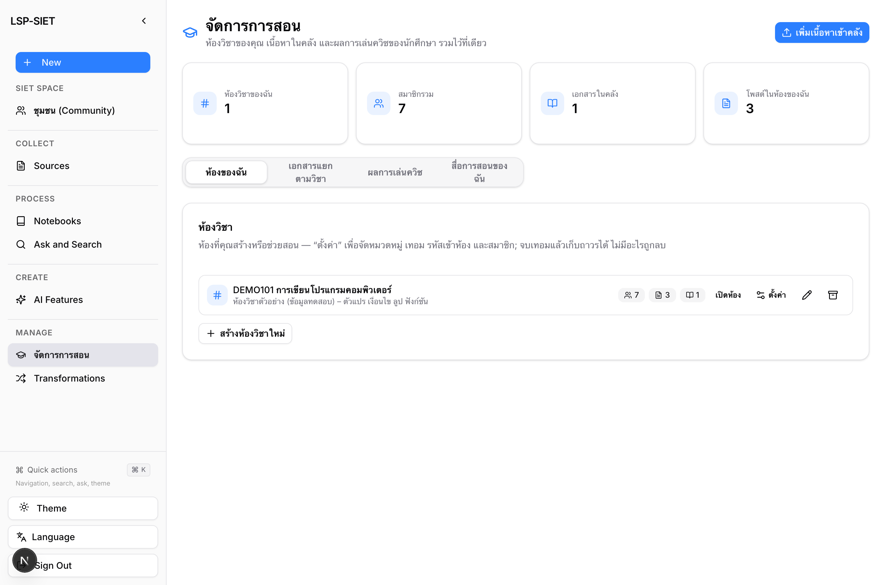
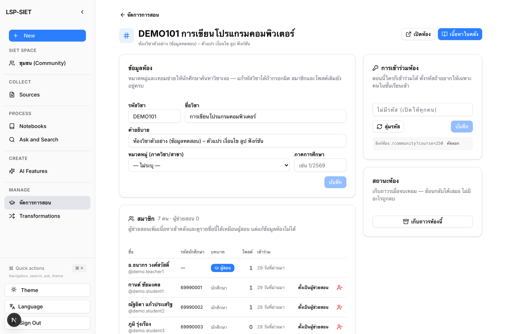
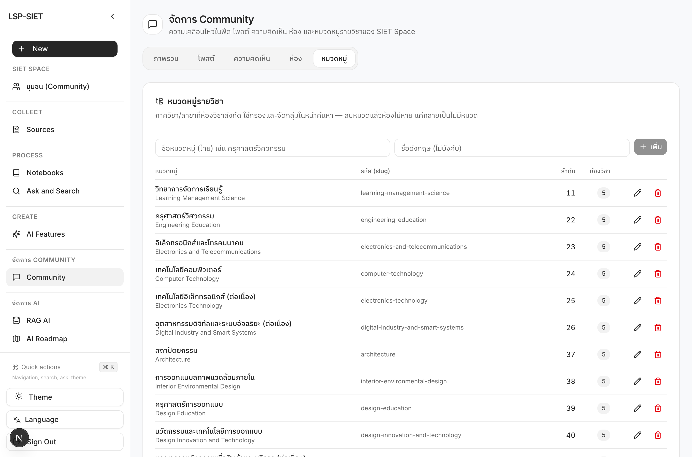
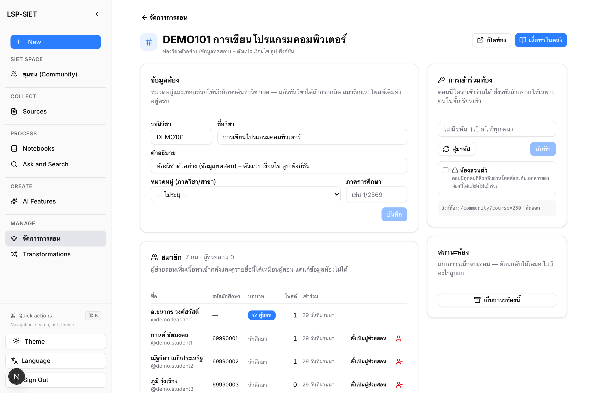
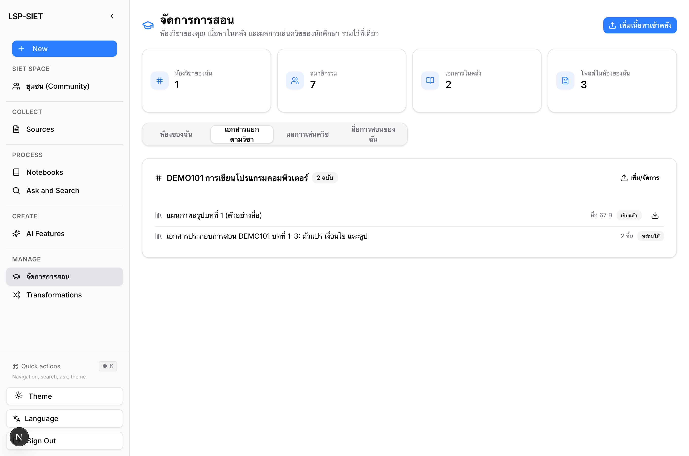
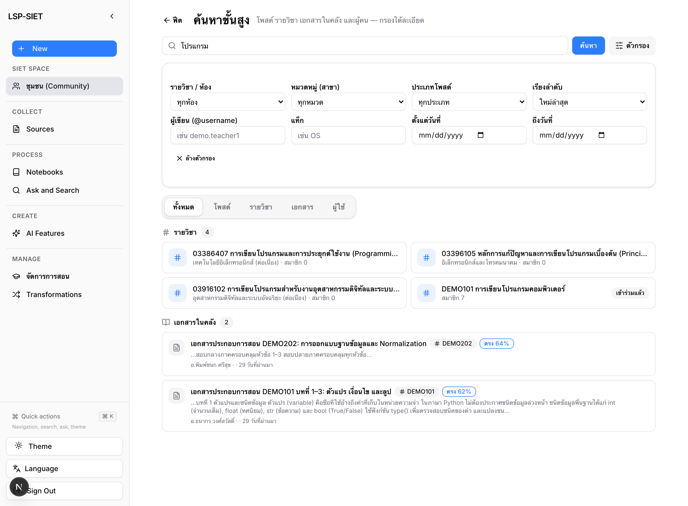
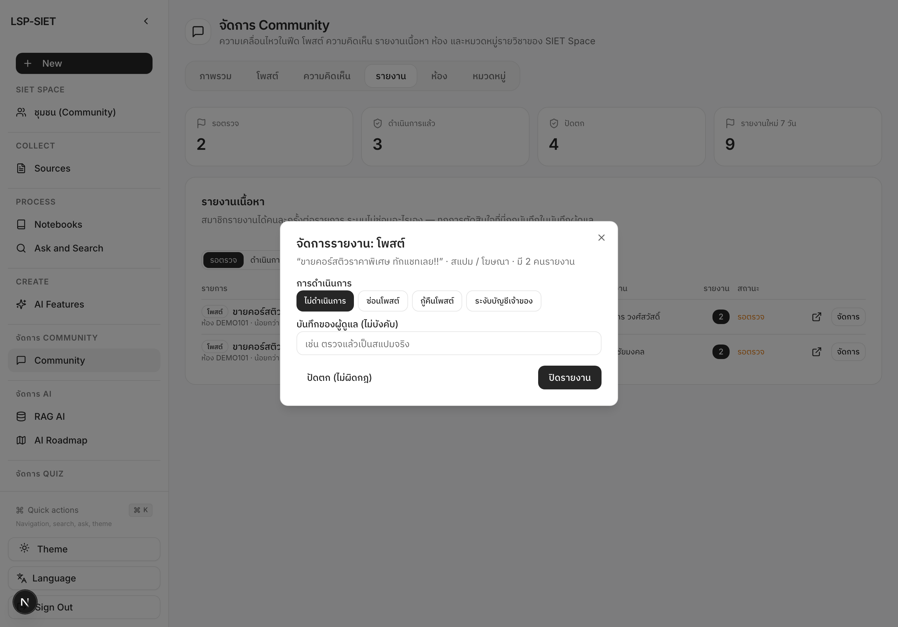
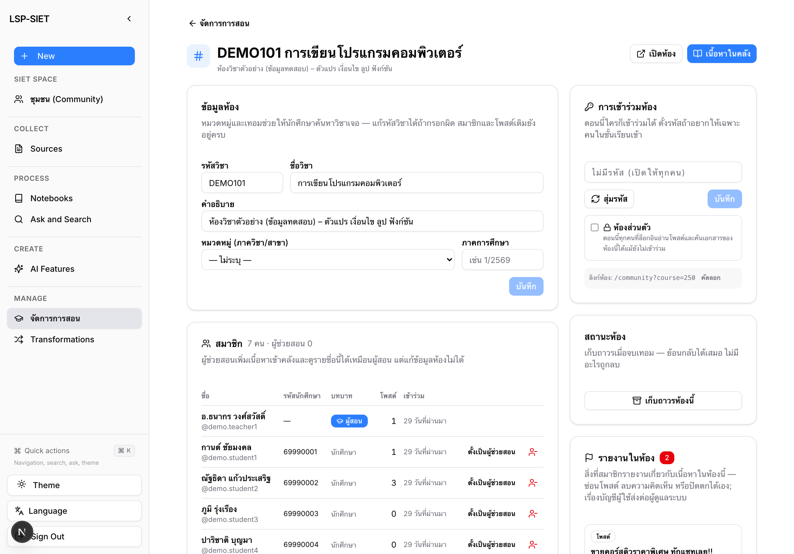
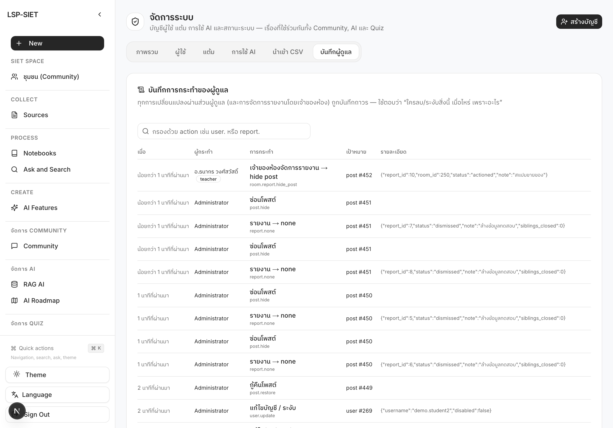

# 4.3 การพัฒนาระบบจัดการคลังข้อมูลและรายวิชา

ระบบ LSP-SIET (SIET Space) จัดเก็บรายวิชาในรูป "ห้องวิชา" (course room) ซึ่งเป็นทั้งพื้นที่พูดคุยของผู้เรียน คลังสื่อการสอนของรายวิชา และขอบเขตของแหล่งอ้างอิงที่ปัญญาประดิษฐ์ (KMITL RAG AI, AI Quiz, AI Roadmap) ใช้ตอบคำถาม หัวข้อนี้อธิบายการพัฒนาส่วนจัดการรายวิชาและคลังข้อมูลทั้ง 5 ส่วนย่อย ได้แก่ โครงสร้างรายวิชาและหมวดหมู่ (4.3.1) การอัปโหลดและดาวน์โหลดสื่อการสอน (4.3.2) การสืบค้นขั้นสูง (4.3.3) การกำหนดระดับการมองเห็น (4.3.4) และการตรวจสอบและรายงานเนื้อหา (4.3.5) โดยข้อมูลทุกส่วนอ้างอิงจากซอร์สโค้ดจริงบนสาขา `refactor/course-repo` และตรวจสอบกับฐานข้อมูลที่รันอยู่เมื่อวันที่ 22 ตุลาคม 2569

## 4.3.1 พัฒนา API และ UI สำหรับจัดการโครงสร้างรายวิชาและหมวดหมู่

### 1) การวิเคราะห์โครงสร้างเดิมและแนวทางการออกแบบ

ก่อนการพัฒนา ตาราง `rooms` มีโครงสร้างแบบแบน (flat) ไม่มีการจัดกลุ่ม ไม่มีภาคการศึกษา ผู้ใช้ทุกคนเข้าร่วมห้องใดก็ได้โดยไม่มีการควบคุม เจ้าของห้องนำสมาชิกออกไม่ได้ และการ "ปิดห้อง" เป็นการลบแถวทิ้งทันทีโดยทิ้งเอกสารในคลังและข้อมูลเวกเตอร์ใน SurrealDB ไว้เป็นข้อมูลกำพร้า (orphan) ผู้พัฒนาจึงออกแบบส่วนขยายตามหลัก 3 ข้อ

1. **หมวดหมู่ชั้นเดียว** — คณะครุศาสตร์อุตสาหกรรมและเทคโนโลยีเป็นคณะเดียว การสร้างต้นไม้ คณะ → ภาควิชา → สาขา จึงเป็นชั้นที่ไม่มีใครใช้เลือกดู ระบบจึงใช้ตาราง `categories` ชั้นเดียวที่แทน "สาขาวิชา" และเก็บภาคการศึกษาไว้ที่ตัวห้อง (`rooms.term`)
2. **เก็บถาวรแทนการลบ** — เจ้าของห้องทำได้เพียง "เก็บถาวร" (archive) ซึ่งย้อนกลับได้ ส่วนการลบถาวรสงวนไว้สำหรับผู้ดูแลระบบและต้องลบข้อมูลที่เกี่ยวข้องให้ครบทุกชั้น
3. **ไม่เพิ่ม FOREIGN KEY** — คงหลักการเดิมของระบบ (หัวข้อ 4.1.2) ที่ให้ชั้นแอปพลิเคชันเป็นผู้ดูแลความสัมพันธ์ เพื่อให้คำสั่ง `ALTER TABLE … IF NOT EXISTS` รันซ้ำได้บนฐานข้อมูลที่มีข้อมูลอยู่แล้ว

### 2) โครงสร้างข้อมูลที่เพิ่ม

**ตารางที่ 4.28** พจนานุกรมข้อมูลตาราง `categories`

| Field | Type | Nullable | Description |
|---|---|---|---|
| id | INT AUTO_INCREMENT | PK | รหัสหมวดหมู่ |
| slug | VARCHAR(64) | NOT NULL, UNIQUE | รหัสอ้างอิงภาษาอังกฤษ เช่น `computer-technology` ใช้จับคู่ตอน seed และนำเข้า CSV |
| name | VARCHAR(128) | NOT NULL | ชื่อหมวดหมู่ภาษาไทย (ชื่อสาขาวิชา) |
| name_en | VARCHAR(128) | NULL | ชื่อภาษาอังกฤษ |
| sort_order | INT | NOT NULL DEFAULT 0 | ลำดับแสดงผล (หลักสิบ = ภาควิชา) |
| created_at | DATETIME | DEFAULT CURRENT_TIMESTAMP | เวลาสร้าง |

**ตารางที่ 4.29** คอลัมน์ที่เพิ่มในตาราง `rooms` และ `room_members`

| ตาราง | Field | Type | Nullable | Description |
|---|---|---|---|---|
| rooms | category_id | INT | NULL | หมวดหมู่ของห้อง (อ้างอิง `categories.id` ระดับแอปพลิเคชัน; ลบหมวดแล้วตั้งเป็น NULL) |
| rooms | term | VARCHAR(16) | NULL | ภาคการศึกษา เช่น `1/2569` |
| rooms | join_code | VARCHAR(32) | NULL | รหัสเข้าห้อง (เก็บตัวพิมพ์ใหญ่); NULL = เข้าร่วมได้ทุกคน |
| rooms | status | ENUM('active','archived') | NOT NULL DEFAULT 'active' | สถานะวงจรชีวิตของห้อง |
| rooms | archived_at | DATETIME | NULL | เวลาที่เก็บถาวร (UTC) |
| room_members | role | ENUM('member','ta') | NOT NULL DEFAULT 'member' | บทบาทในห้อง; `ta` = ผู้ช่วยสอน |

ดัชนีที่เพิ่ม: `idx_rooms_category (category_id, status)` สำหรับการกรองตามหมวดและสถานะในหน้าค้นหา

### 3) กฎความสัมพันธ์และสิทธิ์

**ตารางที่ 4.30** ความสัมพันธ์และการจัดการเมื่อลบ (ระดับแอปพลิเคชัน)

| ความสัมพันธ์ | ชนิด | เมื่อลบฝั่งซ้าย |
|---|---|---|
| categories → rooms | 1:N | `UPDATE rooms SET category_id = NULL` (`repository.delete_category`) |
| rooms → room_members | 1:N | ลบแถวสมาชิก (เฉพาะการลบถาวรโดยผู้ดูแล) |
| rooms → posts | 1:N | `UPDATE posts SET room_id = NULL` — โพสต์ย้ายกลับฟีดรวม ไม่ถูกลบ |
| rooms → library_documents | 1:N | ลบเอกสาร ไฟล์ Source และ `source_embedding` ใน SurrealDB ทีละฉบับ (`library.purge_course_library`) |
| rooms → notebook (SurrealDB) | 1:1 | `Notebook.delete(delete_exclusive_sources=True)` |

**ตารางที่ 4.31** สิทธิ์ตามบทบาทในห้องวิชา

| การกระทำ | นักศึกษา/สมาชิก | ผู้ช่วยสอน (TA) | ผู้สอน (ผู้สร้างห้อง) | ผู้ดูแลระบบ |
|---|---|---|---|---|
| ดูรายการห้อง / เข้าร่วม (ต้องมีรหัสถ้าตั้งไว้) | ✓ | ✓ (ไม่ต้องใช้รหัส) | ✓ (ไม่ต้องใช้รหัส) | ✓ |
| อัปโหลดเนื้อหาเข้าคลังของห้อง | ✗ | ✓ | ✓ | ✓ |
| ดูรายชื่อสมาชิก | ✗ | ✓ | ✓ | ✓ |
| แก้ชื่อ รหัส หมวด เทอม รหัสเข้าห้อง | ✗ | ✗ | ✓ | ✓ |
| ตั้ง/ถอดผู้ช่วยสอน, นำสมาชิกออก | ✗ | ✗ | ✓ | ✓ |
| เก็บถาวร / กู้คืน | ✗ | ✗ | ✓ | ✓ |
| ลบถาวร (cascade) | ✗ | ✗ | ✗ | ✓ |
| เพิ่ม/แก้/ลบหมวดหมู่ | ✗ | ✗ | ✗ | ✓ |

### 4) API ที่พัฒนา

**ตารางที่ 4.32** Endpoint ของส่วนจัดการรายวิชาและหมวดหมู่ (prefix `/api`)

| Method | Path | ผู้เรียก | หน้าที่ |
|---|---|---|---|
| GET | /community/categories | ทุกคน | รายการหมวดหมู่พร้อมจำนวนห้องที่เปิดอยู่ |
| GET | /community/courses?include_archived&category_id | ทุกคน | รายการห้อง (ค่าเริ่มต้นไม่รวมที่เก็บถาวร) พร้อม `category_name`, `term`, `requires_code`, `can_manage` |
| GET | /community/courses/{id} | ทุกคน | รายละเอียดห้อง; `join_code` ส่งกลับเฉพาะผู้จัดการห้อง |
| POST | /community/courses | อาจารย์/ผู้ดูแล (ห้องวิชา) | สร้างห้อง + `category_id`, `term`, `join_code`; ตรวจรหัสซ้ำก่อนบันทึกและดัก `IntegrityError` |
| PATCH | /community/courses/{id} | เจ้าของ/ผู้ดูแล | แก้ข้อมูล (`category_id=0`, `term=""`, `join_code=""` = ล้างค่า) |
| POST | /community/courses/{id}/join | ทุกคน | เข้าร่วม; ห้องที่มีรหัสตอบ 403 พร้อม header `X-Join-Code-Required: 1` จนกว่าจะส่ง `{code}` ที่ถูกต้อง; ห้องที่เก็บถาวรตอบ 400 |
| POST | /community/courses/{id}/archive, /restore | เจ้าของ/ผู้ดูแล | เก็บถาวร / กู้คืน |
| DELETE | /community/courses/{id} | เจ้าของ = เก็บถาวร, ผู้ดูแล = ลบถาวร | ผลลัพธ์แจ้ง `archived` หรือ `deleted` + `purged{documents, notebooks}` |
| GET | /community/courses/{id}/members | ผู้สอน/TA/ผู้ดูแล | รายชื่อสมาชิก บทบาท เวลาที่เข้าร่วม จำนวนโพสต์ |
| PATCH / DELETE | /community/courses/{id}/members/{uid} | เจ้าของ/ผู้ดูแล | ตั้งบทบาท `member`/`ta` / นำออก (ผู้สร้างห้องถูกนำออกไม่ได้) |
| GET/POST/PATCH/DELETE | /admin/categories[/{id}] | ผู้ดูแล | จัดการหมวดหมู่ |
| POST | /admin/import/courses | ผู้ดูแล | นำเข้า CSV คอลัมน์ `code,name,description,category,term` |

การตรวจสิทธิ์อยู่ในฟังก์ชัน `_is_room_owner` (เจ้าของหรือผู้ดูแล), `_can_manage_room` (เพิ่มผู้ช่วยสอน) และ `_room_or_403` / `_managed_room_or_403` ใน `api/routers/community.py` ส่วนคำสั่ง SQL อยู่ใน `open_notebook/community/repository.py` (`list_courses`, `create_course`, `update_course`, `set_course_status`, `list_course_members`, `set_member_role`, `list_categories`, `create_category`, `delete_category`, `join_code_matches`)

### 5) ส่วนติดต่อผู้ใช้

- **อาจารย์** — หน้า `/teacher` แสดงห้องที่สอนหรือช่วยสอนพร้อมป้ายหมวด/เทอม/รหัสเข้าห้อง และส่วน "ห้องที่เก็บถาวร"; ปุ่ม "ตั้งค่า" เปิดหน้า `/teacher/courses/{id}` ซึ่งประกอบด้วย การ์ดข้อมูลห้อง (รหัสวิชา ชื่อ คำอธิบาย หมวดหมู่ ภาคการศึกษา) การ์ดการเข้าร่วม (รหัสเข้าห้อง สุ่ม/คัดลอก/ยกเลิก และลิงก์ห้อง) ตารางสมาชิก (ตั้ง/ถอดผู้ช่วยสอน นำออก) และการ์ดสถานะห้อง (เก็บถาวร/กู้คืน; ลบถาวรเฉพาะผู้ดูแล)
- **ผู้ดูแล** — `/admin/community` แท็บ "ห้อง" เพิ่มคอลัมน์หมวดหมู่/เทอม ป้ายเก็บถาวร และปุ่มลบถาวรที่ระบุผลกระทบ; แท็บใหม่ "หมวดหมู่" เพิ่ม แก้ไขในแถว และลบหมวดหมู่
- **ข้อมูลตั้งต้น** — `open_notebook/community/catalog.py` seed หมวดหมู่ 13 สาขาวิชาระดับปริญญาตรีของคณะ (4 ภาควิชา) และรายวิชาตัวอย่างสาขาละ 5 วิชาจากเล่มหลักสูตร (มคอ.2) ที่เว็บไซต์คณะเผยแพร่ โดยเพิ่มเฉพาะรายการที่ยังไม่มีและไม่เขียนทับข้อมูลที่อาจารย์แก้ไขแล้ว

**รูปที่ 4.6** หน้า "จัดการการสอน" (`/teacher`) ของอาจารย์ แสดงห้องวิชาพร้อมปุ่ม "ตั้งค่า" และ "เก็บถาวร"

**รูปที่ 4.7** หน้าตั้งค่าห้องวิชา (`/teacher/courses/{id}`): ข้อมูลห้อง หมวดหมู่/ภาคการศึกษา รหัสเข้าห้อง รายชื่อสมาชิกพร้อมปุ่มตั้งผู้ช่วยสอน และสถานะห้อง

**รูปที่ 4.8** แท็บ "หมวดหมู่" ใน `/admin/community` แสดงหมวดหมู่ 13 สาขาวิชาของคณะที่ seed ไว้ พร้อมจำนวนห้องในแต่ละหมวด

### 6) การทดสอบ

ชุดทดสอบ `tests/test_course_rooms.py` จำนวน 21 กรณี แบ่งเป็นการทดสอบคำสั่ง SQL ที่ฟังก์ชันคลังข้อมูลสร้าง (เช่น การซ่อนห้องที่เก็บถาวร การเติมหมวดหมู่ตอน seed การกวาดแถวเอกสารตอนลบถาวร) และการทดสอบเส้นทาง API ผ่าน FastAPI TestClient (นักศึกษาสร้างห้องวิชาไม่ได้, รหัสเข้าห้องถูก/ผิด/ไม่ส่ง, เจ้าของห้องไม่ต้องใช้รหัส, ห้องที่เก็บถาวรไม่รับสมาชิก, DELETE ของอาจารย์เป็นเก็บถาวรแต่ของผู้ดูแลเป็นลบถาวร, ผู้ช่วยสอนเห็นรายชื่อแต่แก้ห้องไม่ได้, รหัสเข้าห้องไม่รั่วไปยังผู้ที่ไม่ใช่ผู้จัดการห้อง) ผลการรันในคอนเทนเนอร์ API: ผ่านทั้งหมด 63 กรณีเมื่อรวมชุดทดสอบเดิมของส่วนผู้ดูแลและบทบาท

## 4.3.4 พัฒนาระบบตั้งค่าสิทธิ์ระดับการมองเห็นและซ่อนเนื้อหา (Visibility)

### 1) ปัญหาเดิมและแนวทาง

ก่อนการพัฒนา ระบบตรวจสิทธิ์เฉพาะตอนแสดงฟีดของหน้าโปรไฟล์ แต่เส้นทาง API ของโพสต์เดี่ยว ความคิดเห็น ไฟล์แนบ และคลังเอกสารของรายวิชา ไม่ตรวจความเป็นสมาชิกเลย ผู้ใช้ที่ทราบหมายเลขโพสต์จึงอ่านหรือดาวน์โหลดเนื้อหาของห้องใดก็ได้ และโพสต์ทุกรายการเป็นสาธารณะโดยไม่มีทางเลือก การออกแบบจึงกำหนด **กฎการมองเห็นเพียงกฎเดียว** แล้วบังคับใช้ในทุกจุดที่อ่านโพสต์ โดยคงค่าเริ่มต้นเป็นสาธารณะเพื่อไม่ให้พฤติกรรมของฟีดที่ผู้ใช้คุ้นเคยเปลี่ยนไป

### 2) โครงสร้างข้อมูล

**ตารางที่ 4.33** คอลัมน์ที่เพิ่มสำหรับระดับการมองเห็น

| ตาราง | Field | Type | Nullable | Description |
|---|---|---|---|---|
| posts | visibility | ENUM('public','course','private') | NOT NULL DEFAULT 'public' | ระดับการมองเห็นของโพสต์ (ดัชนี `idx_posts_visibility (visibility, id)`) |
| rooms | is_private | TINYINT(1) | NOT NULL DEFAULT 0 | ห้องส่วนตัว: โพสต์และคลังเห็นได้เฉพาะสมาชิก |

### 3) กฎการมองเห็น

**ตารางที่ 4.34** ผู้ที่อ่านโพสต์ได้ตามระดับการมองเห็นและสถานะของห้อง

| ระดับโพสต์ | ห้องสาธารณะ | ห้องส่วนตัว | ไม่อยู่ในห้อง |
|---|---|---|---|
| public | ทุกคนที่ล็อกอิน | เฉพาะสมาชิก/ผู้สอน/ผู้ช่วยสอน | ทุกคนที่ล็อกอิน |
| course | เฉพาะสมาชิก/ผู้สอน | เฉพาะสมาชิก/ผู้สอน | ลดระดับเป็น public อัตโนมัติ |
| private | ผู้เขียนเท่านั้น | ผู้เขียนเท่านั้น | ผู้เขียนเท่านั้น |

ผู้เขียนและผู้ดูแลระบบอ่านได้ทุกกรณี โพสต์ที่ผู้เรียกไม่มีสิทธิ์อ่านตอบรหัส 404 เหมือนไม่มีอยู่ เพื่อไม่ให้เดาหมายเลขโพสต์ได้ กฎนี้เขียนไว้ที่เดียวเป็นนิพจน์ SQL (`_VISIBLE_SQL`) ที่ต่อท้ายทุกคำสั่งอ่านฟีด และมีฟังก์ชันคู่กันในภาษา Python (`post_visible_to`) สำหรับเส้นทางโพสต์เดี่ยว ซึ่งทุกเส้นทาง (`GET /posts/{id}`, ความคิดเห็น, ไฟล์แนบ, ไลก์, บันทึก, แชร์, เล่นควิซ, ติดตาม roadmap) เรียกผ่าน `_visible_post_or_404`

**การซ่อนเนื้อหา** — ผู้เขียนซ่อนโพสต์ของตนได้โดยเปลี่ยนเป็น `private` ผ่าน `PUT /community/posts/{id}` (ย้อนกลับได้) ส่วนผู้ดูแลยังใช้การซ่อน/กู้คืนระดับระบบ (`is_deleted`) ตามเดิม

**ห้องส่วนตัว** — เมื่ออาจารย์เปิดสวิตช์ "ห้องส่วนตัว" ในหน้าตั้งค่าห้อง โพสต์ทุกระดับและเอกสารในคลังของห้องจะเห็นได้เฉพาะสมาชิก ผู้สอน และผู้ช่วยสอน การกรองใช้กฎเดียวกันใน `GET /community/library`, การเลือกเอกสาร/notebook ให้ AI อ่าน, ขอบเขต `course` ของ KMITL RAG AI และรายการ notebook ที่ `GET /community/knowledge` ส่งให้ (`library._DOC_READABLE_SQL`, `can_read_document`, `can_read_room`) ห้องสาธารณะยังเปิดให้ทุกคนที่ล็อกอินอ่านโพสต์สาธารณะและค้นเอกสารได้แม้ยังไม่เข้าร่วม ซึ่งสอดคล้องกับบทบาท "คลังข้อมูล" ของระบบ

### 4) API

**ตารางที่ 4.35** การเปลี่ยนแปลงของ API สำหรับระดับการมองเห็น

| Method | Path | การเปลี่ยนแปลง |
|---|---|---|
| POST | /community/posts | ฟิลด์ฟอร์ม `visibility` (public/course/private; ค่าอื่น → 400) |
| PUT | /community/posts/{id} | ฟิลด์ `visibility` ในเนื้อหาคำขอ |
| GET | /community/posts, /posts/{id} และทุกเส้นทางย่อย | กรองตามกฎการมองเห็น; ผู้ดูแลเห็นทั้งหมด |
| PATCH | /community/courses/{id} | ฟิลด์ `is_private` |
| GET | /community/library, /library/{id}, /knowledge, POST /ask (scope=course) | กรองห้องส่วนตัวที่ผู้เรียกไม่ได้เป็นสมาชิก |
| GET | /admin/posts | เพิ่มฟิลด์ `visibility` ต่อโพสต์ |

### 5) การทดสอบ

ชุดทดสอบ `tests/test_post_visibility.py` จำนวน 16 กรณี ได้แก่ ตารางค่าความจริงของ `post_visible_to` 10 กรณี (ตารางที่ 4.34) รูปแบบ SQL ของฟีดและโพสต์เดี่ยว การตรวจค่า visibility ตอนสร้าง/แก้ไข และการทดสอบเส้นทาง API ว่าโพสต์ที่มองไม่เห็นตอบ 404 ครบทุกเส้นทางย่อย สมาชิกอ่านโพสต์ระดับ course ได้ ผู้เขียนซ่อนโพสต์ได้ ระดับ course นอกห้องลดเป็น public และสวิตช์ห้องส่วนตัวส่งถึงฐานข้อมูล รวมกับชุดทดสอบเดิมผ่านทั้งหมด 88 กรณี นอกจากนี้ยังตรวจบนระบบจริงด้วยบัญชีสาธิต (ผู้สอน นักศึกษาในห้อง นักศึกษานอกห้อง ผู้ดูแล) ตามลำดับเหตุการณ์ในตารางที่ 4.34

**รูปที่ 4.9** สวิตช์ "ห้องส่วนตัว" ในการ์ดการเข้าร่วมห้องของหน้าตั้งค่าห้องวิชา (`/teacher/courses/{id}`) พร้อมคำอธิบายผลของแต่ละสถานะ

## 4.3.2 พัฒนาระบบอัปโหลด ดาวน์โหลดสื่อการสอนและคลังข้อมูล

### 1) สถานะเดิมและช่องโหว่ที่พบ

คลังเอกสารเดิมรับเฉพาะไฟล์เอกสาร 11 นามสกุลและสกัดข้อความทุกไฟล์เข้าสู่ระบบ RAG ไม่มีเส้นทางดาวน์โหลดไฟล์ที่อัปโหลดเข้าคลัง ตรวจชนิดไฟล์จากนามสกุลเท่านั้น เขียนไฟล์แบบบล็อก event loop การประมวลผลที่ค้างเมื่อเซิร์ฟเวอร์รีสตาร์ตจะคงสถานะ "กำลังประมวลผล" ตลอดไป การกด "ลองใหม่" สร้าง Source ซ้ำโดยไม่ลบของเดิม และเอกสารที่แชร์ลงฟีดใช้ไฟล์เดียวกับโพสต์ทำให้ลบเอกสารแล้วไฟล์แนบของโพสต์หาย หัวข้อนี้แก้ทั้ง 7 ประเด็นพร้อมกับขยายให้รองรับสื่อการสอนที่ไม่ใช่เอกสาร

### 2) ชนิดไฟล์และขีดจำกัด

**ตารางที่ 4.36** ชนิดไฟล์ที่คลังรองรับ

| กลุ่ม | นามสกุล | การประมวลผล | ขนาดสูงสุด |
|---|---|---|---|
| เอกสาร | .pdf .docx .pptx .xlsx .csv .txt .md .html .epub .rtf .odt | สกัดข้อความ → Source → แบ่งชิ้น → embedding (`status=ready`, `chunks>0`) | 100 MB (`LIBRARY_MAX_UPLOAD_MB`) |
| สื่อการสอน | .png .jpg .jpeg .gif .webp .mp4 .webm .zip | เก็บไฟล์และให้ดาวน์โหลด ไม่สกัดข้อความ (`status=ready`, `chunks=0`, `is_media=true`) | 200 MB (`LIBRARY_MAX_MEDIA_MB`) |

### 3) ขั้นตอนการอัปโหลดที่ปรับปรุง

**ตารางที่ 4.37** การตรวจสอบตามลำดับใน `POST /community/library` (ไฟล์)

| ลำดับ | ขั้นตอน | ฟังก์ชัน | ผลเมื่อไม่ผ่าน |
|---|---|---|---|
| 1 | สิทธิ์: ห้องวิชาต้องเป็นผู้สอน/ผู้ช่วยสอน/ผู้ดูแล และห้องไม่ถูกเก็บถาวร | `_can_manage_room` | 403 / 400 |
| 2 | นามสกุลอยู่ในรายการ | `validate_extension` | 400 |
| 3 | สตรีมลงดิสก์แบบ asynchronous ทีละ 1 MB พร้อมคำนวณ MD5 และตัดเมื่อเกินขีดจำกัดของกลุ่ม | `save_upload` (anyio) | 413 และลบไฟล์ |
| 4 | ตรวจ magic bytes ให้ตรงกับนามสกุล (PDF, รูป, วิดีโอ, zip-container ของ Office/EPUB/ODT) และไฟล์ข้อความต้องเป็นข้อความจริง (ไม่มี NUL, ถอดรหัส UTF-8 หรือ CP874) | `check_signature` (ไลบรารี `filetype`) | 400 และลบไฟล์ |
| 5 | กันอัปโหลดซ้ำด้วย MD5 ต่อผู้ใช้ | `ratelimit.check_duplicate_document` | 409 |
| 6 | บันทึกแถว `library_documents` (MIME ที่บันทึก = ค่าที่ตรวจพบจริง) และตั้งงานพื้นหลัง `ingest_document` | `create_document` | — |
| 7 | ถ้าแชร์ลงฟีด คัดลอกไฟล์ให้โพสต์เป็นสำเนาของตนเองใน `DATA_FOLDER/community` | `shutil.copyfile` (ใน thread) | — |

### 4) การดาวน์โหลด

`GET /community/library/{id}/download` ตรวจสิทธิ์ด้วยกฎเดียวกับการอ่านเอกสาร (หัวข้อ 4.3.4: เอกสารส่วนตัวเฉพาะเจ้าของ เอกสารของห้องส่วนตัวเฉพาะสมาชิก) แล้วส่งไฟล์ด้วย `FileResponse` โดยกำหนด `Content-Disposition` เป็น `inline` สำหรับ PDF รูปภาพ วิดีโอ และข้อความ (เปิดในแท็บได้ทันที) และ `attachment` สำหรับชนิดอื่น เนื่องจากลิงก์ `<a href>` ส่ง header Authorization ไม่ได้ เส้นทางนี้จึงรับโทเค็นผ่าน `?token=` ตามกลไกเดิมของระบบ ทุกเอกสารใน API มีฟิลด์ `download_url` และฝั่งหน้าเว็บมี `libraryDownloadUrl()` สำหรับประกอบลิงก์ ปุ่มดาวน์โหลดแสดงในหน้าจัดการการสอน (แท็บเอกสารแยกตามวิชา) และหน้าจัดการ RAG ของผู้ดูแล

### 5) ความทนทาน

- **ตัวเก็บกวาดงานค้าง** — เมื่อ API เริ่มทำงาน `reap_stuck_documents()` เปลี่ยนแถวที่ค้าง `processing` นานกว่า `LIBRARY_PROCESSING_TIMEOUT_MINUTES` (30 นาที) เป็น `failed` พร้อมข้อความแนะนำให้กดลองใหม่ เพราะงานพื้นหลังของ FastAPI สูญหายไปพร้อมกับกระบวนการที่รีสตาร์ต
- **ลองใหม่ไม่ทิ้งขยะ** — `ingest_document` ลบ Source และ `source_embedding` เดิม (`_discard_source`) ก่อนสร้างใหม่ทุกครั้ง
- **ลบเอกสารอย่างปลอดภัย** — `delete_document` ตรวจก่อนว่ามีโพสต์หรือเอกสารอื่นยังใช้ไฟล์เดียวกันหรือไม่ (`_file_still_referenced`) สำหรับข้อมูลเก่าที่สร้างก่อนการแยกสำเนา
- **สิทธิ์จัดการ** — `can_manage_document(user, doc, managed_room_ids(user))` ให้ผู้สอนและผู้ช่วยสอนของห้องลบหรือลองใหม่เอกสารของห้องได้ ไม่จำกัดเฉพาะผู้อัปโหลด โดยคำนวณชุดห้องที่ผู้ใช้ดูแลเพียงครั้งเดียวต่อคำขอ

### 6) การทดสอบ

ชุดทดสอบ `tests/test_library_media.py` จำนวน 12 กรณี ครอบคลุมการจำแนกนามสกุลและขีดจำกัดตามกลุ่ม การตรวจ magic bytes (PDF/PNG/zip ผ่าน, ไฟล์ .exe ที่ตั้งชื่อ .pdf และไฟล์ไบนารีที่ตั้งชื่อ .md ถูกปฏิเสธ) การสตรีมไฟล์และการตัดเมื่อเกินขีดจำกัด สื่อที่ถูกบันทึกโดยไม่สกัดข้อความ การลบ Source เดิมเมื่อลองใหม่ คำสั่ง SQL ของตัวเก็บกวาด การคงไฟล์ที่โพสต์ยังใช้อยู่ สิทธิ์ของผู้ดูแลห้อง และเส้นทางดาวน์โหลด (inline/attachment/404) นอกจากนี้ยังตรวจบนระบบจริงด้วยการอัปโหลด PDF, รูปภาพ, ZIP และไฟล์ปลอมนามสกุล แล้วดาวน์โหลดกลับด้วยบัญชีสาธิต

**รูปที่ 4.10** แท็บ "เอกสารแยกตามวิชา" ในหน้าจัดการการสอน แสดงไฟล์สื่อ (ป้าย "สื่อ · เก็บแล้ว") คู่กับเอกสารที่ถูกสกัดข้อความ และปุ่มดาวน์โหลดที่เรียก `GET /community/library/{id}/download`

## 4.3.3 พัฒนาระบบการสืบค้นขั้นสูง (Advanced Search)

### 1) ข้อจำกัดเดิมและการตัดสินใจออกแบบ

ระบบเดิมมีเพียงช่องค้นหาบนส่วนหัวของชุมชนที่กรองฟีดด้วย `LIKE %คำ%` และเส้นทาง `GET /community/search` ที่ไม่มีหน้าจอเรียกใช้ การค้นหาผู้ใช้จับคู่กับอีเมลและรหัสนักศึกษาให้ทุกคน อักขระ `%`/`_` ของผู้ใช้ทำหน้าที่เป็น wildcard และการแบ่งหน้าแบบ "ยอดนิยม" ใช้ cursor ตามหมายเลขโพสต์ทั้งที่เรียงตามคะแนน ทำให้หน้าถัดไปข้ามหรือซ้ำรายการ

การออกแบบพิจารณาข้อเท็จจริงสำคัญว่า **ดัชนี FULLTEXT ของ MariaDB ตัดคำภาษาไทยไม่ได้** (ไม่มี n-gram parser) จึงเลือกแนวทางผสม: ข้อความของโพสต์และรายวิชาซึ่งมีขนาดเล็กใช้ `LIKE` ที่ escape แล้วพร้อมตัวกรองเชิงโครงสร้าง ส่วน **เอกสารในคลังใช้การค้นหาเชิงความหมาย** ผ่านเวกเตอร์ชุดเดียวกับที่ KMITL RAG AI ใช้ (หัวข้อ 4.1.3) ซึ่งไม่ขึ้นกับภาษาและการตัดคำ

### 2) สถาปัตยกรรมการค้นหา

**ตารางที่ 4.38** ชนิดผลลัพธ์ วิธีค้น และตัวกรองของ `GET /community/search`

| ชนิด | วิธีค้น | ตัวกรอง | การควบคุม |
|---|---|---|---|
| โพสต์ | query ของฟีด (`repository.list_posts`) เพิ่มเงื่อนไข tag (ตรงทั้งแท็ก), ช่วงวันที่, ผู้เขียน, หมวดหมู่ของห้อง | ห้อง, หมวดหมู่, ประเภท, ผู้เขียน, แท็ก, วันที่, ลำดับ | เคารพ visibility และห้องส่วนตัว (4.3.4) โดยอัตโนมัติ; แบ่งหน้าด้วย `before_id` |
| รายวิชา | `search_courses`: รหัส ชื่อห้อง หรือชื่อหมวดหมู่ เฉพาะห้องที่เปิดอยู่ | หมวดหมู่ | ไม่ส่งรหัสเข้าห้อง |
| เอกสาร | embedding ของคำค้น (cache 1 ชั่วโมง) → cosine similarity บน `source_embedding` ของ notebook ที่ผู้ใช้อ่านได้ → ยุบเป็นรายเอกสารพร้อมข้อความที่ตรงที่สุด (`snippet`) และค่าความคล้าย; รวมกับการตรงชื่อไฟล์ | ห้อง, หมวดหมู่ | ขอบเขตจาก `room_ids_readable_by` (ห้องสาธารณะ + ห้องส่วนตัวที่เป็นสมาชิก + คลังส่วนตัว); cache 5 นาที; จำกัด 20 ครั้ง/นาที/คน; ไม่หักแต้ม |
| ผู้ใช้ | ชื่อแสดงและ username; เฉพาะอาจารย์/ผู้ดูแลจับคู่อีเมลและรหัสนักศึกษาได้ | — | นักศึกษาไม่ได้รับ `student_id` (หลัก data minimisation) |

### 3) การแก้ไขฐานราก

**ตารางที่ 4.39** จุดที่แก้ไขในชั้นคลังข้อมูล

| จุด | ก่อน | หลัง |
|---|---|---|
| `_like()` | `%คำ%` ตรง ๆ — `%` ของผู้ใช้ค้นได้ทุกรายการ | escape `\`, `%`, `_` ก่อนประกอบ |
| cursor ของ `order=popular` | `p.id < :before_id` ขณะเรียงตามคะแนน → ข้าม/ซ้ำ | keyset `(คะแนน, id)`: หาคะแนนของโพสต์ cursor ด้วย subquery แล้วเทียบ `(score < cur) OR (score = cur AND id < cur)` โดยไคลเอนต์ยังส่งแค่ id เดิม |
| `search_users` | จับคู่อีเมล/รหัสนักศึกษาให้ทุกคน | พารามิเตอร์ `include_contact` เปิดเฉพาะ staff; ซ่อนบัญชีที่ถูกระงับ |
| `search_courses` | รหัส/ชื่อเท่านั้น | + ชื่อหมวดหมู่, กรองหมวด, เฉพาะห้อง active, คืน `member_count`/`joined`/metadata ของห้อง |

### 4) ส่วนติดต่อผู้ใช้

หน้า `/community/search` ประกอบด้วยช่องค้นหา ปุ่มตัวกรอง (ห้อง หมวดหมู่ ประเภทโพสต์ ลำดับ ผู้เขียน แท็ก ช่วงวันที่) และแท็บ ทั้งหมด/โพสต์/รายวิชา/เอกสาร/ผู้ใช้ แท็บ "ทั้งหมด" แสดงชนิดละ 5 รายการพร้อมปุ่ม "ดูทั้งหมด" แท็บโพสต์โหลดเพิ่มได้ต่อเนื่อง ผลลัพธ์เอกสารแสดงข้อความที่ตรงที่สุด ร้อยละความคล้าย และปุ่มดาวน์โหลด (หัวข้อ 4.3.2) ทุกตัวกรองอยู่ใน query string ของ URL จึงแชร์ผลการค้นหาเป็นลิงก์ได้ (`filtersFromParams`/`paramsFromFilters` ใน `lib/api/community-search.ts`)

### 5) การทดสอบ

ชุดทดสอบ `tests/test_search.py` จำนวน 10 กรณี ครอบคลุมการ escape wildcard, ตัวกรองทั้งหมดของฟีด, cursor แบบ keyset, การค้นหาผู้ใช้สองโหมด, การค้นหารายวิชาตามหมวด, ขอบเขต notebook ของการค้นหาเอกสาร (ห้องส่วนตัวที่ไม่ได้เป็นสมาชิกไม่ถูกค้น), การใช้ cache, และเส้นทาง API (การกระจายตัวกรอง การแบ่งหน้า สิทธิ์ staff และการจำกัดความถี่ที่ตอบ 429) รวมกับชุดทดสอบเดิมผ่านทั้งหมด 110 กรณี และตรวจบนระบบจริงด้วยบัญชีสาธิต

**รูปที่ 4.11** หน้าค้นหาขั้นสูง (`/community/search`) คำค้น "โปรแกรม": แผงตัวกรอง แท็บชนิดผลลัพธ์ รายวิชาที่ตรงรหัส/ชื่อ และเอกสารในคลังที่ค้นด้วยความหมายพร้อมร้อยละความคล้ายและข้อความที่ตรงที่สุด

## 4.3.5 พัฒนาระบบตรวจสอบและรายงานเนื้อหาที่ไม่เหมาะสม (Moderation)

### 1) สถานะเดิมและหลักการออกแบบ

ระบบเดิมมีเครื่องมือของผู้ดูแลสำหรับซ่อน/กู้คืนโพสต์ ลบความคิดเห็น และระงับบัญชี แต่ไม่มีช่องทางให้ผู้ใช้รายงานเนื้อหา ไม่มีการบันทึกการกระทำของผู้ดูแล (มีเพียง log ของเซิร์ฟเวอร์) และการระงับบัญชีไม่มีเหตุผลหรือระยะเวลา ผู้ถูกระงับจึงไม่ทราบสาเหตุ การออกแบบยึดหลัก 3 ข้อ: (1) **ไม่ซ่อนอัตโนมัติ** — ชุมชนขนาดเล็กถูกกลั่นแกล้งได้ง่ายด้วยรายงานร่วมกันไม่กี่คน ทุกการตัดสินต้องมีผู้ตรวจ (2) **ผู้สอนดูแลห้องของตน** — รายงานเกี่ยวกับเนื้อหาในห้องวิชาไปถึงผู้สอนก่อน ส่วนเรื่องบัญชีผู้ใช้สงวนไว้ให้ผู้ดูแลระบบ (3) **ตรวจสอบย้อนหลังได้** — ทุกการกระทำของผู้ดูแลและเจ้าของห้องถูกบันทึกถาวร

### 2) โครงสร้างข้อมูล

**ตารางที่ 4.40** พจนานุกรมข้อมูลตาราง `content_reports`

| Field | Type | Nullable | Description |
|---|---|---|---|
| id | BIGINT AUTO_INCREMENT | PK | รหัสรายงาน |
| reporter_id | INT | NOT NULL | ผู้รายงาน (`users.id`) |
| target_type | ENUM('post','comment','user','document') | NOT NULL | ชนิดของสิ่งที่ถูกรายงาน |
| target_id | BIGINT | NOT NULL | รหัสของสิ่งที่ถูกรายงาน |
| room_id | INT | NULL | ห้องของเนื้อหา (คำนวณตอนสร้าง) ใช้ส่งรายงานถึงผู้สอน |
| reason | ENUM('spam','harassment','inappropriate','copyright','other') | NOT NULL | เหตุผล |
| detail | VARCHAR(500) | NULL | รายละเอียดเพิ่มเติม |
| status | ENUM('open','dismissed','actioned') | NOT NULL DEFAULT 'open' | สถานะ |
| action | VARCHAR(32) | NULL | การดำเนินการที่ใช้ (none/hide_post/restore_post/delete_comment/suspend_user/delete_document) |
| note | VARCHAR(255) | NULL | บันทึกของผู้ตรวจ |
| reviewed_by, reviewed_at | INT, DATETIME | NULL | ผู้ตรวจและเวลา |
| created_at | DATETIME | DEFAULT CURRENT_TIMESTAMP | เวลาที่รายงาน |

ดัชนี: `UNIQUE (reporter_id, target_type, target_id)` ทำให้รายงานซ้ำเป็นไปไม่ได้ในระดับฐานข้อมูล; `(status, created_at)`, `(target_type, target_id)`, `(room_id, status)`

**ตารางที่ 4.41** พจนานุกรมข้อมูลตาราง `admin_audit_log` และคอลัมน์ที่เพิ่มใน `users`

| ตาราง | Field | Type | Description |
|---|---|---|---|
| admin_audit_log | id | BIGINT AUTO_INCREMENT | รหัส |
| admin_audit_log | actor_id | INT NOT NULL | ผู้กระทำ (ผู้ดูแล หรือเจ้าของห้องที่จัดการรายงาน) |
| admin_audit_log | action | VARCHAR(64) NOT NULL | ชื่อการกระทำแบบ `user.update`, `post.hide`, `report.suspend_user`, `room.report.hide_post` |
| admin_audit_log | target_type, target_id | VARCHAR(32), VARCHAR(64) | เป้าหมาย |
| admin_audit_log | detail | TEXT | รายละเอียดเป็น JSON (เช่น บทบาทใหม่ จำนวนแต้ม เหตุผลที่ระงับ) |
| admin_audit_log | created_at | DATETIME | เวลา (ดัชนี `created_at`, `(actor_id, created_at)`, `(action, created_at)`) |
| users | suspend_reason | VARCHAR(255) NULL | เหตุผลที่ระงับ (แจ้งผู้ใช้) |
| users | suspended_until | DATETIME NULL | วันที่การระงับสิ้นสุด; NULL = ไม่มีกำหนด |

### 3) กระบวนการรายงานและตัดสิน

**ตารางที่ 4.42** สิทธิ์และขั้นตอนของระบบรายงาน

| ขั้นตอน | ใคร | กติกา |
|---|---|---|
| รายงาน (`POST /community/reports`) | ผู้ใช้ที่ล็อกอิน | รายงานได้เฉพาะสิ่งที่ตนเองมองเห็น (กฎ 4.3.4); รายงานเนื้อหาของตนเองไม่ได้ (400); ซ้ำได้ครั้งเดียว (409); ระบบจำ `room_id` ของเนื้อหา |
| คิวของห้อง (`GET/POST /community/courses/{id}/reports`) | ผู้สอน/ผู้ช่วยสอน (ดู) · ผู้สร้างห้อง (ตัดสิน) | ปัดตก / ซ่อนโพสต์ / ลบความคิดเห็น; ทุกการตัดสินเขียนลง audit log ในชื่อผู้สอน |
| คิวผู้ดูแล (`GET/POST /admin/reports`) | ผู้ดูแลระบบ | เห็นทุกรายงานพร้อมจำนวนคนที่รายงานรายการเดียวกัน; ทำได้ครบ: ปัดตก ซ่อน/กู้คืนโพสต์ ลบความคิดเห็น ลบเอกสาร ระงับเจ้าของ; รายงานซ้ำของเป้าหมายเดียวกันปิดตามอัตโนมัติ |
| ระงับบัญชี (`PATCH /admin/users/{id}`) | ผู้ดูแลระบบ | ระบุเหตุผลและวันปล่อยได้; ผู้ใช้ได้รับการแจ้งเตือนในระบบ; ข้อความ 403 บอกเหตุผล; การระงับแบบมีกำหนดเวลาปล่อยเองเมื่อถึงวัน (ตรวจใน `get_current_user` และตอนล็อกอิน) |
| บันทึกผู้ดูแล (`GET /admin/audit`) | ผู้ดูแลระบบ | ทุก route ที่เปลี่ยนข้อมูลใต้ `/api/admin` (บัญชี แต้ม รหัสผ่าน ลบบัญชี โพสต์ ความคิดเห็น เอกสาร หมวดหมู่ Roadmap Quiz รายงาน) รวมถึงการลบห้องถาวรและการตัดสินรายงานโดยเจ้าของห้อง; การบันทึกไม่ทำให้การกระทำหลักล้มเหลว |

### 4) ส่วนติดต่อผู้ใช้

- **ผู้ใช้ทั่วไป** — คอมโพเนนต์ `ReportButton` (dialog เลือกเหตุผล + รายละเอียด) และ `useMyReports` สำหรับแสดงสถานะ "รายงานแล้ว" เตรียมไว้ให้ฝั่งฟีดนำไปวาง
- **ผู้สอน** — การ์ด "รายงานในห้อง" ในหน้าตั้งค่าห้องวิชา แสดงรายงานค้างพร้อมจำนวนผู้รายงาน ปุ่มซ่อนโพสต์/ลบความคิดเห็น/ปัดตก
- **ผู้ดูแล** — `/admin/community` แท็บ "รายงาน" (สถิติ 4 ใบ ตารางคิว dialog จัดการที่เลือกการดำเนินการตามชนิดเป้าหมาย และฟอร์มเหตุผล/วันปล่อยเมื่อระงับ) และ `/admin` แท็บ "บันทึกผู้ดูแล" (ค้นด้วย prefix ของ action); กล่องผู้ใช้ใน `/admin` เพิ่มช่องเหตุผลและวันปล่อยก่อนระงับ และแสดงข้อมูลการระงับที่มีอยู่

### 5) การแก้ไขข้อบกพร่องที่พบระหว่างทาง

ฟังก์ชัน `list_comments` ไม่ได้เลือกคอลัมน์ `parent_id` ทำให้ความคิดเห็นตอบกลับทุกรายการแสดงเป็นความคิดเห็นชั้นบน (ถดถอยจาก commit `8494961`) แก้โดยเพิ่ม `c.parent_id` ใน SELECT และยืนยันด้วยการทดสอบบนระบบจริง

### 6) การทดสอบ

ชุดทดสอบ `tests/test_moderation.py` จำนวน 10 กรณี ครอบคลุมกติกาการรายงาน (ตนเอง/ไม่พบ/ซ้ำ/เหตุผลไม่ถูกต้อง) รูปแบบ SQL ของคิว การตรวจสอบค่าตอนตัดสินและการปิดรายงานซ้ำ บันทึกผู้ดูแลที่ไม่ล้มแม้ฐานข้อมูลล่ม การปล่อยการระงับอัตโนมัติ ข้อความแจ้งเหตุผล และเส้นทาง API ทั้งฝั่งผู้ใช้ เจ้าของห้อง และผู้ดูแล (สิทธิ์ การดำเนินการ การระงับพร้อมวันปล่อย และการบันทึก) รวมกับชุดเดิมผ่าน 120 กรณี และตรวจบนระบบจริงด้วยบัญชีสาธิตตั้งแต่รายงาน → ผู้สอนลบความคิดเห็น → ผู้ดูแลซ่อนโพสต์ → ระงับ/ปล่อยบัญชี → ตรวจบันทึกผู้ดูแล

**รูปที่ 4.12** แท็บ "รายงาน" ใน `/admin/community`: สถิติ คิวรายงานที่แสดงจำนวนผู้รายงานรายการเดียวกัน และกล่องตัดสินที่เลือกการดำเนินการตามชนิดของเป้าหมาย

**รูปที่ 4.13** การ์ด "รายงานในห้อง" ในหน้าตั้งค่าห้องวิชาของผู้สอน พร้อมปุ่มซ่อนโพสต์และปัดตก

**รูปที่ 4.14** แท็บ "บันทึกผู้ดูแล" ใน `/admin` แสดงการกระทำล่าสุด รวมถึงการจัดการรายงานโดยเจ้าของห้อง (`room.report.hide_post`) และการระงับบัญชี
