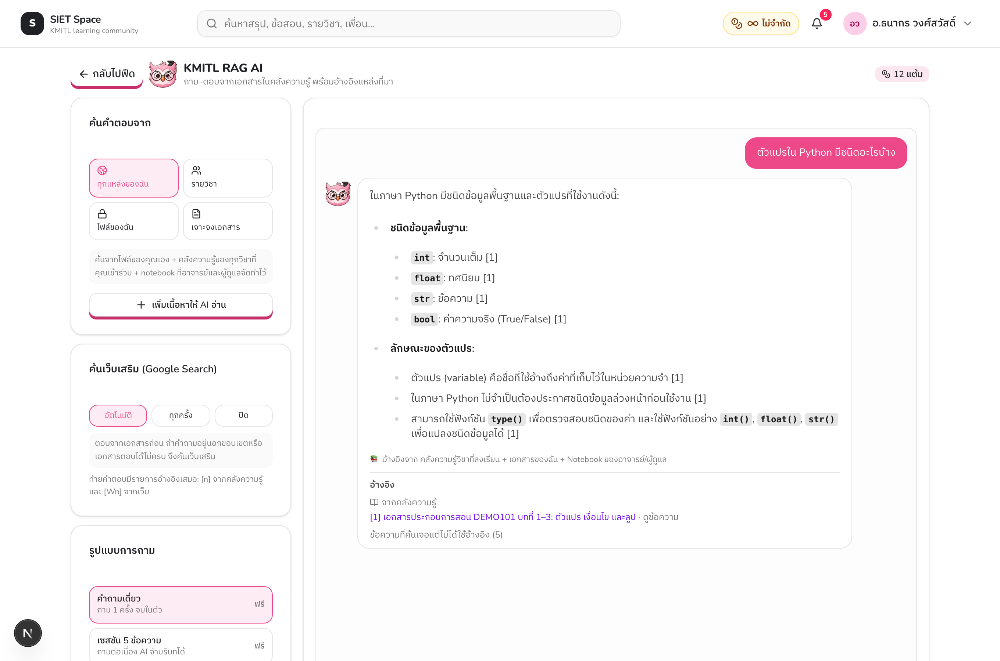
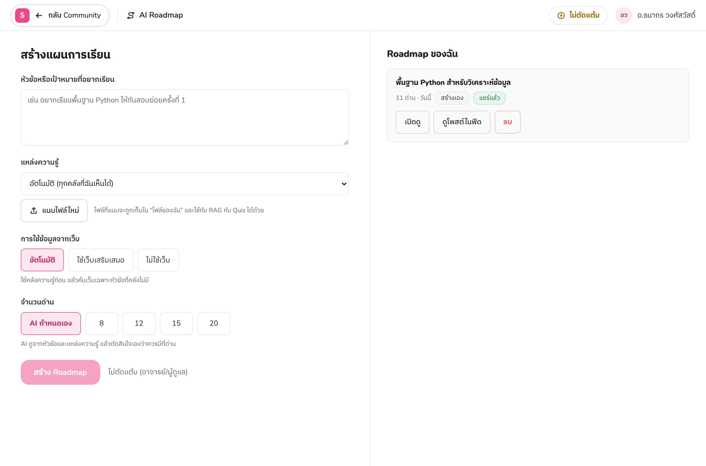
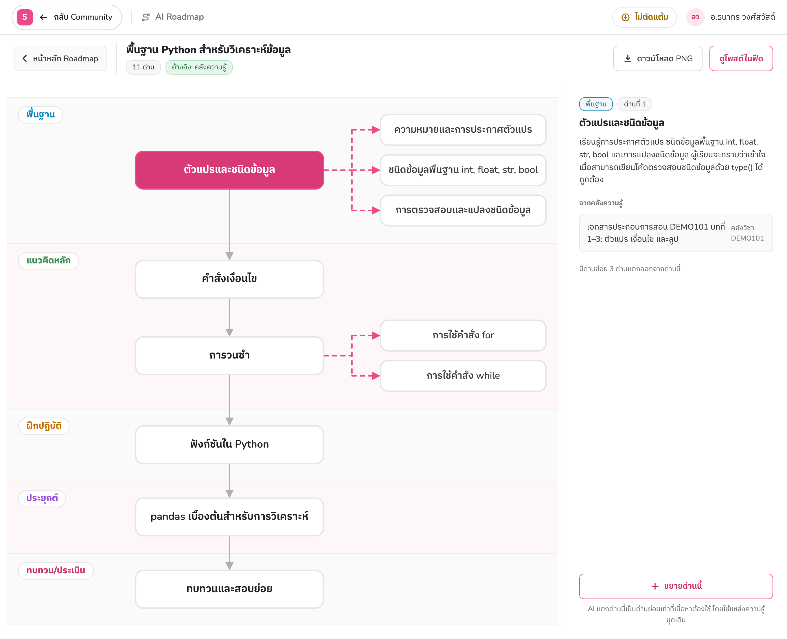

# 4.5 การพัฒนาระบบปัญญาประดิษฐ์ (Premium AI Features)

ระบบปัญญาประดิษฐ์ของ LSP-SIET ประกอบด้วย KMITL RAG AI (ถาม–ตอบจากคลังเอกสารพร้อมอ้างอิง) และ AI Roadmap (สร้างเส้นทางการเรียนรู้จากคลังความรู้และเว็บ) ซึ่งเชื่อมต่อและใช้งานได้ครบตั้งแต่ก่อนหน้านี้ หัวข้อนี้จึงเน้น **ความทนทานภายใต้ผู้ใช้จริง** และการปรับหน้าจอให้เป็นไปตามระบบออกแบบ SIET Pink (`DESIGN.md`) โดยไม่เพิ่มความสามารถใหม่ ข้อมูลอ้างอิงจากซอร์สโค้ดบนสาขา `refactor/course-repo` และตรวจสอบบนระบบที่รันอยู่เมื่อวันที่ 22 ตุลาคม 2569

## 4.5.1 เชื่อมต่อและพัฒนาระบบผู้ช่วยอัจฉริยะ (KMITL RAG AI) สำหรับค้นหาความรู้จากเอกสาร

### 1) สถาปัตยกรรมที่มีอยู่ (สรุป)

`POST /community/ask` รับคำถามพร้อมขอบเขต (`auto` / `course` / `personal` / `document` / `notebook`) → แปลงขอบเขตเป็นรายการ notebook ที่ผู้ใช้อ่านได้ (หัวข้อ 4.3.4) → ค้นหาชิ้นข้อความด้วย cosine similarity บน `source_embedding` ใน SurrealDB (หัวข้อ 4.1.3) → เสริมด้วยการค้นเว็บเมื่อเอกสารไม่ครอบคลุม → สังเคราะห์คำตอบพร้อมรายการอ้างอิง `[n]` / `[Wn]` → หักแต้ม (คำถามเดี่ยว 1 แต้ม, เซสชัน 5 ข้อความ 4 แต้ม; อาจารย์/ผู้ดูแลไม่ถูกหัก) → บันทึกประวัติ (`rag_conversations`, `rag_messages`) มีแคชคำตอบ การรวมคำขอซ้ำที่มาพร้อมกัน และการจำกัดความถี่ (3 วินาที / 8 ต่อนาที / 60 ต่อชั่วโมง / 300 ต่อวัน)

### 2) ช่องโหว่ที่พบและการแก้ไข

**ตารางที่ 4.38** การเสริมความทนทานของ KMITL RAG AI

| ประเด็น | ปัญหาเดิม | การแก้ไข | ไฟล์ |
|---|---|---|---|
| โควตาข้อความของเซสชัน | ตรวจ `credits_left` ด้วยการอ่านตอนต้น แล้วเขียนค่าลดลงตอนจบ (read-then-write) คำถามที่ส่งพร้อมกันจึงผ่านการตรวจทั้งหมดและใช้เกินโควตาได้ | **จองเครดิตแบบอะตอมมิก** ก่อนเรียกโมเดล: `UPDATE rag_credit_sessions SET credits_left = credits_left - 1 WHERE id = :id AND user_id = :uid AND credits_left > 0` ถ้าไม่มีแถวถูกแก้ → ตอบ 402 ทันที; เมื่อคำตอบล้มเหลวหรือถูก throttle คืนเครดิต (`release_rag_credit`); ข้อความของเซสชันบันทึกแยก (`save_rag_messages`) | `repository.py`, `community.py` |
| ข้อความข้อผิดพลาด | `except Exception` ส่ง `str(exc)` ให้ client ใน 4 เส้นทาง (ask, quiz, roadmap, expand) ซึ่งอาจมีข้อความจากผู้ให้บริการโมเดล path ของไฟล์ หรือ SQL | `_internal_error(exc, what)` บันทึก traceback พร้อมรหัสอ้างอิง 8 ตัว แล้วตอบ 500 ด้วยข้อความภาษาไทยและรหัสนั้น; มีการทดสอบว่าไม่เหลือ `detail=str(exc)` กับรหัส 500 ในโมดูล | `community.py` |
| ข้อมูลตกค้างเมื่อลบบัญชี | `admin_delete_user` ไม่ลบ `rag_conversations`/`rag_messages`, `saved_collections`, รายงานที่ยื่น และลบแถว `library_documents` โดยทิ้งไฟล์ Source embeddings และ notebook ส่วนตัวใน SurrealDB ไว้ | `library.purge_user_library`: เอกสารส่วนตัวลบพร้อมไฟล์/Source/embeddings; เอกสารของห้องโอนให้ผู้สอนของห้อง (ลบเฉพาะเมื่อห้องไม่มีเจ้าของ); ลบ notebook ส่วนตัวพร้อม source ที่ใช้เฉพาะ จากนั้น `admin_delete_user` ลบประวัติแชท คอลเลกชัน และรายงานที่ยื่น ใช้ทั้งการลบเดี่ยวและหลายบัญชี | `library.py`, `user.py`, `admin.py` |

### 3) ธีมตามระบบออกแบบ SIET Pink

หน้า `/community/ask` ใช้ class `theme-adventure` ซึ่งนิยามใน `globals.css` จากค่าใน `DESIGN.md` (สีหลัก `#ED4988`, hover `#D83A78`, pressed `#C92F6B`, พื้นอ่อน `#FCE7F0`, ตัวอักษร `#202124`, เส้นขอบ `#E5E5E5`, สีสถานะ info/success/error/streak/xp/reward) โดย map ลงตัวแปร semantic ชุดเดิมของแอป (`--primary`, `--accent`, `--ai` …) คอมโพเนนต์ shadcn และแผงของชุมชนจึงรับธีมโดยไม่ต้องแก้ ฟอนต์ใช้ Nunito (โหลดผ่าน `next/font`) สำหรับอักษรละตินและตัวเลข และตกไปที่ IBM Plex Sans Thai สำหรับอักษรไทย หัวข้อหนา 800 ปุ่มหลักมีขอบล่าง 4 px ตามสเปก และคงเป็นธีมสว่างเสมอ (DESIGN.md ไม่มีโหมดมืด): hook `useForcedLightTheme()` ถอด class `dark` ของทั้งแอปออกตลอดเวลาที่หน้านี้เปิดอยู่และคืนค่าเมื่อออกจากหน้า เพราะเมื่อผู้ใช้เปิดโหมดมืดไว้ คอมโพเนนต์ที่ใช้ร่วมกับหน้าชุมชน (แถบหัว, ตัวแสดง Markdown, แผงประวัติ) จะใช้สีตัวอักษรของโหมดมืดบนพื้นขาวของธีมนี้จนอ่านไม่ออก (พบจากการใช้งานจริง) สีที่เคยฝังในโค้ด (violet/sky) ถูกแทนด้วย `primary` ในหน้านี้ และ map ผ่าน CSS สำหรับแผงที่ใช้ร่วมกัน

### 4) การทดสอบ

ชุดทดสอบ `tests/test_rag_hardening.py` จำนวน 6 กรณี (การจองเครดิตเป็น UPDATE เดียวที่มีเงื่อนไข, การคืนเครดิตและการบันทึกข้อความแยกจากกัน, ข้อความ 500 ไม่มีข้อมูลภายในแต่มีรหัสอ้างอิง, ไม่มี `detail=str(exc)` เหลือในโมดูล, การลบบัญชีลบประวัติแชท/คอลเลกชัน/รายงาน, การโอน/ลบเอกสารและ notebook) รวมกับชุดทดสอบเดิมของ RAG (answer cache, policy) ผ่านทั้งหมด 160 กรณี และตรวจบนระบบจริง: ยิง 6 คำถามพร้อมกันบนเซสชันที่เหลือ 4 เครดิต ได้คำตอบไม่เกิน 4 และถูกปฏิเสธด้วย 402 ส่วนที่เหลือ; สร้างบัญชีชั่วคราว อัปโหลดเอกสาร ถาม 1 ครั้ง ยื่นรายงาน แล้วลบบัญชี พบว่าข้อมูลทุกส่วนถูกล้าง

การตรวจบนระบบจริงยังแสดงเส้นทาง "คืนเครดิต" ด้วย: ในการเดินเซสชัน 5 ข้อความ ข้อความหนึ่งล้มเหลวจากผู้ให้บริการโมเดล (502) เครดิตของข้อความนั้นถูกคืน ทำให้ตัวนับเดินต่อ 3 → (ล้มเหลว, คืน) → 2 → 1 → 0 ครบ 5 คำตอบตามที่ซื้อ ส่วนการยิงพร้อมกันจากบัญชีเดียวถูกกันไว้ก่อนด้วยช่วงพัก 3 วินาทีต่อคำถาม (429) การจองแบบอะตอมมิกจึงเป็นชั้นป้องกันที่สองสำหรับกรณีที่ช่วงพักไม่ครอบคลุม (เช่น staff ที่ได้โควตา ×4)

**รูปที่ 4.15** หน้า KMITL RAG AI (`/community/ask`) ในธีม SIET Pink: สีหลักชมพู `#ED4988` ฟอนต์ Nunito สำหรับอักษรละติน หัวข้อน้ำหนัก 800 ปุ่มหลักมีขอบล่าง และน้องฮูกประจำหน้า

## 4.5.2 เชื่อมต่อและพัฒนาระบบ AI Roadmap Generator เพื่อสร้างเส้นทางการเรียนรู้

### 1) สถาปัตยกรรมที่มีอยู่ (สรุป)

แอป AI Roadmap เป็นแอป Next.js แยก (`ai-roadmap-generator/`) เสิร์ฟที่ `/roadmap` และเรียก API ของ SIET Space ผ่านเซิร์ฟเวอร์ของตัวเอง (`/roadmap/api/ws/*`) โดยรับ JWT จากหน้า Community ผ่านพารามิเตอร์ `token` แล้วเก็บใน localStorage ทันที (ไม่ค้างใน address bar) `POST /community/study/roadmap` สร้างแผนจากคลังความรู้ที่ผู้ใช้อ่านได้ (ขอบเขตเดียวกับ KMITL RAG AI) เสริมด้วยเว็บเมื่อคลังไม่ครอบคลุม ได้ด่านหลัก 5 ช่วง (พื้นฐาน / แนวคิดหลัก / ฝึกปฏิบัติ / ประยุกต์ / ทบทวน-ประเมิน) `POST /community/roadmaps/mine/{id}/expand` แตกด่านเป็นด่านย่อยได้ 2 ชั้น (สูงสุด 200 ด่าน) และการแชร์แผนลงฟีดคือการสร้างโพสต์ชนิด `roadmap` ซึ่งเก็บ **สำเนา** ของ nodes ไว้ที่ `posts.linked_snapshot` ผู้อ่านจึงเห็นแผนได้แม้เจ้าของไม่ออนไลน์

### 2) ช่องโหว่ที่พบและการแก้ไข

**ตารางที่ 4.39** การเสริมความทนทานของ AI Roadmap

| ประเด็น | ปัญหาเดิม | การแก้ไข | ไฟล์ |
|---|---|---|---|
| โพสต์ล้าหลังแผน | เมื่อเจ้าของขยายด่าน สำเนาในโพสต์ยังเป็นรุ่นเก่า ต้องกดปุ่ม "อัปเดตโพสต์ในฟีด" เอง (`POST /posts/{id}/roadmap/sync`) ในการใช้งานจริงผู้ใช้ไม่กด ผู้อ่านในฟีดจึงเห็นแผนที่ไม่ครบ | `expand` เขียนสำเนาใหม่ลงโพสต์ที่แชร์ไว้ทันทีหลังบันทึกด่านย่อย (`repo.update_post_snapshot`) และตอบ `synced_post_id` ให้แอปแจ้งผู้ใช้ว่าโพสต์ถูกอัปเดตแล้ว ปุ่ม sync ยังคงอยู่สำหรับกรณีอื่น | `community.py`, `[id].jsx` |
| ความคงอยู่ของโพสต์เมื่อลบแผน | ต้องยืนยันว่าการลบแผน (โดยเจ้าของหรือผู้ดูแลผ่าน `DELETE /admin/roadmaps/{id}`) ไม่ทำให้โพสต์ในฟีดพัง | ตรวจบนระบบจริงแล้วว่าโพสต์ยังอ่านได้ครบจากสำเนาของตัวเอง และการลบของผู้ดูแลถูกบันทึกใน `admin_audit_log` (`roadmap.delete`) ไม่ต้องแก้โค้ด | — |
| ธีมไม่เข้ากับระบบ | แอปใช้ธีมมืดของตัวเอง (พื้น `#0C0C0C` สีหลักน้ำเงิน `#2B6FDE` ฟอนต์ IBM Plex Sans Thai) ต่างจาก SIET Space ทั้งหมด ทำให้ผู้ใช้รู้สึกว่าเป็นคนละระบบ และ PNG ที่ดาวน์โหลดเป็นพื้นดำ | เขียนชุดตัวแปรสีใหม่ตาม `DESIGN.md` (ตารางที่ 4.40) ฟอนต์ Nunito → IBM Plex Sans Thai หัวข้อหนา 800 ปุ่มหลักขอบล่าง 4 px ยุบเมื่อกด ด่านที่เลือกเป็นชมพูทึบ เส้นแตกด่านเป็นเส้นประชมพู ป้ายชื่อเลนเป็นชิป และ PNG เป็นพื้นขาว; จากการทดลองใช้พบว่ากราฟเล็กเกินไปเมื่อเทียบกับพื้นที่ว่าง จึงขยายกล่องด่าน (หลัก 272×56 px ย่อย 240×46 px) และให้กราฟขยายอัตโนมัติจนเต็มความกว้างของพื้นที่ (1–1.6 เท่า) โดยคงรูป PNG ที่ส่งออกไว้ที่ขนาด 1:1 | `app.css`, `roadmap-layout.js`, `RoadmapGraph.jsx`, `_document.js`, `[id].jsx` |

**ตารางที่ 4.40** การ map สีของแอป Roadmap จากธีมมืดเดิมไปยัง SIET Pink

| บทบาท | เดิม (มืด) | ใหม่ (SIET Pink) |
|---|---|---|
| พื้นหลัง / การ์ด / ช่องกรอก | `#0C0C0C` / `#161616` / `#141414` | `#FFFFFF` / `#FAFAFA` / `#FFFFFF` |
| เส้นขอบ | `#2A2A2A`, `#4A4A4A` | `#E5E5E5`, `#CFCFCF` |
| ตัวอักษร หลัก / รอง / จาง | `#E6E6E6` / `#F4F4F4` / `#A8A8A8` | `#3C3C3C` / `#202124` / `#777777` |
| สีหลัก / hover / pressed / พื้นอ่อน | `#2B6FDE` / `#3A7DF0` / — / `#152238` | `#ED4988` / `#D83A78` / `#C92F6B` / `#FCE7F0` |
| ลิงก์และโฟกัส | `#8FBCFF` | `#1CB0F6` |
| สถานะ สำเร็จ / ผิดพลาด / รางวัล / แต้ม | เขียว `#8FDDBB`, แดง `#F2A3AF`, ม่วง `#C9B4FF`, ทอง `#F1D58A` | `#2F7A4A`, `#FF4B4B`, `#7A3FD1`, `#9A6B00` (เฉดเข้มของ `#58A66A` `#FF4B4B` `#CE82FF` `#FFC800` เพื่อให้อ่านบนพื้นขาว) |
| เลน (สลับ) / ป้ายชื่อเลน 5 ช่วง | `#101010` / `#0D0D0D`; พาสเทล `#6EA8FF` `#46C7B2` `#E9B949` `#F0925A` `#B79CFF` | `#FAFAFA` / `#FDF7F9`; `#1686BD` `#3E8A50` `#C66F00` `#9A4FE0` `#C92F6B` |
| ด่าน / ด่านที่เลือก / เส้นเชื่อม | `#1B1B1B` ขอบ `#3A3A3A` / พื้นน้ำเงินเข้ม / เทา `#8C96A8` | ขาวขอบ `#E5E5E5` / `#ED4988` ตัวอักษรขาว / เทา `#AFAFAF` ทึบ, ชมพูเส้นประสำหรับด่านย่อย |

### 3) การทดสอบ

ชุดทดสอบ `tests/test_roadmap_sync.py` ยืนยันว่าเมื่อแผนถูกแชร์แล้ว `expand` เรียก `update_post_snapshot` ด้วยรหัสโพสต์และสำเนาล่าสุดหนึ่งครั้ง และตอบ `synced_post_id` ส่วนแผนที่ยังไม่แชร์ไม่แตะโพสต์ใด (2 กรณี) รวมกับชุดทดสอบของหัวข้อ 4.3 และ 4.5.1 ผ่านทั้งหมด 113 กรณี การตรวจบนระบบจริง (22 ตุลาคม 2569) ผ่าน 14 ข้อ: สร้างแผน 8 ด่านจากเอกสารวิชา DEMO101 แชร์ลงฟีด ขยายด่านแรกได้ด่านย่อย 3 ด่าน โพสต์ในฟีดเปลี่ยนจาก 8 เป็น 11 ด่านทันทีโดยไม่ต้องกดอัปเดต และนักศึกษาอ่านโพสต์เห็น 11 ด่าน; สร้างแผนที่สอง แชร์ แล้วให้ผู้ดูแลลบแผน พบว่าแผนหายจากเจ้าของ (404) แต่โพสต์ยังแสดงสำเนาครบ และบันทึกผู้ดูแลมีรายการ `roadmap.delete`

**รูปที่ 4.16** หน้าแรกของแอป AI Roadmap (`/roadmap`) ในธีม SIET Pink: ฟอร์มสร้างแผน (หัวข้อ แหล่งความรู้ การใช้เว็บ จำนวนด่าน) และรายการแผนของฉันพร้อมสถานะ "แชร์แล้ว"

**รูปที่ 4.17** แผน "พื้นฐาน Python สำหรับวิเคราะห์ข้อมูล" หลังขยายด่านแรก: 5 เลนตามช่วงการเรียน ด่านที่เลือกเป็นชมพูทึบ ด่านย่อยเชื่อมด้วยเส้นประชมพู แผงขวาแสดงเอกสารอ้างอิงจากคลังความรู้ และปุ่ม "ขยายด่านนี้"
