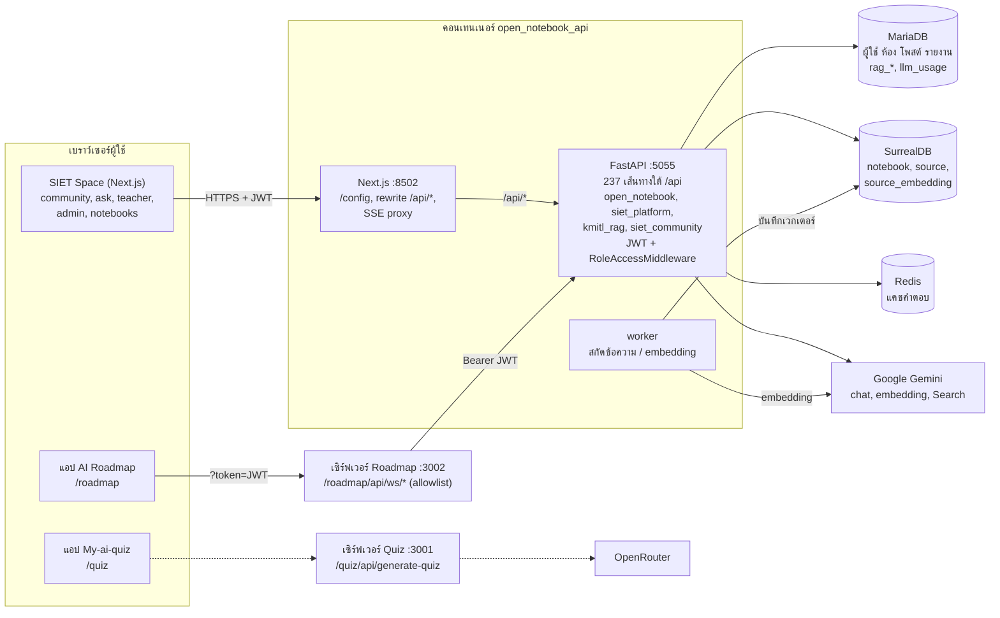
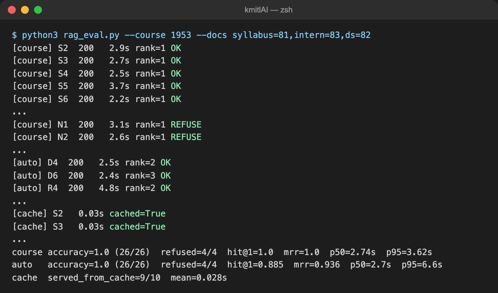

# 4.6 การบูรณาการระบบและการทดสอบเบื้องต้น

หัวข้อนี้รวมผลงานของสมาชิกทุกคนเข้าเป็นระบบเดียวบนสาขา `staging` แล้วทดสอบใน 3 ระดับ ได้แก่ (1) การเชื่อมต่อระหว่างส่วนหน้าและส่วนหลังของทุกโมดูล (4.6.1) (2) การทดสอบระดับหน่วยของโค้ด (4.6.2) และ (3) ประสิทธิผลและความแม่นยำของโมเดล AI ที่ระบบใช้ (4.6.3) โค้ดที่ทดสอบคือสาขา `staging` ที่ commit `ebaf162` (ตรงกับสาขา `refactor/course-repo` ที่ `9289f23` ซึ่งต่างกันเฉพาะไฟล์เอกสาร) ทดสอบเมื่อวันที่ 23 ตุลาคม 2569 บนสภาพแวดล้อมทดสอบที่แยกจากระบบใช้งานจริง (ตารางที่ 4.46) การทดสอบทุกส่วนไม่เขียนข้อมูลลงฐานข้อมูลของระบบใช้งานจริง ตัวเลขทุกค่าในหัวข้อนี้มาจากผลการรันจริงซึ่งเก็บไว้ใน `docs/report/eval/results/` และรันซ้ำได้ด้วยสคริปต์ใน `docs/report/eval/`

**ตารางที่ 4.46** สภาพแวดล้อมที่ใช้ทดสอบ

| องค์ประกอบ | รายละเอียด |
|---|---|
| โค้ดที่ทดสอบ | สาขา `staging` commit `ebaf162` (หลังรวม PR #1–#8, สาขา `refactor/community`, `refactor/siet-split` และ Open Notebook v1.15.0) |
| อิมเมจ | `kmitlai/open-notebook:local` สร้างจาก `staging` เมื่อ 23 ต.ค. 2569 (อิมเมจเดียวกับที่ใช้งานจริง) และอิมเมจของแอป AI Roadmap และ My-ai-quiz |
| คอนเทนเนอร์ทดสอบ | `siet46-app` (API พอร์ต 25055, เว็บพอร์ต 28502), `siet46-roadmap` (พอร์ต 23002), `siet46-quiz` (พอร์ต 23001) |
| ฐานข้อมูล | ชุดทดสอบ `siettest-mariadb`, `siettest-surreal`, `siettest-redis` ซึ่งเป็นสำเนาข้อมูลที่แยกจากระบบใช้งานจริง |
| โมเดล AI | สนทนา: Google `gemini-3.5-flash-lite`; Embedding: Google `gemini-embedding-001` (3072 มิติ); ค้นเว็บ: Google Search grounding ของ Gemini |
| บัญชีทดสอบ | `it46.admin`, `it46.teacher`, `it46.student1`–`it46.student3` และบัญชี Google จำลอง (`GOOGLE_OAUTH_MOCK=1`) |
| ข้อมูลทดสอบ | ห้องวิชา `IT46-201` (room 1953) พร้อมเอกสาร 3 ฉบับ (ตารางที่ 4.58) |
| เครื่องมือ | Python 3.12 + pytest 9.0.3, Python 3.14 + requests, Node.js 26 + Vitest 4.1.9, TypeScript 5.8.3, Playwright (Chrome for Testing) |
| เครื่อง | macOS (Apple Silicon) + Docker (OrbStack) |

## 4.6.1 เชื่อมต่อระบบหน้าบ้าน (Frontend) เข้ากับหลังบ้าน (Backend API) ครบทุกโมดูล

### 1) การรวมโค้ดของสมาชิกเข้าสาขา staging

สมาชิกแต่ละคนพัฒนาบนสาขาของตนเองแล้วเปิด Pull Request (PR) เข้าสาขา `staging` คำอธิบาย PR ทุกฉบับใช้แม่แบบเดียวกัน ประกอบด้วยสิ่งที่ทำ ผู้รับผิดชอบ การเปลี่ยนแปลงฐานข้อมูล/env วิธีทดสอบ และบล็อก `merge-ownership` ที่ระบุว่าสาขานั้นเป็นเจ้าของไฟล์หรือพื้นที่ใด (`owns`) ยอมให้สาขาใดเป็นหลัก (`defers-to`) และไฟล์ที่ใช้ร่วมกัน (`shared`) ก่อนรวมแต่ละครั้งจำลองการรวมด้วย `git merge-tree` เพื่อหาไฟล์ที่ชนกันล่วงหน้า แล้วรวมตามลำดับในตารางที่ 4.47 โดยตัดสินจุดที่ชนตามบล็อก `merge-ownership`

**ตารางที่ 4.47** ลำดับการรวมโค้ดเข้าสาขา staging

| ลำดับ | PR / สาขา | ผู้พัฒนา | เนื้อหา | ผลการรวม |
|---|---|---|---|---|
| 1 | #1 `refactor/course-repo` | phuwishpk | คลังข้อมูลและรายวิชา (4.3), เสริมความทนทานของ AI (4.5) | รวมได้ทันที |
| 2 | #3 `feat/auth-rbac-logs` | Tanabordi | Google OAuth, RBAC 4 ระดับ, หน้า pending | ชนที่ `domain/user.py` (ทั้งสองฝั่งเพิ่มฟังก์ชันท้ายไฟล์) แก้โดยเก็บทั้งสองฝั่ง และพบว่าคำสั่งสร้างคอลัมน์ `users.google_sub` ใน `schema.py` ถูกลบไปโดยไม่ตั้งใจ (ฐานข้อมูลใหม่จะเริ่มระบบไม่ได้) จึงแก้เพิ่มใน `9777788` |
| 3 | #2 `feat/quiz-ai` | SpriteUm | หน้าเล่นแบบทดสอบคนเดียวของ My-ai-quiz | รวมได้ทันที |
| 4 | #4 `dev-poh` | pornprompoh | ออกแบบหน้า Community ใหม่ หน้าโปรไฟล์ | รวมได้ทันที |
| 5 | `refactor/siet-split` | phuwishpk | แยกโค้ด KMITL ออกจาก Open Notebook เป็นแพ็กเกจ `siet-platform`, `kmitl-rag`, `community` | `a108090` |
| 6 | `chore/upstream-v1.15.0` | phuwishpk | ปรับฐาน Open Notebook เป็นรุ่น v1.15.0 | `dc064a7` |
| 7 | `refactor/community` | SpriteUm | ปรับสไตล์คอมโพเนนต์ Community | ชน 4 ไฟล์กับ #4 คงฉบับที่อยู่ใน staging ไว้ก่อนและบันทึกฉบับของอีกฝั่งในคอมเมนต์ `MERGE-OWNER` รอเจ้าของตัดสิน (`1a784b1`) |
| 8 | #7, #6, #8 | phuwishpk, pornprompoh, Tanabordi | ธีม light/dark ทุกแอป, แถบนำทาง, บันทึกประวัติระบบ ระดับการมองเห็น และการตรวจรายงาน | รวม 23 ต.ค. 2569 แล้วแก้การ build (`ebaf162`) |

### 2) สถาปัตยกรรมการเชื่อมต่อ

ระบบหลังรวมโค้ดมีส่วนหลังเป็น FastAPI กระบวนการเดียว (พอร์ต 5055) ซึ่งประกอบด้วยแกน Open Notebook และแพ็กเกจของ SIET 3 แพ็กเกจที่เสียบเข้ามาผ่านจุดต่อขยาย (`open_notebook/extensions.py`) เส้นทางทั้งหมดอยู่ใต้ `/api` จำนวน 237 เส้นทางที่เปิดใช้ (ปิด podcast 19 เส้นทางและ `GET /api/auth/status` เดิมของ Open Notebook ไว้โดยค่าเริ่มต้น) ส่วนหน้าเป็น Next.js ในคอนเทนเนอร์เดียวกัน (พอร์ต 8502) โดยหน้าจอของ SIET อยู่ในแพ็กเกจ `@siet/platform`, `@siet/kmitl-rag`, `@siet/community` เบราว์เซอร์อ่านที่อยู่ API จาก `/config` เรียก API ผ่าน axios ที่แนบ `Authorization: Bearer <JWT>` จาก `localStorage` (`auth-storage`) และ Next.js ส่งต่อ `/api/*` ไปยัง FastAPI (`INTERNAL_API_URL`) ส่วนคำตอบแบบสตรีม (SSE) ผ่าน route handler ที่ส่งต่อ header การยืนยันตัวตน ฝั่ง FastAPI ตรวจ JWT ใน `WorkspaceAuthBackend` แล้วตรวจสิทธิ์ตามบทบาทใน `RoleAccessMiddleware` (นักศึกษาใช้ `/api/community/*`, `/api/features/*`; อาจารย์ใช้ notebook/source/search เพิ่ม; ผู้ดูแลใช้ `/api/admin/*`, models, credentials) แอป AI Roadmap รับ JWT ทาง `?token=` แล้วเรียก API ผ่านเซิร์ฟเวอร์ของตัวเอง (`/roadmap/api/ws/*`) ซึ่งอนุญาตเฉพาะ `community/*` และ `users/me` ส่วนแอป My-ai-quiz สร้างข้อสอบโดยเรียก OpenRouter โดยตรง ไม่ได้ผ่าน API ของระบบ (รูปที่ 4.18)

**รูปที่ 4.18** แผนภาพการเชื่อมต่อระหว่างส่วนหน้า ส่วนหลัง ฐานข้อมูล และผู้ให้บริการโมเดล AI ของระบบหลังรวมโค้ด เส้นประคือส่วนที่ยังไม่เชื่อมกับ API ของระบบ

ซอร์ส Mermaid ของรูปที่ 4.18

### 3) โมดูลของระบบและการเชื่อมต่อ

ตารางที่ 4.48 สรุปทุกโมดูลของระบบ หน้าจอที่ผู้ใช้เปิด ไฟล์ฝั่งหน้าที่เรียก API และ router ฝั่งหลังที่รับคำขอ ได้จากการไล่ซอร์สโค้ดของทั้งสองฝั่ง ร่วมกับผลการตรวจในหัวข้อย่อยที่ 4–6

**ตารางที่ 4.48** โมดูลของระบบ หน้าจอ และ API ที่เชื่อมต่อ

| โมดูล | หน้าจอ (เส้นทาง) | ฝั่งหน้า (ไฟล์เรียก API) | ฝั่งหลัง (router) | สถานะ |
|---|---|---|---|---|
| ยืนยันตัวตนและสิทธิ์ | `/login`, `/auth/google/callback`, `/pending`, ตัวกันเส้นทางใน `(dashboard)/layout.tsx` | `@siet/platform` `lib/api/auth.ts`, `auth-store.ts` | `siet_platform/routers/users.py`, `google_auth.py` | เชื่อมครบ |
| Notebook, source, note | `/notebooks`, `/notebooks/[id]`, `/sources/[id]` | `lib/api/notebooks.ts`, `sources.ts`, `notes.ts`, `insights.ts` | `api/routers/notebooks.py`, `sources.py`, `notes.py`, `insights.py` | เชื่อมครบ |
| แชท notebook / source / แชทรวม | `/notebooks/[id]`, `/sources/[id]`, แท็บถามใน `/search` | `lib/api/chat.ts`, `source-chat.ts`, `@siet/kmitl-rag` `global-chat.ts` | `api/routers/chat.py`, `source_chat.py`, `kmitl_rag/routers/global_chat.py` | เชื่อมครบ |
| ค้นหาในพื้นที่ทำงาน | `/search` | `lib/api/search.ts` | `api/routers/search.py` | เชื่อมครบ |
| โมเดล ข้อมูลรับรอง ค่าตั้ง | `/settings`, `/settings/models`, `/advanced`, `/transformations` | `lib/api/models.ts`, `credentials.ts`, `settings.ts`, `transformations.ts` | `api/routers/models.py`, `credentials.py`, `settings.py`, `transformations.py` | อาจารย์เปิด `/search`, `/transformations` แล้วได้ 403 จาก `/api/models` (ตารางที่ 4.52) |
| Podcast | `/podcasts` | `lib/api/podcasts.ts` | `podcasts.py` ฯลฯ ปิดไว้ด้วย `SIET_ENABLE_PODCASTS` | ปิดใช้งานโดยตั้งใจ |
| ฟีดชุมชน โพสต์ ความคิดเห็น | `/community?view=…` | `@siet/platform` `lib/api/community.ts` | `siet_community/routers/community.py` | เชื่อมครบ |
| ห้องวิชาและหน้าผู้สอน | `/teacher`, `/teacher/courses/[id]` | `lib/api/community.ts`, `courses.ts` | `community.py` | เชื่อมครบ |
| คลังเอกสาร | `/community?view=library`, ปุ่มดาวน์โหลด | `lib/api/library.ts` | `community.py` (`/community/library*`) | เชื่อมครบ |
| ค้นหาขั้นสูง | `/community/search` | `lib/api/community-search.ts` | `community.py` (`/community/search`) | เชื่อมครบ |
| รายงานและการตรวจสอบ | ปุ่มรายงาน, `/teacher/courses/[id]`, `/admin/community`, แท็บบันทึกผู้ดูแล | `lib/api/moderation.ts`, `admin.ts` | `community.py`, `siet_community/routers/admin.py` | เชื่อมครบ |
| แต้มและการแจ้งเตือน | กระเป๋าแต้ม, เมนูแจ้งเตือน | `lib/api/community.ts` | `community.py` (`/community/me`, `/wallet`, `/notifications`) | เชื่อมครบ |
| โปรไฟล์ | `/community/profile/[userId]` | ใช้ `community/me` และ `community/posts` | ไม่มีเส้นทางแก้ไขโปรไฟล์ | การแก้ไขโปรไฟล์บันทึกเฉพาะในหน้า |
| KMITL RAG AI | `/community/ask`, AiQuickWidget, `/admin/rag` | `lib/api/community.ts` (`community/ask*`), `admin.ts` | `kmitl_rag/routers/ask.py`, `kmitl_rag/routers/admin.py` | เชื่อมครบ |
| AI Roadmap | แอป `/roadmap`, `/features`, โพสต์ชนิด roadmap, `/admin/roadmap` | แอป Roadmap `lib/api.js` → `/roadmap/api/ws/*`, `lib/api/features.ts` | `community.py` (`/community/study/roadmap`, `/roadmaps/mine*`), `siet_platform/routers/features.py` | เชื่อมครบ |
| AI Quiz | `/features`, โพสต์ชนิด quiz, `/admin/quiz` | `lib/api/features.ts`, `community.ts` | `community.py` (`/community/study/quiz`, `/posts/{id}/quiz/*`), `siet_community/routers/features.py` | เชื่อมครบ |
| แอป My-ai-quiz | `/quiz`, `/quiz/solo`, `/quiz/solo/play` | `app/api/generate-quiz/route.ts` → OpenRouter | ไม่ผ่าน API ของระบบ | ยังไม่เชื่อม (ตารางที่ 4.52) |
| คอนโซลผู้ดูแล | `/admin`, `/admin/community`, `/admin/rag`, `/admin/roadmap`, `/admin/quiz` | `lib/api/admin.ts`, `courses.ts` | `siet_platform/routers/admin.py`, `siet_community/routers/admin.py`, `kmitl_rag/routers/admin.py` | เชื่อมครบ |

### 4) การตรวจสัญญา API แบบอัตโนมัติ

สคริปต์ `api_contract.py` อ่านโค้ดฝั่งหน้าทั้งหมด (แอปหลังรวมแพ็กเกจ SIET แอป Roadmap และแอป Quiz) แล้วดึงทุกคำสั่งที่เรียก API ทั้งรูปแบบ `apiClient.get/post/…`, `fetch` และ `ws()` ของแอป Roadmap นำเมธอดและเส้นทางที่ได้ไปจับคู่กับเอกสาร OpenAPI ของระบบที่รันอยู่ (`/openapi.json`) ตัวแปรในเส้นทาง เช่น `${id}` จับคู่ได้เฉพาะกับพารามิเตอร์ของเส้นทาง ไม่จับคู่กับคำคงที่ ถ้าคำสั่งใดไม่มีเส้นทางรองรับ หมายความว่าหน้าจอเรียก API ที่ไม่มีอยู่จริง ถ้าเส้นทางใดไม่มีโค้ดเรียก หมายความว่าไม่มีหน้าจอใดใช้เส้นทางนั้น

ผลการตรวจ (รูปที่ 4.19): พบคำสั่งเรียก API 257 จุดในโค้ด คิดเป็นคำขอที่ไม่ซ้ำกัน 232 แบบ (แอปหลัก 228 แบบ แอป Roadmap 11 แบบ แอป Quiz 2 แบบ บางแบบซ้ำกันระหว่างแอป) จากเส้นทางที่เปิดใช้ 237 เส้นทาง มีโค้ดฝั่งหน้าเรียกใช้ 217 เส้นทาง (ร้อยละ 91.6) บางเส้นทางในจำนวนนี้ถูกเรียกจากคอมโพเนนต์หรือ hook ที่ยังไม่ได้วางในหน้าใด เช่น Leaderboard อีก 20 เส้นทางไม่มีโค้ดฝั่งหน้าเรียก ได้แก่ API คิวงานเบื้องหลัง 4 เส้นทาง, API ตั้งค่า Redis และแคชคำตอบ 10 เส้นทาง, `GET /api/auth/legacy-status`, `POST /api/sources/json`, `POST /api/insights/{id}/save-as-note`, `POST /api/search/ask/simple`, `POST /api/search/ask/notebooks` และ `POST /api/credentials/migrate-encryption` ทั้งหมดเป็นเส้นทางสำหรับผู้ดูแลระบบหรือสคริปต์ ไม่มีหน้าจอใดขาด API ส่วนคำสั่งเรียกที่ไม่มีเส้นทางรองรับมี 15 แบบ คือ API podcast 14 แบบที่ปิดไว้โดยตั้งใจ และ `GET /api/models/{id}` ใน `lib/api/models.ts` ซึ่งเป็นฟังก์ชันที่ไม่มีหน้าจอใดเรียกแล้ว

**ตารางที่ 4.49** ผลการตรวจสัญญา API แยกตามกลุ่มเส้นทาง

| กลุ่มเส้นทาง | เส้นทาง | หน้าจอเรียกใช้ | กลุ่มเส้นทาง | เส้นทาง | หน้าจอเรียกใช้ |
|---|---|---|---|---|---|
| `/api/admin` | 41 | 41 | `/api/insights` | 3 | 2 |
| `/api/auth` | 4 | 3 | `/api/languages` | 1 | 1 |
| `/api/capabilities` | 1 | 1 | `/api/models` | 13 | 13 |
| `/api/chat` | 16 | 16 | `/api/notebooks` | 8 | 8 |
| `/api/commands` | 5 | 1 | `/api/notes` | 5 | 5 |
| `/api/community` | 66 | 66 | `/api/providers` | 1 | 1 |
| `/api/config` | 11 | 1 | `/api/recently-viewed` | 1 | 1 |
| `/api/credentials` | 14 | 13 | `/api/search` | 4 | 2 |
| `/api/embed` | 1 | 1 | `/api/settings` | 2 | 2 |
| `/api/embeddings` | 2 | 2 | `/api/sources` | 17 | 16 |
| `/api/features` | 8 | 8 | `/api/transformations` | 8 | 8 |
| `/api/users` | 5 | 5 | **รวม** | **237** | **217** |

**รูปที่ 4.19** ผลการรัน `api_contract.py` กับระบบทดสอบ: จำนวนคำสั่งเรียก API เส้นทางที่ถูกใช้แยกตามกลุ่ม และคำสั่งเรียกที่ไม่มีเส้นทางรองรับ

### 5) การทดสอบการเชื่อมต่อตามสถานการณ์การใช้งาน

สคริปต์ `integration_test.py` เรียก API ตามลำดับเดียวกับที่หน้าจอเรียกจริง ครอบคลุมทุกโมดูลและทุกบทบาท (ไม่ได้เข้าสู่ระบบ นักศึกษา อาจารย์ ผู้ดูแล และบัญชีรออนุมัติ) แต่ละขั้นกำหนดรหัสสถานะที่คาดหวังไว้ล่วงหน้า กรณีที่ต้องถูกปฏิเสธก็ทดสอบด้วย เช่น นักศึกษาเปิดคอนโซลผู้ดูแลต้องได้ 403 สถานการณ์ที่ทดสอบครอบคลุมการทำงานต่อเนื่องข้ามโมดูล เช่น อาจารย์อัปโหลดเอกสาร แล้ววัดว่าระบบสกัดข้อความและสร้าง embedding เสร็จ จากนั้นนักศึกษาถาม KMITL RAG AI และคำตอบต้องมีรหัสตรวจสอบที่อยู่ในเอกสารนั้น อาจารย์สร้างแบบทดสอบจากคลังเอกสาร แชร์ลงฟีด นักศึกษาทำแบบทดสอบ และระบบตรวจคะแนนฝั่งเซิร์ฟเวอร์ได้ 3/3 อาจารย์สร้าง Roadmap แชร์ลงฟีด แล้วลบแผนเดิม และโพสต์ยังแสดงสำเนาแผนได้ ส่วน Google sign-in ทดสอบในโหมดจำลอง อีเมลรหัสนักศึกษาคณะ 03 ได้บทบาท student อีเมลคณะอื่นได้ pending ซึ่งเข้าชุมชนไม่ได้ (403) แต่ดูข้อมูลตนเองได้ และอีเมลนอกโดเมน `kmitl.ac.th` ถูกปฏิเสธ เมื่อจบการรัน สคริปต์ลบข้อมูลที่สร้างขึ้นทั้งหมด

ผลการทดสอบ (ตารางที่ 4.50, รูปที่ 4.20): ผ่าน 135 จาก 135 ขั้น ระหว่างพัฒนาสคริปต์พบว่าถ้าคำขอสร้างข้อมูลไม่คืน id ขั้นที่ต่อจากนั้นจะถูกข้ามไปโดยไม่รายงาน รุ่นสุดท้ายจึงนับกรณีนี้เป็นความล้มเหลว (`require()`) ขั้นของ AI ที่รันซ้ำภายในอายุแคช (คำตอบ RAG 600 วินาที, แบบทดสอบและ Roadmap 3,600 วินาที) จะได้คำตอบจากแคช เวลาในตารางนี้จึงใช้เป็นตัวชี้วัดประสิทธิภาพของ AI ไม่ได้ ประสิทธิภาพของ AI วัดแยกไว้ในหัวข้อ 4.6.3

**ตารางที่ 4.50** ผลการทดสอบการเชื่อมต่อตามสถานการณ์ แยกตามโมดูล

| โมดูล | ขั้น | ผ่าน | เวลามัธยฐาน (ms) | เวลาสูงสุด (ms) | สถานการณ์หลัก |
|---|---|---|---|---|---|
| ยืนยันตัวตน | 7 | 7 | 7.0 | 276.5 | สถานะสาธารณะ, รหัสผ่านผิด 401, ข้อมูลผู้ใช้ทุกบทบาท, ยินยอม PDPA |
| สิทธิ์ (RBAC) | 14 | 14 | 3.6 | 26.1 | ไม่มี token 401, นักศึกษา/อาจารย์เข้าคอนโซลผู้ดูแล 403, Google จำลอง 3 กรณี, บัญชี pending |
| ห้องวิชา | 15 | 15 | 5.9 | 14.0 | สร้างห้องพร้อมรหัสเข้าห้อง, รหัสผิด 403, ตั้ง TA, เก็บถาวร/คืน, หน้าผู้สอน |
| คลังเอกสาร | 8 | 8 | 6.5 | 269.0 | อัปโหลดและประมวลผลเสร็จ, ดาวน์โหลด PDF ทั้งแบบ header และ `?token=`, นักศึกษาอัปโหลดเข้าห้องไม่ได้ |
| ฟีดและโพสต์ | 15 | 15 | 9.0 | 47.7 | โพสต์, แก้ไขโดยเจ้าของ/ผู้อื่น 403, Helpful, ความคิดเห็นและการตอบกลับ, บันทึก, แชร์, โพสต์ส่วนตัว 404 |
| รายงานและการตรวจสอบ | 14 | 14 | 7.3 | 272.4 | รายงาน, รายงานซ้ำ 409, คิวของห้อง, ผู้สอนซ่อนโพสต์และบันทึกลง audit, ระงับบัญชีแล้วเข้าระบบไม่ได้ |
| ค้นหาขั้นสูง | 4 | 4 | 12.6 | 14.6 | posts, courses, documents, users |
| แต้มและการแจ้งเตือน | 4 | 4 | 11.0 | 15.1 | ยอดแต้ม ประวัติกระเป๋า การแจ้งเตือน |
| KMITL RAG AI | 4 | 4 | 6.4 | 23.6 | ถามจากคลังวิชา (คำตอบมีรหัส `INTEG-4627`), ประวัติ, ลบบทสนทนา |
| AI Quiz | 4 | 4 | 25.2 | 3,012.9 | สร้างจากคลังวิชา แชร์ลงฟีด นักศึกษาทำ และตรวจคะแนนที่เซิร์ฟเวอร์ |
| AI Roadmap | 7 | 7 | 31.9 | 513.9 | สร้าง, รายการ, แชร์, ลบแผนแล้วโพสต์ยังอยู่ |
| แอปภายนอก | 6 | 6 | 17.0 | 49.5 | หน้าแอป Roadmap, proxy อนุญาต/ปฏิเสธ (404), หน้าแอป Quiz, `/quiz/api/me` |
| Notebook (พื้นที่ทำงาน) | 11 | 11 | 79.4 | 1,229.6 | สร้าง notebook, source, note, ค้นหา, ลบ |
| คอนโซลผู้ดูแล | 22 | 22 | 8.7 | 58.6 | ภาพรวม ผู้ใช้ การใช้งาน AI สุขภาพระบบ หมวดหมู่ (สร้าง/แก้/ลบ) RAG Roadmap Quiz โมเดล |
| **รวม** | **135** | **135** | | | |

**รูปที่ 4.20** ส่วนหนึ่งของผลการรัน `integration_test.py`: แต่ละบรรทัดแสดงผล รหัสสถานะ เวลา โมดูล และสถานการณ์ บรรทัดสุดท้ายสรุปผลรวม 135/135

### 6) การทดสอบผ่านเบราว์เซอร์ (End-to-end)

สคริปต์ `docs/report/tools/e2e-4.6.mjs` ใช้ Playwright เปิดทุกหน้าจอหลักในบทบาทของผู้ใช้ทุกประเภท ใส่ JWT ใน `localStorage` แบบเดียวกับการเข้าสู่ระบบจริง แล้วบันทึกทุกคำขอ `/api/*` ที่หน้าจอส่งออกไปและทุกข้อผิดพลาดใน console หน้าจอผ่านเมื่อแสดงผลได้โดยไม่ถูกส่งกลับไป `/login` ไม่มีคำขอ API ใดได้รหัส 400 ขึ้นไป และไม่มีข้อผิดพลาด JavaScript ส่วนแถวที่ทดสอบตัวกันเส้นทางจะผ่านเมื่อผู้ใช้ถูกพาออกจากหน้าที่ไม่มีสิทธิ์

ผลการทดสอบ (ตารางที่ 4.51, รูปที่ 4.21): เปิดหน้าจอทั้งหมด 37 ครั้ง ผ่าน 35 ครั้ง หน้าจอส่งคำขอ API ทั้งหมด 437 ครั้ง ล้มเหลว 6 ครั้ง ทั้ง 6 ครั้งเป็นรหัส 403 ใน 2 หน้าของอาจารย์ ได้แก่ `/search` และ `/transformations` ซึ่งเรียก `GET /api/models` และ `GET /api/models/defaults` เพื่อแสดงตัวเลือกโมเดล แต่ `RoleAccessMiddleware` อนุญาต `/api/models` เฉพาะผู้ดูแล ตัวเลือกโมเดลจึงโหลดไม่ได้สำหรับอาจารย์ (ตารางที่ 4.52) ตัวกันเส้นทางทำงานถูกต้องทุกกรณี ผู้ที่ไม่ได้เข้าสู่ระบบถูกส่งไป `/login` นักศึกษาที่เปิด `/admin`, `/teacher`, `/notebooks` และอาจารย์ที่เปิด `/admin` ถูกส่งกลับไป `/community` ส่วนแอป My-ai-quiz ไม่ส่งคำขอ API ของระบบเลยตลอดการเปิดหน้า ยืนยันข้อค้นพบในตารางที่ 4.48 รูปที่ 4.22 แสดงตัวอย่างการทำงานต่อเนื่องที่ทดสอบผ่านเบราว์เซอร์

**ตารางที่ 4.51** ผลการทดสอบผ่านเบราว์เซอร์ แยกตามบทบาท

| บทบาท | หน้าจอที่เปิด | ผ่าน | คำขอ API | คำขอที่ล้มเหลว | ข้อผิดพลาด JS | เวลามัธยฐานถึงโหลดเสร็จ (ms) |
|---|---|---|---|---|---|---|
| ไม่ได้เข้าสู่ระบบ (รวมตัวกันเส้นทาง 1) | 2 | 2 | 6 | 0 | 0 | 2,367–2,555 |
| นักศึกษา (รวมแอป Quiz) | 13 | 13 | 124 | 0 | 0 | 2,420 |
| นักศึกษา – ตัวกันเส้นทาง | 3 | 3 | 30 | 0 | 0 | 2,463 |
| อาจารย์ (รวมแอป Roadmap) | 9 | 7 | 123 | 6 | 6 | 2,454 |
| อาจารย์ – ตัวกันเส้นทาง | 1 | 1 | 14 | 0 | 0 | 2,537 |
| ผู้ดูแล | 9 | 9 | 140 | 0 | 0 | 2,846 |
| **รวม** | **37** | **35** | **437** | **6** | **6** | |

**รูปที่ 4.21** ผลการรัน `e2e-4.6.mjs`: เวลาโหลด จำนวนคำขอ API คำขอที่ล้มเหลว และข้อผิดพลาด JavaScript ของแต่ละหน้าจอ หน้า `/search` และ `/transformations` ของอาจารย์ไม่ผ่านเพราะได้ 403 จาก `/api/models`

**รูปที่ 4.22** การทำงานต่อเนื่องที่ทดสอบผ่านเบราว์เซอร์: นักศึกษาเลือกขอบเขต "รายวิชา" IT46-201 แล้วถามเรื่องการส่งงานช้า คำตอบคำนวณได้ร้อยละ 80 พร้อมอ้างอิง `[2]` ไปยังประมวลรายวิชาที่อาจารย์อัปโหลด และแจ้งว่าไม่ตัดแต้มเพราะเป็นคำถามเดิมที่ตอบจากแคช

### 7) ข้อบกพร่องและส่วนที่ยังไม่เชื่อมต่อ

ตารางที่ 4.52 รวมข้อบกพร่องด้านการเชื่อมต่อที่พบจากการทดสอบทั้ง 3 วิธี และจากการไล่ซอร์สโค้ด พร้อมแนวทางแก้ ณ วันที่ทดสอบ ทุกรายการยังไม่ได้แก้ในโค้ด

**ตารางที่ 4.52** ข้อบกพร่องและส่วนที่ยังไม่เชื่อมต่อ

| # | ประเด็น | พบจาก | ผลกระทบ | แนวทางแก้ |
|---|---|---|---|---|
| 1 | หน้า `/search` และ `/transformations` ของอาจารย์เรียก `/api/models` ซึ่งอนุญาตเฉพาะผู้ดูแล | E2E (403 จำนวน 6 ครั้ง) | ตัวเลือกโมเดลว่าง และมีข้อผิดพลาดใน console | อนุญาต `GET /api/models*` แบบอ่านอย่างเดียวให้อาจารย์ หรือซ่อนตัวเลือกโมเดลเมื่อไม่ใช่ผู้ดูแล |
| 2 | My-ai-quiz สร้างข้อสอบโดยเรียก OpenRouter โดยตรง ไม่ผ่าน API ของระบบ และ deployment ไม่ได้ตั้งคีย์ไว้ | ตรวจสัญญา API, E2E, ทดสอบจริง 3/3 ครั้งได้ HTTP 500 | โหมดเล่นคนเดียวสร้างข้อสอบไม่ได้ ไม่หักแต้ม ไม่บันทึก และไม่ใช้คลังความรู้ | ให้ `/quiz/api/generate-quiz` เรียก `POST /api/community/study/quiz` ซึ่งทำงานได้แล้วด้วย Gemini + RAG (ตารางที่ 4.61) |
| 3 | My-ai-quiz ไม่อ่าน `?token=` ที่แอปหลังส่งมา (`getWorkspaceToken` ไม่ถูกเรียก) แถบบนใช้ผู้ใช้สำรองตายตัว (`test1`, 22 แต้ม) ประวัติ/XP เก็บใน `localStorage` และปุ่มห้องแข่งเป็นเพียง `alert()` | ไล่ซอร์สโค้ด | ข้อมูลของแอป Quiz ไม่เชื่อมกับบัญชีและแต้มของระบบ | อ่าน token แบบแอป Roadmap แล้วใช้ `/quiz/api/me` และ API ชุมชน |
| 4 | การแก้ไขโปรไฟล์บันทึกเฉพาะ state ของหน้า (ข้อความ "บันทึกการเปลี่ยนแปลงในหน้านี้แล้ว") และไม่มีเส้นทางแก้ไขโปรไฟล์ฝั่งหลัง | ไล่ซอร์สโค้ด | รีเฟรชแล้วข้อมูลหาย | เพิ่ม `PATCH /api/users/me` สำหรับชื่อ ประวัติ รูปภาพ |
| 5 | ตัวเลือกแชร์ "ลงวิชา" และ "ส่งส่วนตัว" ใน `SharePostModal` แสดงเพียงข้อความว่ายังไม่รองรับ | ไล่ซอร์สโค้ด | ผู้ใช้เลือกได้แต่ไม่เกิดผล | ซ่อนตัวเลือก หรือทำ API รองรับ |
| 6 | ฟังก์ชัน `GET /api/models/{id}` และ API podcast 14 รายการในฝั่งหน้า ไม่มีเส้นทางรองรับ (podcast ปิดไว้โดยตั้งใจ แต่หน้า `/podcasts` ยังเปิดได้) | ตรวจสัญญา API | โค้ดค้าง และหน้า podcast แสดงข้อผิดพลาด | ลบฟังก์ชันที่ไม่ใช้ และซ่อนเส้นทาง `/podcasts` เมื่อปิดฟีเจอร์ |
| 7 | ชื่อไฟล์ภาษาไทยในคลังเอกสาร สระและวรรณยุกต์ถูกแทนด้วย `_` เช่น `IT46-201-ประมวลรายว_ชา.pdf` | ทดสอบจริง | ชื่อเอกสารที่แสดงและที่ใช้อ้างอิงอ่านยาก | ให้ `safe_filename` คงอักขระไทย หรือเก็บชื่อที่แสดงแยกจากชื่อไฟล์ |

## 4.6.2 ทดสอบการทำงานระดับหน่วยย่อย (Unit Testing) เพื่อหาข้อผิดพลาดของโค้ด

### 1) เครื่องมือและขอบเขต

ส่วนหลังทดสอบด้วย pytest 9.0.3 ร่วมกับ pytest-asyncio และ pytest-cov ชุดทดสอบเรียก API ผ่าน FastAPI `TestClient` และแทนที่ฟังก์ชันที่ติดต่อฐานข้อมูลหรือโมเดลด้วย `AsyncMock` ผ่าน `monkeypatch` จึงไม่ต้องใช้ฐานข้อมูลจริง ชุดทดสอบอยู่ใน 4 โฟลเดอร์ตามแพ็กเกจ (`open-notebook/tests`, `siet-platform/tests`, `kmitl-rag/tests`, `community/tests`) รันด้วยคำสั่งเดียวกับ `make test-backend` ในสภาพแวดล้อมเสมือนที่สร้างจาก `uv.lock` (Python 3.12.13) ตั้ง `PYTHON_DOTENV_DISABLED=1` เพื่อไม่ให้โหลดค่าเชื่อมต่อจริงจาก `.env` และตรวจแล้วว่าเครื่องที่รันไม่มีพอร์ตฐานข้อมูลเปิดอยู่ ส่วนหน้าตรวจชนิดข้อมูลด้วย TypeScript (`tsc --noEmit`) ครอบคลุม 440 ไฟล์ของแอปหลังและแพ็กเกจ SIET แล้วทดสอบคอมโพเนนต์และ hook ด้วย Vitest 4.1.9 + Testing Library บน jsdom โดยบล็อกการเชื่อมต่อเครือข่ายไปยังพอร์ตของระบบไว้ตลอดการรัน (ไม่มีความพยายามเชื่อมต่อเกิดขึ้น)

### 2) ผลการทดสอบส่วนหลัง (Backend)

ทั้งหมด 97 ไฟล์ 1,367 กรณี ผ่าน 1,288 กรณี (ร้อยละ 94.2) ไม่ผ่าน 79 กรณี ไม่มีข้อผิดพลาดตอนโหลดชุดทดสอบ ใช้เวลารวม 22.74 วินาที (ตารางที่ 4.53, รูปที่ 4.23) แพ็กเกจ `siet-platform` และ `kmitl-rag` ผ่านทุกกรณี กรณีที่ไม่ผ่านเกือบทั้งหมดอยู่ในชุดทดสอบเดิมของ Open Notebook สาเหตุวิเคราะห์ไว้ในตารางที่ 4.56

**ตารางที่ 4.53** ผลการทดสอบระดับหน่วยของส่วนหลัง แยกตามแพ็กเกจ

| ชุดทดสอบ | ไฟล์ | กรณี | ผ่าน | ไม่ผ่าน | ร้อยละที่ผ่าน | เวลา (วินาที) |
|---|---|---|---|---|---|---|
| `open-notebook/tests` (แกน Open Notebook) | 67 | 987 | 909 | 78 | 92.1 | 8.37 |
| `siet-platform/tests` (ยืนยันตัวตน สิทธิ์ แคช การใช้งาน AI) | 12 | 168 | 168 | 0 | 100 | 1.84 |
| `kmitl-rag/tests` (KMITL RAG AI) | 8 | 77 | 77 | 0 | 100 | 0.05 |
| `community/tests` (ห้องวิชา คลัง ค้นหา รายงาน Roadmap) | 10 | 135 | 134 | 1 | 99.3 | 0.38 |
| **รวม** | **97** | **1,367** | **1,288** | **79** | **94.2** | **22.74** (รวมเวลาโหลดและวัดความครอบคลุม) |

**รูปที่ 4.23** ผลการรัน pytest ของส่วนหลังทั้ง 4 แพ็กเกจ: ความครอบคลุมรวม ตัวอย่างกรณีที่ไม่ผ่านจากแต่ละกลุ่มสาเหตุ และผลสรุป 79 failed, 1288 passed

### 3) ผลการทดสอบส่วนหน้า (Frontend)

การตรวจชนิดข้อมูลไม่พบข้อผิดพลาด (exit 0) Vitest รัน 44 ไฟล์ 219 กรณี ผ่าน 215 กรณี (ร้อยละ 98.2) ไม่ผ่าน 4 กรณี ใช้เวลา 12.01 วินาที (ตารางที่ 4.54, รูปที่ 4.24) แพ็กเกจ `@siet/community` ยังไม่มีชุดทดสอบของตนเอง แอป AI Roadmap และ My-ai-quiz ไม่มีสคริปต์ทดสอบหรือตรวจชนิดข้อมูล

**ตารางที่ 4.54** ผลการทดสอบระดับหน่วยของส่วนหน้า

| ชุดทดสอบ | ไฟล์ | กรณี | ผ่าน | ไม่ผ่าน |
|---|---|---|---|---|
| ตรวจชนิดข้อมูล TypeScript (440 ไฟล์) | – | – | ไม่มีข้อผิดพลาด | 0 |
| Vitest: `open-notebook/frontend` | 34 | 178 | 174 | 4 |
| Vitest: `@siet/platform` | 6 | 27 | 27 | 0 |
| Vitest: `@siet/kmitl-rag` | 4 | 14 | 14 | 0 |
| Vitest: `@siet/community` | 0 | – | – | – |
| **รวม Vitest** | **44** | **219** | **215** | **4** |

**รูปที่ 4.24** ผลการตรวจชนิดข้อมูลด้วย `tsc` และการรัน Vitest ของส่วนหน้า: ไฟล์ที่มีกรณีไม่ผ่าน 2 ไฟล์ และผลสรุป 4 failed, 215 passed

### 4) ความครอบคลุมของโค้ด (Code coverage)

ความครอบคลุมวัดระดับบรรทัด (line coverage) ส่วนหลังครอบคลุม 9,809 จาก 18,741 คำสั่ง (ร้อยละ 52.34) ส่วนหน้าวัดเฉพาะไฟล์ที่ชุดทดสอบโหลด 113 ไฟล์ใน `open-notebook/frontend/src` ครอบคลุมคำสั่งร้อยละ 35.72 แพ็กเกจ SIET ฝั่งหน้าอยู่นอก root ของ Vitest จึงไม่ถูกนับ ส่วนที่ครอบคลุมต่ำคือ router ขนาดใหญ่ของ community และ kmitl-rag ซึ่งการทดสอบระดับหน่วยตรวจเฉพาะเส้นทางสำคัญ ส่วนที่เหลือทดสอบแบบบูรณาการแล้วในหัวข้อ 4.6.1

**ตารางที่ 4.55** ความครอบคลุมของโค้ด

| แพ็กเกจ | ไฟล์ | คำสั่ง | ไม่ถูกเรียก | ครอบคลุม (ร้อยละ) |
|---|---|---|---|---|
| `open_notebook` | 45 | 4,228 | 1,521 | 64.0 |
| `api` | 33 | 4,542 | 2,262 | 50.2 |
| `commands` | 4 | 531 | 181 | 65.9 |
| `siet_platform` | 45 | 5,224 | 2,646 | 49.3 |
| `kmitl_rag` | 15 | 1,540 | 910 | 40.9 |
| `siet_community` | 10 | 2,676 | 1,412 | 47.2 |
| **รวมส่วนหลัง** | **152** | **18,741** | **8,932** | **52.34** |
| ส่วนหน้า (statements / branches / functions / lines) | 113 | 3,124 | 2,008 | 35.72 / 39.84 / 29.58 / 36.25 |

### 5) การวิเคราะห์กรณีที่ไม่ผ่าน

กรณีที่ไม่ผ่านทั้ง 83 กรณี (ส่วนหลัง 79 ส่วนหน้า 4) จัดกลุ่มตามสาเหตุจาก traceback ได้ 7 กลุ่ม (ตารางที่ 4.56) มีเพียงกลุ่ม D ที่เป็นข้อบกพร่องของโค้ดระบบจริง กลุ่มที่เหลือเกิดจากชุดทดสอบไม่ตรงกับการออกแบบปัจจุบัน หรือจากสภาพแวดล้อมที่ใช้รัน กลุ่ม E เป็นชุดทดสอบของหัวข้อ 4.3.5 ที่ลืมแทนที่ฟังก์ชันค้นผู้ช่วยสอน (`repo.member_role`) ทำให้ชุดทดสอบพยายามติดต่อ MariaDB จริง ซึ่งถ้ารันภายในคอนเทนเนอร์ของระบบจะอ่านฐานข้อมูลจริงได้ จึงแก้ในชุดทดสอบทันทีหลังพบ และรันไฟล์นั้นซ้ำผ่าน 10/10 กรณี (ผลรวมในตารางที่ 4.53 เป็นผลก่อนแก้)

**ตารางที่ 4.56** สาเหตุของกรณีที่ไม่ผ่าน

| กลุ่ม | จำนวน | สาเหตุ | ประเภท | การดำเนินการ |
|---|---|---|---|---|
| A | 64 | เส้นทาง notebook, note, source และ source chat ตรวจเจ้าของข้อมูล (`Depends(get_owner_id)`) ตามการแยกข้อมูลรายผู้ใช้ของระบบ แต่ชุดทดสอบเดิมของ Open Notebook ไม่ส่ง token จึงได้ 401 แทนผลที่คาด | ชุดทดสอบล้าสมัย | ปรับชุดทดสอบให้ยืนยันตัวตนก่อนเรียก |
| B | 12 | เส้นทาง podcast ถูกปิดโดยค่าเริ่มต้น (`SIET_ENABLE_PODCASTS`) จึงได้ 404 | ปิดฟีเจอร์โดยตั้งใจ | ข้ามชุดทดสอบเมื่อปิดฟีเจอร์ |
| C | 1 | การตรวจเจ้าของ session แชทเทียบ `owner_id` ของ `MagicMock` ซึ่งไม่ใช่ค่า "default" จึงได้ 404 ก่อนถึงส่วนที่ทดสอบ | fixture ของชุดทดสอบ | กำหนด `owner_id` ใน mock |
| D | 1 | `WorkspaceAuthBackend` เทียบรหัสผ่านสำรองแบบสตริง แต่ Starlette ถอดรหัส header แบบ latin-1 รหัสผ่านที่มีอักษรนอก ASCII (เช่น ภาษาไทย) จึงไม่ผ่าน (แกนเดิมเทียบเป็น bytes) | **ข้อบกพร่องของระบบ** | เทียบ `credentials.encode("latin-1")` กับ `password.encode("utf-8")` แบบแกนเดิม |
| E | 1 | ชุดทดสอบ `test_room_owner_settles_reports_in_own_room_only` ไม่ได้แทนที่ `repo.member_role` จึงติดต่อ MariaDB จริง | ชุดทดสอบไม่แยกจากฐานข้อมูล | **แก้แล้ว** (10/10 ผ่าน) |
| F1 | 3 | Node.js 26 มี `localStorage` ทดลองของตัวเองซึ่งบัง `localStorage` ของ jsdom ทำให้ zustand persist ได้ `undefined` (ผ่านเมื่อรันด้วย `--no-experimental-webstorage`; อิมเมจ build ใช้ Node 22) | สภาพแวดล้อมที่รัน | ตรึงรุ่น Node ของเครื่องทดสอบเป็น 22 |
| F2 | 1 | พบคีย์ข้อความ 16 คีย์ที่ไม่มีโค้ดใช้ 15 คีย์เป็นข้อความของหน้า login เดิมที่ถูกแทนด้วยหน้า login ของ SIET อีก 1 คีย์ใช้ในแพ็กเกจ `kmitl-rag` ซึ่งอยู่นอกโฟลเดอร์ที่ตัวตรวจค้น | ข้อความค้าง + ตัวตรวจไม่รู้จักแพ็กเกจที่แยก | ลบคีย์ที่ไม่ใช้ และขยายโฟลเดอร์ที่ตัวตรวจค้น |

## 4.6.3 ทดสอบประสิทธิผลและความแม่นยำในการตอบสนองของ AI Models

### 1) โมเดลและฟีเจอร์ที่ทดสอบ

**ตารางที่ 4.57** ฟีเจอร์ AI และโมเดลที่ทดสอบ

| ฟีเจอร์ | โมเดล | เส้นทาง | สิ่งที่วัด |
|---|---|---|---|
| KMITL RAG AI | `gemini-3.5-flash-lite` + `gemini-embedding-001` + Google Search | `POST /api/community/ask` | ความถูกต้องของคำตอบ การปฏิเสธเมื่อไม่มีข้อมูล การค้นคืน (Hit@k, MRR) การอ้างอิง เวลา แคช ค่าใช้จ่าย |
| ค้นหาเอกสารเชิงความหมาย | `gemini-embedding-001` (cosine similarity) | `GET /api/community/search?kind=documents` | อันดับของเอกสารที่ถูกต้อง เวลา |
| AI Quiz | `gemini-3.5-flash-lite` + RAG | `POST /api/community/study/quiz` | โครงสร้าง ความถูกต้องของเฉลย ความสอดคล้องกับเอกสาร เวลา ค่าใช้จ่าย |
| AI Roadmap | `gemini-3.5-flash-lite` + RAG + Google Search รายด่าน | `POST /api/community/study/roadmap`, `…/expand` | โครงสร้างกราฟ ลำดับช่วงการเรียน การอ้างอิง ความครอบคลุมหัวข้อ เวลา ค่าใช้จ่าย |
| My-ai-quiz (โหมดคนเดียว) | โมเดลฟรีของ OpenRouter | `POST /quiz/api/generate-quiz` | โครงสร้างข้อสอบ (ทดสอบไม่ได้ ดูหัวข้อย่อยที่ 8) |

### 2) ชุดข้อมูลทดสอบ

การวัดความแม่นยำต้องรู้คำตอบที่ถูกต้องแน่นอน และต้องแยกให้ได้ว่าคำตอบมาจากการค้นคืนเอกสาร ไม่ใช่จากความรู้เดิมของโมเดล จึงสร้างเอกสาร 3 ฉบับ (`make-eval-corpus.mjs`) ที่มีข้อเท็จจริงสมมติซึ่งไม่มีอยู่ที่อื่น เช่น เกณฑ์คะแนนของวิชา IT46-201 และแบบฟอร์ม IT46-F02 อาจารย์ทดสอบอัปโหลดเอกสารเข้าห้องวิชาผ่าน API ปกติ ระบบสกัดข้อความและสร้าง embedding เสร็จภายในไม่ถึงหนึ่งนาที ชุดคำถาม `rag_questions.json` มี 30 ข้อ กำหนดข้อเท็จจริงที่คำตอบต้องมีไว้ทุกข้อ (ยอมรับได้หลายรูปแบบ เช่น "20%" หรือ "ร้อยละ 20")

**ตารางที่ 4.58** เอกสารและชุดคำถามทดสอบ

| เอกสาร | ภาษา | ขนาด | ข้อความที่สกัดได้ | ชิ้น (chunk) | คำถาม |
|---|---|---|---|---|---|
| ประมวลรายวิชา IT46-201 การพัฒนาเว็บแอปพลิเคชัน | ไทย | 43,572 ไบต์ | 2,278 อักขระ | 4 | ข้อเท็จจริง 8, ต้องคำนวณ 3, ไม่มีคำตอบ 2 |
| คู่มือการฝึกงานภาคฤดูร้อน 2569 | ไทย | 37,855 ไบต์ | 1,391 อักขระ | 3 | ข้อเท็จจริง 8, ต้องคำนวณ 1, ไม่มีคำตอบ 2 |
| Data Structures Handout: Stacks and Queues | อังกฤษ | 18,170 ไบต์ | 1,133 อักขระ | 1 | ข้อเท็จจริงภาษาอังกฤษ 2, ถามข้ามภาษา (ไทยถามเอกสารอังกฤษ) 4 |
| **รวม** | | | | **8** | **30** (ตอบได้ 26, ไม่มีคำตอบ 4) |

### 3) วิธีวัดผล

ถามทุกข้อในฐานะนักศึกษาของห้องวิชา (หมุนเวียน 3 บัญชีเพื่อไม่ให้ชนเกณฑ์จำกัดความถี่ 3 วินาที/8 ครั้งต่อนาที) ภายใต้ 2 รูปแบบ คือ **course** (ขอบเขตห้องวิชา ปิดการค้นเว็บ) ซึ่งวัดการค้นคืนและการสร้างคำตอบล้วน และ **auto** (ขอบเขตอัตโนมัติ ค้นเว็บอัตโนมัติ) ซึ่งเป็นค่าเริ่มต้นที่นักศึกษาใช้จริง ขอบเขตนี้ค้นทุกคลังที่นักศึกษาอ่านได้ รวมคลังของวิชาอื่นและเอกสารหลักสูตรจริงของคณะ แล้วถาม 10 ข้อแรกซ้ำเพื่อวัดผลของแคช ตัวชี้วัดมีดังนี้
- **ความถูกต้อง (accuracy):** สัดส่วนคำตอบที่มีข้อเท็จจริงที่กำหนดครบทุกข้อ (นับเฉพาะ 26 ข้อที่ตอบได้)
- **การปฏิเสธ:** สำหรับ 4 ข้อที่เอกสารไม่มีคำตอบ คำตอบต้องระบุว่าไม่พบข้อมูลในเอกสาร
- **Hit@1, Hit@k และ MRR:** อันดับแรกของรายการอ้างอิงที่มาจากเอกสารที่ถูกต้อง (MRR = ค่าเฉลี่ยของ 1/อันดับ)
- **อ้างอิงถูกฉบับ:** คำตอบอ้างถึง `[n]` ที่มาจากเอกสารที่ถูกต้อง
- **เวลาตอบ:** วัดฝั่งผู้เรียก ไม่รวมคำตอบจากแคช
- **ค่าใช้จ่าย:** จาก `llm_usage` ช่วงเวลาที่ทดสอบ

ผลอัตโนมัติจากการจับคำถูกตรวจซ้ำด้วยการอ่านคำตอบทั้ง 60 ข้อเทียบกับเอกสารต้นฉบับ (`results/rag_manual_review.json`)

### 4) ผลการทดสอบ KMITL RAG AI

ทั้งสองรูปแบบตอบถูกครบ 26/26 ข้อ (ร้อยละ 100) ทั้งข้อเท็จจริงเดี่ยว ข้อถามข้ามภาษา และข้อที่ต้องคำนวณ เช่น ส่งงานช้า 2 วันได้คะแนนสูงสุดร้อยละ 80 และฝึกงาน 240 ชั่วโมงใน 6 สัปดาห์เฉลี่ย 40 ชั่วโมงต่อสัปดาห์ ข้อที่ไม่มีคำตอบในเอกสาร 4/4 ข้อระบุว่าไม่พบข้อมูลโดยไม่แต่งคำตอบ การตรวจด้วยการอ่านคำตอบไม่พบกรณีที่ตัวจับคำนับถูกทั้งที่ผิด (ตารางที่ 4.59, รูปที่ 4.25) แบบ course ค้นคืนเอกสารที่ถูกต้องเป็นอันดับ 1 ทุกข้อ แบบ auto ซึ่งมีเอกสารอื่นในระบบมาแข่ง มีเอกสารที่ถูกต้องในรายการอ้างอิงทุกข้อ (Hit@k = 1.0) แต่ 3 ข้ออยู่อันดับ 2–3 รองจากเอกสารหลักสูตร ค.อ.บ. ของจริงหรือบทสรุปของเอกสารอื่น โดยคำตอบยังถูกต้อง

เวลาตอบแบบ course เฉลี่ย 2.83 วินาที (ช่วง 2.22–3.66 วินาที) แบบ auto เฉลี่ย 3.54 วินาที โดยคำตอบที่ไม่ค้นเว็บใช้เฉลี่ย 2.90 วินาที และ 6 ข้อที่ค้นเว็บใช้เฉลี่ย 6.08 วินาที เมื่อถามซ้ำ ระบบตอบจากแคช 9 จาก 10 ข้อ ใช้เวลาเฉลี่ย 0.028 วินาทีและไม่หักแต้ม ข้อที่ไม่ได้มาจากแคชคือข้อที่ถูกถามไว้ก่อนเริ่มการทดสอบ และแคชหมดอายุไปแล้ว ตลอดการประเมินมีคำถามที่ไม่ได้ตอบจากแคช 60 ครั้ง เรียกโมเดลสนทนา 68 ครั้ง (ข้อที่ระบบค้นเว็บหรือพยายามค้นเว็บเรียกโมเดลครั้งที่สอง) ใช้ input 124,038 token และ output 8,693 token ค่าใช้จ่ายรวม 0.059 ดอลลาร์สหรัฐ หรือประมาณ 0.03 บาทต่อคำถาม (อัตรา 34.06 บาท/ดอลลาร์ ตามที่ระบบใช้)

**ตารางที่ 4.59** ผลการทดสอบ KMITL RAG AI

| ตัวชี้วัด | course (ห้องวิชา, ไม่ค้นเว็บ) | auto (ค่าเริ่มต้น) |
|---|---|---|
| ตอบถูก: ข้อเท็จจริง (18 ข้อ) | 18 | 18 |
| ตอบถูก: ข้ามภาษา (4 ข้อ) | 4 | 4 |
| ตอบถูก: ต้องคำนวณ (4 ข้อ) | 4 | 4 |
| **ความถูกต้องรวม** | **26/26 (100%)** | **26/26 (100%)** |
| ระบุว่าไม่พบข้อมูล เมื่อเอกสารไม่มีคำตอบ | 4/4 | 4/4 (และเสริมข้อมูลจากเว็บแยกหัวข้อพร้อม `[Wn]`) |
| Hit@1 / Hit@k / MRR | 1.000 / 1.000 / 1.000 | 0.885 / 1.000 / 0.936 |
| อ้างอิงเอกสารถูกฉบับ | 26/26 | 25/26 (1 ข้อตอบถูกแต่ไม่มี `[n]`) |
| ข้อที่ค้นเว็บ | 0 | 6 (ไม่มีคำตอบ 4, ตอบได้แต่ระบบประเมินว่าครอบคลุมบางส่วน 2) |
| เวลาตอบ เฉลี่ย / p50 / p95 / สูงสุด (วินาที) | 2.83 / 2.74 / 3.62 / 3.66 | 3.54 / 2.70 / 6.60 / 7.58 |

**รูปที่ 4.25** ส่วนหนึ่งของผลการรัน `rag_eval.py`: ผลรายข้อ (รหัสสถานะ เวลา อันดับของเอกสารที่ถูกต้อง ผล) ผลการถามซ้ำจากแคช และสรุปตัวชี้วัดของทั้งสองรูปแบบ

ข้อสังเกตจากการอ่านคำตอบทั้ง 60 ข้อ
- **ค้นเว็บเกินจำเป็น:** แบบ auto ประเมินความครอบคลุมเป็น "บางส่วน" ใน 2 ข้อที่เอกสารตอบได้ครบ (เงื่อนไขหน่วยกิตและการลาป่วย) จึงค้นเว็บเพิ่ม ได้ข้อมูลทั่วไปที่ไม่ตรงคำถามต่อท้ายคำตอบที่ถูก และใช้เวลาเพิ่มเป็นประมาณ 6 วินาที
- **ข้อมูลเกินและปนรายวิชา:** แบบ course 1 ข้อตอบถูก แต่ต่อท้ายรายละเอียดของอีกวิชาที่ไม่เกี่ยวข้อง
- **การสะกดผิด:** พบ 2 คำ ได้แก่ "สเตียก" (สแตก) และ "autgrader"
- **คำลงท้าย:** บางคำตอบลงท้ายว่า "ครับ" ถ้าต้องการน้ำเสียงกลางควรกำหนดในพรอมต์

### 5) ผลการค้นหาเอกสารเชิงความหมาย

ทดสอบ 12 คำค้นที่ใช้ถ้อยคำต่างจากเนื้อหาในเอกสาร ทั้งภาษาไทย ภาษาอังกฤษ และข้ามภาษา ในฐานะนักศึกษาซึ่งอ่านเอกสารได้ 5 ฉบับ (ตารางที่ 4.60) เอกสารที่ถูกต้องอยู่อันดับ 1 ทุกคำค้น ค่าความคล้ายของอันดับ 1 เฉลี่ย 0.732 และห่างจากอันดับ 2 เฉลี่ย 0.117 กรณีที่ห่างน้อยที่สุดคือ "ชั่วโมงให้คำปรึกษาของอาจารย์" ซึ่งห่างเพียง 0.017 เพราะเอกสารทั้งสองฉบับพูดถึงอาจารย์ จำนวนเอกสารที่นักศึกษาอ่านได้ยังน้อย ผลนี้จึงยืนยันได้ว่า embedding แยกเอกสารตามความหมายได้ แต่ยังไม่ได้วัดความแม่นยำบนคลังขนาดใหญ่

**ตารางที่ 4.60** ผลการค้นหาเอกสารเชิงความหมาย

| ตัวชี้วัด | ผล |
|---|---|
| คำค้น | 12 (ภาษาไทย 10, ภาษาอังกฤษ 2; ข้ามภาษา 4 คำค้น คือ ไทยค้นเอกสารอังกฤษ 3 และอังกฤษค้นเอกสารไทย 1) |
| Hit@1 / Hit@3 / MRR | 1.000 / 1.000 / 1.000 |
| ค่าความคล้ายอันดับ 1 เฉลี่ย | 0.732 |
| ระยะห่างอันดับ 1 กับอันดับ 2 เฉลี่ย / ต่ำสุด / สูงสุด | 0.117 / 0.017 / 0.177 |
| เวลาตอบ | 0.47–0.54 วินาที (2 คำค้นตอบจากแคช 0.016 วินาที) |

### 6) ผลการทดสอบ AI Quiz

อาจารย์สร้างแบบทดสอบจากเอกสารแต่ละฉบับ ชุดละ 5 ข้อ ได้ครบ 15 ข้อ (ตารางที่ 4.61) ผ่านการตรวจโครงสร้างอัตโนมัติทุกข้อ คือมี 4 ตัวเลือกไม่ซ้ำกัน มีตัวเลือกที่ถูกเพียงข้อเดียว เฉลยอยู่ในตัวเลือก และมีคำอธิบาย การตรวจทีละข้อเทียบกับเอกสารพบว่าเฉลยถูกทั้ง 15 ข้อ และทุกข้อถามข้อเท็จจริงที่มีอยู่ในเอกสาร ไม่มีข้อที่แต่งข้อมูลเพิ่ม พบปัญหาคุณภาพ 1 ข้อ คือข้อที่ถามว่าองค์ประกอบใดมีสัดส่วนคะแนนสูงสุด ตัวเลือกกำกับเปอร์เซ็นต์ไว้ ผู้สอบจึงเลือกค่าที่มากที่สุดได้โดยไม่ต้องรู้เนื้อหา

**ตารางที่ 4.61** ผลการทดสอบ AI Quiz

| ตัวชี้วัด | ผล |
|---|---|
| คำขอ / สำเร็จ | 3 / 3 |
| จำนวนข้อตรงตามที่ขอ | 3/3 ชุด (ชุดละ 5 ข้อ) |
| ผ่านการตรวจโครงสร้าง | 15/15 |
| เฉลยถูกต้อง (ตรวจทีละข้อ) | 15/15 |
| ถามจากข้อเท็จจริงในเอกสาร | 15/15 |
| ปัญหาคุณภาพของตัวเลือก | 1 ข้อ (ตัวเลือกเผยคำตอบ) |
| ภาษาของคำถาม | ไทยทุกข้อ (รวมชุดที่สร้างจากเอกสารภาษาอังกฤษ) |
| เวลาสร้างต่อชุด | 4.37–4.91 วินาที (เฉลี่ย 4.70) |
| ค่าใช้จ่าย | 0.010 ดอลลาร์สหรัฐต่อ 3 ชุด (ประมาณ 0.11 บาทต่อชุด) |

### 7) ผลการทดสอบ AI Roadmap

สร้างแผน 6 แบบ (ตารางที่ 4.62) โดยแปรขอบเขต (คลังของวิชา หรือไม่ใช้คลัง) การค้นเว็บ และจำนวนด่าน แต่ละแผนตรวจอัตโนมัติว่า (1) เส้นเชื่อมทุกเส้นชี้ไปยังด่านที่มีอยู่ (2) กราฟไม่มีวงวน (3) ด่านหลักใช้ช่วงการเรียน 5 ช่วงที่กำหนดและเรียงลำดับถูก (4) ทุกด่านมีชื่อและคำอธิบาย (5) จำนวนด่านไม่เกินที่ขอ และวัดความครอบคลุมด้วยคำสำคัญที่แผนควรมี (เช่น แผนเตรียมสอบกลางภาคต้องมีหัวข้อสัปดาห์ที่ 1–7 ของประมวลรายวิชา) จากนั้นขยายด่านแรกของทุกแผนลงหนึ่งชั้น

แผนทั้ง 6 แบบผ่านการตรวจโครงสร้างครบ ทุกด่านของแผนที่ใช้คลังวิชามีแหล่งอ้างอิงจากคลังความรู้ แผนที่เปิดค้นเว็บมีลิงก์เว็บเกือบทุกด่าน (9–13 ด่าน, 37–47 ลิงก์ต่อแผน) แผนเตรียมสอบกลางภาค (RM1) จัดหัวข้อตามสัปดาห์ที่ 1–7 ของประมวลรายวิชาได้ครบ ความครอบคลุมเฉลี่ยร้อยละ 95.2 แผน RM5 ได้ร้อยละ 71.4 เพราะตัววัดใช้คำภาษาอังกฤษ ("clean", "numpy") แต่แผนเขียนหัวข้อการทำความสะอาดข้อมูลเป็นภาษาไทย คุณภาพจริงจึงสูงกว่าตัวเลข การขยายด่านสำเร็จทั้ง 6 แผน ได้ด่านย่อย 1–3 ด่าน พบปัญหา 1 จุด คือแผน RM6 มีชื่อด่านที่ข้อความเพี้ยน ("ตัวเตอรและชนิดข้อมูล" ซึ่งควรเป็นตัวแปร) เวลาสร้างแผนแบบไม่ค้นเว็บอยู่ที่ 4.3–6.2 วินาที แบบค้นเว็บ 15.9–30.4 วินาที และการขยายด่านแบบค้นเว็บใช้ได้ถึง 87.5 วินาที (RM4) จึงควรแสดงความคืบหน้าระหว่างรอ ค่าใช้จ่ายเฉลี่ยประมาณ 0.24 บาทต่อแผน และ 0.06 บาทต่อการขยายหนึ่งครั้ง

**ตารางที่ 4.62** ผลการทดสอบ AI Roadmap

| แผน | หัวข้อ | ขอบเขต / เว็บ / ด่านที่ขอ | ด่าน (หลัก) | ช่วงการเรียนที่ใช้ | ด่านที่มีแหล่งจากคลัง / เว็บ | ครอบคลุมหัวข้อ | เวลาสร้าง (วินาที) | ขยายด่าน: เพิ่ม / เวลา (วินาที) |
|---|---|---|---|---|---|---|---|---|
| RM1 | เตรียมสอบกลางภาค IT46-201 | คลังวิชา / ปิด / อิสระ | 15 (5) | 4 | 15 / 0 | 100% | 6.0 | 2 / 3.2 |
| RM2 | เตรียมสอบกลางภาค IT46-201 | คลังวิชา / อัตโนมัติ / อิสระ | 14 (8) | 5 | 14 / 13 | 100% | 30.4 | 1 / 5.3 |
| RM3 | เตรียมตัวฝึกงานตามคู่มือ | คลังวิชา / ปิด / 8 | 8 (5) | 5 | 8 / 0 | 100% | 4.3 | 2 / 3.2 |
| RM4 | Stack และ Queue สำหรับ Lab 5 | คลังวิชา / อัตโนมัติ / 10 | 10 (6) | 5 | 10 / 10 | 100% | 15.9 | 3 / 87.5 |
| RM5 | วิเคราะห์ข้อมูลด้วย Python | ไม่ใช้คลัง / อัตโนมัติ / 12 | 12 (8) | 5 | 0 / 9 | 71.4% | 17.8 | 3 / 28.6 |
| RM6 | OOP ด้วยภาษา Java | ไม่ใช้คลัง / ปิด / อิสระ | 18 (9) | 5 | 0 / 0 | 100% | 6.2 | 2 / 2.1 |

### 8) โหมดเล่นคนเดียวของ My-ai-quiz

ส่งคำขอสร้างข้อสอบ 3 หัวข้อ (ฟังก์ชันใน Python, Normalization, แบบจำลอง OSI) ไปยังแอป My-ai-quiz ที่ใช้งานจริง ทั้ง 3 ครั้งได้ HTTP 500 พร้อมข้อความว่าไม่พบ `OPENROUTER_API_KEY` ตรวจแล้วพบว่าคอนเทนเนอร์ไม่ได้ตั้งค่าคีย์ใดไว้เลย (`OPENROUTER_API_KEY`, `GOOGLE_GENERATIVE_AI_API_KEY`, `GEMINI_API_KEY`) จึงวัดความแม่นยำของโหมดนี้ไม่ได้ แนวทางที่แนะนำคือให้แอปเรียก AI Quiz ของระบบ (หัวข้อย่อยที่ 6) แทนการเรียกผู้ให้บริการโดยตรง ซึ่งจะได้ทั้งคลังความรู้ การหักแต้ม และการบันทึกประวัติ (ตารางที่ 4.52 ข้อ 2)

### 9) สรุปผลและข้อจำกัด

โมเดลที่ระบบใช้ (`gemini-3.5-flash-lite` ร่วมกับ `gemini-embedding-001`) ตอบคำถามจากเอกสารของรายวิชาได้ถูกต้องทุกข้อในชุดทดสอบ ปฏิเสธคำถามที่ไม่มีคำตอบในเอกสารได้ทุกข้อ อ้างอิงแหล่งที่มาได้ถูกต้อง และตอบภายในประมาณ 3 วินาทีเมื่อไม่ค้นเว็บ ค่าใช้จ่ายต่อครั้งต่ำมาก (ตารางที่ 4.63) จุดที่ควรปรับมี 4 ข้อ
- ลดการค้นเว็บเกินจำเป็นของการประเมินความครอบคลุม
- ตรวจความถูกต้องของภาษาในคำตอบและชื่อด่าน
- ลดเวลาการขยายด่านแบบค้นเว็บ
- เชื่อมแอป My-ai-quiz เข้ากับ AI Quiz ของระบบ

ผลนี้มีข้อจำกัดดังนี้
- **คลังทดสอบเล็ก:** มี 3 เอกสาร 8 ชิ้นข้อความ การค้นคืนแบบ course จึงง่ายกว่าการใช้งานจริง แบบ auto ซึ่งมีเอกสารจริงของระบบมาแข่งสะท้อนสภาพจริงได้ดีกว่า
- **ผู้เขียนคำถามคือผู้ทดสอบ:** คำถามอาจตรงกับถ้อยคำในเอกสารมากกว่าคำถามของนักศึกษาจริง
- **รันรอบเดียว:** โมเดลภาษาให้ผลไม่คงที่ จึงยังไม่ได้วัดความแปรปรวนของผล
- **นับค่าใช้จ่ายจากฐานข้อมูลที่ใช้ร่วมกัน:** ค่าใช้จ่ายมาจาก `llm_usage` ของฐานข้อมูลทดสอบ ซึ่งอาจมีการใช้งานอื่นปนในช่วงเวลาเดียวกัน

ขั้นต่อไปควรประเมินด้วยเอกสารจริงของรายวิชาและคำถามที่เก็บจากนักศึกษา และรันซ้ำหลายรอบด้วยชุดสคริปต์เดิม

**ตารางที่ 4.63** สรุปเวลาตอบสนองและค่าใช้จ่ายต่อครั้งของฟีเจอร์ AI

| ฟีเจอร์ | เวลาตอบสนองทั่วไป | กรณีช้าสุดที่พบ | ค่าใช้จ่ายต่อครั้ง (บาท) |
|---|---|---|---|
| KMITL RAG AI (ไม่ค้นเว็บ) | 2.7–2.9 วินาที | 3.7 วินาที | ≈ 0.03 |
| KMITL RAG AI (ค้นเว็บ) | ≈ 6 วินาที | 7.6 วินาที | สูงกว่าเล็กน้อย (เรียกโมเดล 2 ครั้ง) |
| คำตอบจากแคช | 0.03 วินาที | – | 0 (ไม่หักแต้ม) |
| ค้นหาเอกสารเชิงความหมาย | 0.5 วินาที | 0.54 วินาที | ≈ 0 (embedding คำค้นเท่านั้น) |
| AI Quiz (5 ข้อ) | 4.7 วินาที | 4.9 วินาที | ≈ 0.11 |
| AI Roadmap (ไม่ค้นเว็บ / ค้นเว็บ) | 4–6 / 16–30 วินาที | 30.4 วินาที | ≈ 0.24 |
| ขยายด่าน Roadmap (ไม่ค้นเว็บ / ค้นเว็บ) | 2–3 / 5–29 วินาที | 87.5 วินาที | ≈ 0.06 |

การทดสอบทั้งหมดในหัวข้อนี้รันซ้ำได้ด้วยสคริปต์ใน `docs/report/eval/` (`api_contract.py`, `integration_test.py`, `rag_eval.py`, `ai_features_eval.py`, `cleanup_test_data.py`) และ `docs/report/tools/` (`e2e-4.6.mjs`, `make-eval-corpus.mjs`, `figs-4.6.mjs`) ผลดิบทุกชุดเก็บใน `docs/report/eval/results/`
