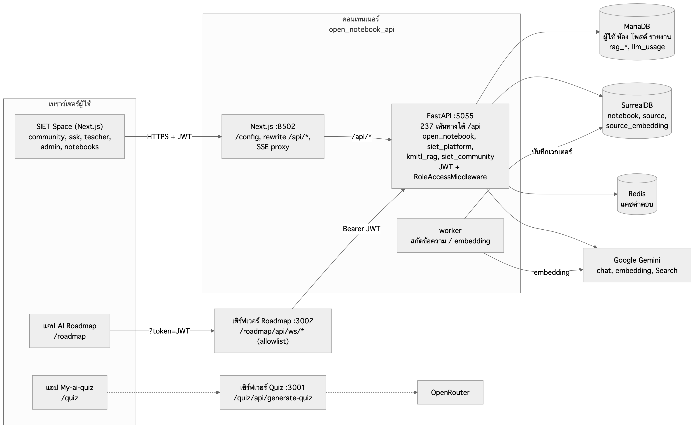
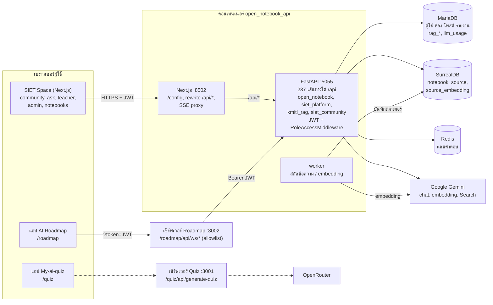
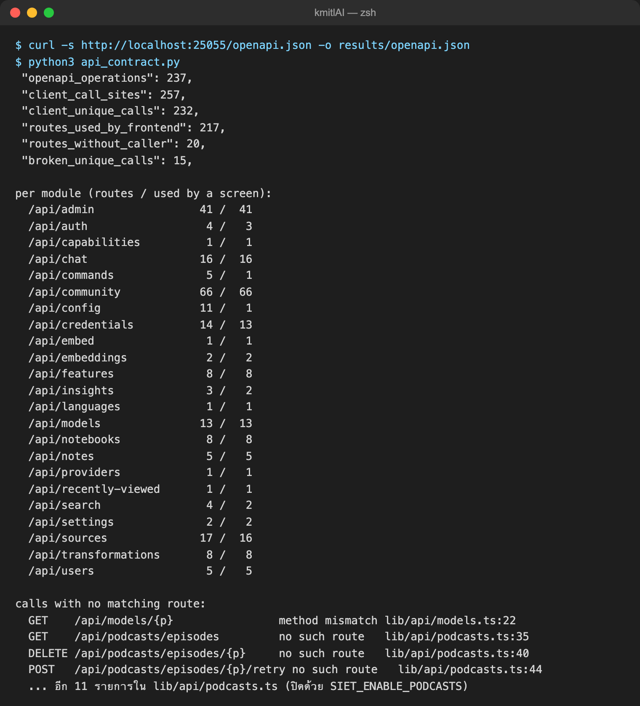
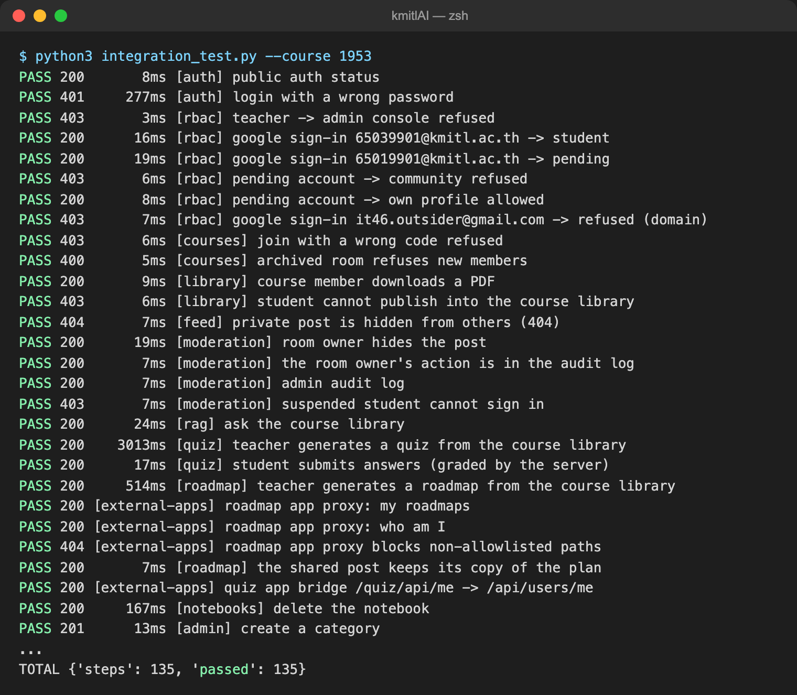
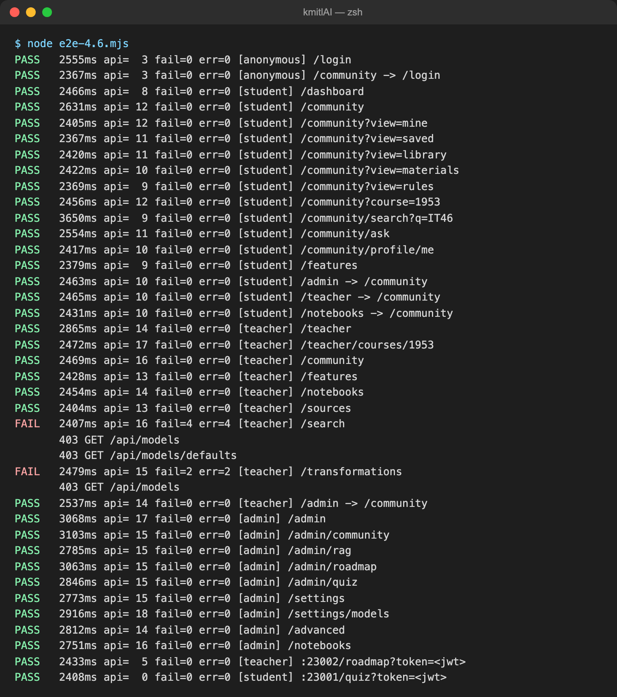
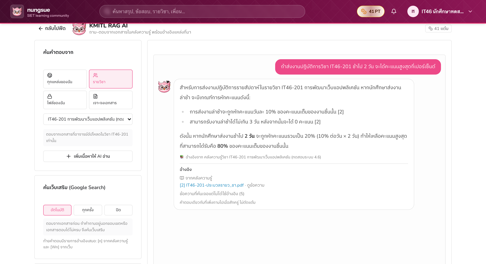
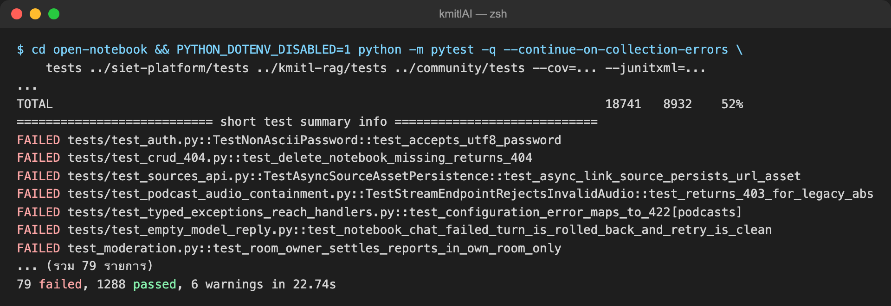
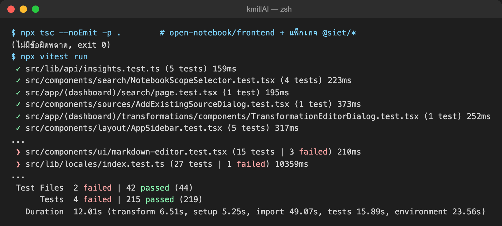

# 4.6 การบูรณาการระบบและการทดสอบเบื้องต้น

หัวข้อนี้รวมผลงานของสมาชิกทุกคนเข้าเป็นระบบเดียวบนสาขา `staging` แล้วทดสอบใน 2 ระดับ ได้แก่ (1) การเชื่อมต่อระหว่างส่วนหน้าและส่วนหลังของทุกโมดูล (4.6.1) และ (2) การทดสอบระดับหน่วยของโค้ด (4.6.2) โค้ดที่ทดสอบคือสาขา `staging` ที่ commit `ebaf162` (ตรงกับสาขา `refactor/course-repo` ที่ `9289f23` ซึ่งต่างกันเฉพาะไฟล์เอกสาร) ทดสอบเมื่อวันที่ 23 ตุลาคม 2569 บนสภาพแวดล้อมทดสอบที่แยกจากระบบใช้งานจริง (ตารางที่ 4.46) การทดสอบทุกส่วนไม่เขียนข้อมูลลงฐานข้อมูลของระบบใช้งานจริง ตัวเลขทุกค่าในหัวข้อนี้มาจากผลการรันจริงซึ่งเก็บไว้ใน `docs/report/eval/results/` และรันซ้ำได้ด้วยสคริปต์ใน `docs/report/eval/` ผลของหัวข้อ 4.6.1 และ 4.6.2 ตัดสินว่ายอมรับได้หรือไม่ด้วยเกณฑ์ที่นำค่ามาจากมาตรฐานและแนวปฏิบัติที่เผยแพร่ (หัวข้อ 4.6.1 ข้อ 1)

**ตารางที่ 4.46** สภาพแวดล้อมที่ใช้ทดสอบ

| องค์ประกอบ | รายละเอียด |
|---|---|
| โค้ดที่ทดสอบ | สาขา `staging` commit `ebaf162` (หลังรวม PR #1–#8, สาขา `refactor/community`, `refactor/siet-split` และ Open Notebook v1.15.0) |
| อิมเมจ | `kmitlai/open-notebook:local` สร้างจาก `staging` เมื่อ 23 ต.ค. 2569 (อิมเมจเดียวกับที่ใช้งานจริง) และอิมเมจของแอป AI Roadmap และ My-ai-quiz |
| คอนเทนเนอร์ทดสอบ | `siet46-app` (API พอร์ต 25055, เว็บพอร์ต 28502), `siet46-roadmap` (พอร์ต 23002), `siet46-quiz` (พอร์ต 23001) |
| ฐานข้อมูล | ชุดทดสอบ `siettest-mariadb`, `siettest-surreal`, `siettest-redis` ซึ่งเป็นสำเนาข้อมูลที่แยกจากระบบใช้งานจริง |
| โมเดล AI | สนทนา: Google `gemini-3.5-flash-lite`; Embedding: Google `gemini-embedding-001` (3072 มิติ); ค้นเว็บ: Google Search grounding ของ Gemini |
| บัญชีทดสอบ | `it46.admin`, `it46.teacher`, `it46.student1`–`it46.student3` และบัญชี Google จำลอง (`GOOGLE_OAUTH_MOCK=1`) |
| ข้อมูลทดสอบ | ห้องวิชา `IT46-201` (room 1953) พร้อมเอกสาร PDF 3 ฉบับที่สร้างขึ้นสำหรับการทดสอบ ได้แก่ ประมวลรายวิชา คู่มือการฝึกงาน และเอกสาร Stack/Queue ภาษาอังกฤษ (`docs/report/eval/corpus/`) |
| เครื่องมือ | Python 3.12 + pytest 9.0.3, Python 3.14 + requests, Node.js 26 + Vitest 4.1.9, TypeScript 5.8.3, Playwright (Chrome for Testing) |
| เครื่อง | macOS (Apple Silicon) + Docker (OrbStack) |

## 4.6.1 เชื่อมต่อระบบหน้าบ้าน (Frontend) เข้ากับหลังบ้าน (Backend API) ครบทุกโมดูล

### 1) หลักการและเกณฑ์การยอมรับ

ผลการทดสอบจะบอกได้ว่าระบบพร้อมใช้งานหรือไม่ก็ต่อเมื่อมีเกณฑ์ตัดสินที่ชัดเจนว่าผลแบบใดยอมรับได้และแบบใดยอมรับไม่ได้ ISTQB เรียกเกณฑ์ชุดนี้ว่าเกณฑ์การออกจากการทดสอบ (exit criteria) หมายถึงชุดเงื่อนไขสำหรับการปิดงานที่กำหนดไว้อย่างเป็นทางการ หัวข้อ 4.6.1 และ 4.6.2 จึงตัดสินผลทุกกรณีด้วยเกณฑ์ชุดเดียวกัน โดยค่าเกณฑ์เชิงตัวเลขและนิยามทุกข้อนำมาจากมาตรฐานหรือแนวปฏิบัติที่เผยแพร่ในตารางที่ 4.47 ไม่ได้ตั้งขึ้นเองให้เข้ากับผลที่ได้ กรอบหลักคือแบบจำลองคุณภาพผลิตภัณฑ์ ISO/IEC 25010:2023 ซึ่งแบ่งคุณภาพของซอฟต์แวร์เป็น 9 คุณลักษณะ การทดสอบในหัวข้อ 4.6.1 และ 4.6.2 วัด 5 คุณลักษณะ ได้แก่ ความเหมาะสมเชิงฟังก์ชัน (ครบถ้วนและถูกต้อง) ความเข้ากันได้ (การทำงานร่วมกันของส่วนหน้าและส่วนหลัง) ประสิทธิภาพด้านเวลา ความมั่นคงปลอดภัย (การควบคุมสิทธิ์) และการบำรุงรักษาได้ (ความสามารถในการทดสอบ) มาตรฐานอื่นในตารางให้ค่าตัดสินของตัวชี้วัดแต่ละตัว

**ตารางที่ 4.47** มาตรฐานและแนวปฏิบัติที่ใช้กำหนดเกณฑ์การยอมรับ

| มาตรฐาน / แหล่งอ้างอิง | สาระที่นำมาใช้ | ใช้ตัดสิน |
|---|---|---|
| ISO/IEC 25010:2023 Product quality model | คุณภาพผลิตภัณฑ์ 9 คุณลักษณะ ใช้ functional suitability (functional completeness, functional correctness), compatibility (interoperability), performance efficiency (time behaviour), security และ maintainability (testability) | คุณลักษณะที่การทดสอบแต่ละแบบวัด และนับว่าระบบที่แจ้งว่าสำเร็จแต่ไม่บันทึกข้อมูล หรือแสดงข้อมูลของบัญชีอื่น ผิดด้าน functional correctness |
| ISTQB Standard Glossary of Terms Used in Software Testing v3.4 (2020) | exit criteria คือชุดเงื่อนไขสำหรับการปิดงานที่กำหนดไว้อย่างเป็นทางการ; false-positive result คือผลที่รายงานข้อบกพร่องทั้งที่สิ่งที่ทดสอบไม่มีข้อบกพร่องนั้นจริง | การกำหนดเกณฑ์การยอมรับ และการแยกกรณีที่ไม่ผ่านเพราะชุดทดสอบหรือสภาพแวดล้อม (ผลบวกลวง) ออกจากข้อบกพร่องจริง |
| IEEE Std 1044-2009 Classification for Software Anomalies, Table A.1 | ความรุนแรง 5 ระดับ: Blocking (การทดสอบต้องหยุดรอการแก้หรือทางเลี่ยง), Critical (การทำงานที่จำเป็นหยุดชะงักโดยเลี่ยงไม่ได้ ความปลอดภัยหรือความมั่นคงเสียหาย), Major (การทำงานที่จำเป็นได้รับผลกระทบแต่ยังทำต่อได้), Minor (การทำงานที่ไม่จำเป็นหยุดชะงัก), Inconsequential (ไม่มีผลต่อการทำงานอย่างมีนัยสำคัญ) | ระดับความรุนแรงของข้อบกพร่องทุกรายการ |
| IETF RFC 9110 HTTP Semantics (2022) หมวด 15 | รหัสสถานะเป็นเลข 3 หลัก หลักแรกบอกประเภทของผล เขียนเป็นกลุ่มโดยใช้ xx แทนเลขสองหลักท้ายใดก็ได้: 2xx (200–299) คำขอสำเร็จ; 4xx (400–499) คำขอผิดหรือทำให้ไม่ได้ (401 ไม่มีข้อมูลยืนยันตัวตนที่ใช้ได้, 403 เซิร์ฟเวอร์เข้าใจคำขอแต่ปฏิเสธ, 404 ใช้แทน 403 ได้เมื่อต้องการซ่อนว่ามีทรัพยากรนั้นอยู่); 5xx (500–599) เซิร์ฟเวอร์ทำคำขอที่ดูถูกต้องไม่สำเร็จ | รหัสสถานะของทุกขั้นการทดสอบ |
| OWASP Top 10:2021 A01 Broken Access Control | ยกเว้นทรัพยากรสาธารณะ ต้องปฏิเสธเป็นค่าเริ่มต้น (deny by default); การยกระดับสิทธิ์ เช่น ใช้งานโดยไม่เข้าสู่ระบบ หรือใช้งานแบบผู้ดูแลทั้งที่เป็นผู้ใช้ทั่วไป ถือเป็นช่องโหว่ | การทดสอบสิทธิ์และตัวกันเส้นทาง |
| Nielsen, *Usability Engineering* (1993) บทที่ 5 | 0.1 วินาที ผู้ใช้รู้สึกว่าระบบตอบสนองทันที; 1.0 วินาที ความคิดของผู้ใช้ยังต่อเนื่องแม้สังเกตเห็นความล่าช้า; 10 วินาที ขีดจำกัดที่ผู้ใช้ยังจดจ่อกับหน้าจอ ถ้านานกว่านั้นต้องแจ้งว่าจะเสร็จเมื่อใด | เวลาตอบสนองของ API |
| Google, Core Web Vitals: Largest Contentful Paint (web.dev) | LCP ไม่เกิน 2.5 วินาที = ดี, 2.5–4.0 วินาที = ควรปรับปรุง, เกิน 4.0 วินาที = แย่ วัดที่เปอร์เซ็นไทล์ที่ 75 ของการโหลดหน้า | เวลาโหลดหน้าจอ |
| Chrome Lighthouse, audit "Browser errors were logged to the console" | ข้อผิดพลาดทุกรายการที่เบราว์เซอร์บันทึกใน console คือปัญหาของหน้าที่ต้องแก้ | ข้อผิดพลาด JavaScript ของหน้าจอ |
| Arguelles, Ivanković และ Bender, "Code Coverage Best Practices", Google Testing Blog (2020) | ไม่มีตัวเลขความครอบคลุมที่ดีที่สุดตายตัว แต่ Google ใช้แนวทาง 60% = ยอมรับได้ (acceptable), 75% = น่าชมเชย (commendable), 90% = เป็นแบบอย่าง (exemplary) และความครอบคลุมของโค้ดที่เปลี่ยนในแต่ละ commit ควรไม่ต่ำกว่า 90% | ความครอบคลุมของโค้ด (4.6.2) |

รหัสสถานะ HTTP (HTTP status code) คือเลข 3 หลักที่เซิร์ฟเวอร์ส่งกลับมากับคำตอบทุกครั้งเพื่อบอกผลของคำขอ หลักแรกบอกประเภทของผลลัพธ์ RFC 9110 จึงเรียกรหัสเป็นกลุ่มโดยเขียน "xx" แทนเลขสองหลักท้ายใดก็ได้ หัวข้อนี้ใช้การเขียนแบบเดียวกัน ดังนี้
- **2xx (รหัส 200–299) คำขอสำเร็จ:** เช่น 200 OK (ทำตามคำขอสำเร็จ) และ 201 Created (สร้างข้อมูลใหม่สำเร็จ)
- **4xx (รหัส 400–499) ระบบปฏิเสธคำขอเพราะปัญหาฝั่งผู้เรียก:** เช่น 400 Bad Request (ข้อมูลที่ส่งมาไม่ถูกต้อง), 401 Unauthorized (ยังไม่ได้ยืนยันตัวตน), 403 Forbidden (ยืนยันตัวตนแล้วแต่ไม่มีสิทธิ์), 404 Not Found (ไม่พบ หรือระบบซ่อนไว้จากผู้ที่ไม่มีสิทธิ์) และ 409 Conflict (ข้อมูลซ้ำหรือขัดกับสถานะปัจจุบัน)
- **5xx (รหัส 500–599) เซิร์ฟเวอร์ทำงานผิดพลาดทั้งที่คำขอถูกต้อง:** เช่น 500 Internal Server Error

ในการทดสอบ ขั้นที่ออกแบบให้สำเร็จต้องได้รหัสกลุ่ม 2xx ขั้นที่ออกแบบให้ถูกปฏิเสธต้องได้รหัสกลุ่ม 4xx ตรงตามที่กำหนดไว้ล่วงหน้า และรหัสกลุ่ม 5xx ยอมรับไม่ได้ทุกกรณี (เงื่อนไข (ก) ในตารางที่ 4.48)

ผลของแต่ละตัวชี้วัดตัดสินเป็น 3 ระดับตามตารางที่ 4.48 ระดับความรุนแรงของ IEEE Std 1044-2009 เป็นตัวแบ่งหลัก ส่วนเงื่อนไข (ก)–(ง) เป็นกรณีที่ยอมรับไม่ได้ไม่ว่าความรุนแรงจะเป็นระดับใด เพราะขัดกับมาตรฐานในตารางที่ 4.47 โดยตรง เงื่อนไข (ง) มาจากข้อกำหนดของการทดสอบในหัวข้อ 4.6 ที่ห้ามเขียนข้อมูลลงฐานข้อมูลของระบบใช้งานจริง

**ตารางที่ 4.48** ระดับผลการตัดสิน

| ระดับ | ความหมาย | เงื่อนไข |
|---|---|---|
| ยอมรับได้ | เป็นไปตามเกณฑ์ ใช้งานได้ตามที่ออกแบบ | ผลอยู่ในช่วง "ยอมรับได้" ของตารางเกณฑ์ หรือเป็นข้อบกพร่องระดับ Inconsequential |
| ยอมรับได้แบบมีเงื่อนไข | ใช้งานต่อได้ แต่ต้องแก้ตามแผน | ข้อบกพร่องระดับ Minor ที่ไม่เข้าเงื่อนไข (ก)–(ง) หรือกรณีไม่ผ่านที่เป็นผลบวกลวงซึ่งทราบสาเหตุและวิธีแก้แล้ว |
| ยอมรับไม่ได้ | ต้องแก้และทดสอบซ้ำก่อนนำไปใช้งานจริง | ข้อบกพร่องระดับ Major, Critical หรือ Blocking หรือเข้าเงื่อนไขข้อใดข้อหนึ่ง: (ก) ได้รหัส 5xx จากคำขอที่ถูกต้อง (ข) ระบบไม่ปฏิเสธผู้ที่ไม่มีสิทธิ์ (ค) ระบบแจ้งว่าสำเร็จแต่ไม่บันทึกข้อมูล หรือแสดงข้อมูลของบัญชีอื่น (ง) ชุดทดสอบติดต่อฐานข้อมูลของระบบใช้งานจริง |

ตารางที่ 4.49 คือเกณฑ์ของการทดสอบการเชื่อมต่อในหัวข้อย่อยที่ 5–8 ผลเทียบเกณฑ์ของแต่ละการทดสอบอยู่ท้ายหัวข้อย่อยนั้น และสรุปรวมไว้ในหัวข้อย่อยที่ 9

**ตารางที่ 4.49** เกณฑ์การยอมรับของการทดสอบการเชื่อมต่อ

| ตัวชี้วัด | อ้างอิง | ยอมรับได้ | ยอมรับได้แบบมีเงื่อนไข | ยอมรับไม่ได้ |
|---|---|---|---|---|
| คำสั่งเรียก API ที่ไม่มีเส้นทางรองรับ (ข้อ 5) | ISO/IEC 25010 interoperability | ไม่มี | มีเฉพาะในฟีเจอร์ที่ปิดโดยตั้งใจ หรือในฟังก์ชันที่ไม่มีหน้าจอใดเรียก | หน้าจอที่เปิดใช้งานเรียกเส้นทางที่ไม่มีอยู่ |
| เส้นทาง API ที่ไม่มีหน้าจอเรียก (ข้อ 5) | ISO/IEC 25010 functional completeness | เป็นเส้นทางของผู้ดูแล สคริปต์ หรืองานเบื้องหลัง | เป็นฟีเจอร์ของผู้ใช้ที่ยังไม่มีหน้าจอ | – |
| รหัสสถานะของขั้นที่ควรสำเร็จ (ข้อ 6) | RFC 9110 | 2xx | – | 4xx (ฟังก์ชันใช้ไม่ได้) หรือ 5xx |
| รหัสสถานะของขั้นที่ควรถูกปฏิเสธ (ข้อ 6) | RFC 9110, OWASP A01 | 4xx ตรงกับที่ออกแบบไว้ล่วงหน้า (404 แทน 403 ได้เมื่อต้องซ่อนทรัพยากร) | 4xx แต่ไม่ตรงกับที่ออกแบบ | 2xx (สิทธิ์รั่ว) หรือ 5xx |
| การทำงานต่อเนื่องข้ามโมดูล (ข้อ 6) | ISO/IEC 25010 functional correctness, interoperability | ทุกขั้นผ่าน และข้อมูลที่ส่งต่อถูกต้อง เช่น คำตอบ RAG มีรหัสที่อยู่ในเอกสาร | – | ขั้นใดขั้นหนึ่งไม่ผ่าน หรือข้อมูลที่ส่งต่อผิด |
| เวลาตอบสนองของแต่ละขั้น (ข้อ 6) | Nielsen (1993) | ไม่เกิน 1.0 วินาที | 1.0–10 วินาที และหน้าจอแสดงสถานะระหว่างรอ | เกิน 10 วินาที หรือ 1.0–10 วินาทีโดยไม่แสดงสถานะ |
| เวลาโหลดหน้าจอ: LCP ที่เปอร์เซ็นไทล์ 75 (ข้อ 7) | Core Web Vitals | ไม่เกิน 2.5 วินาที | 2.5–4.0 วินาที | เกิน 4.0 วินาที |
| คำขอ API ที่ล้มเหลวและข้อผิดพลาด JavaScript ของหน้าจอ (ข้อ 7) | RFC 9110, Lighthouse | 0 รายการ | เกิดเฉพาะกับส่วนประกอบรอง ฟังก์ชันหลักของหน้ายังใช้ได้ | ฟังก์ชันหลักของหน้าใช้ไม่ได้ หรือผู้มีสิทธิ์ถูกส่งกลับไป `/login` |
| ตัวกันเส้นทาง (ข้อ 7) | OWASP A01 | ผู้ไม่มีสิทธิ์ถูกพาออกทุกกรณี | – | ผู้ไม่มีสิทธิ์เปิดหน้าจอได้ |
| ข้อบกพร่องที่พบ (ข้อ 8) | IEEE 1044, ตารางที่ 4.48 | Inconsequential | Minor | Major ขึ้นไป หรือเข้าเงื่อนไข (ก)–(ง) |

### 2) การรวมโค้ดของสมาชิกเข้าสาขา staging

สมาชิกแต่ละคนพัฒนาบนสาขาของตนเองแล้วเปิด Pull Request (PR) เข้าสาขา `staging` คำอธิบาย PR ทุกฉบับใช้แม่แบบเดียวกัน ประกอบด้วยสิ่งที่ทำ ผู้รับผิดชอบ การเปลี่ยนแปลงฐานข้อมูล/env วิธีทดสอบ และบล็อก `merge-ownership` ที่ระบุว่าสาขานั้นเป็นเจ้าของไฟล์หรือพื้นที่ใด (`owns`) ยอมให้สาขาใดเป็นหลัก (`defers-to`) และไฟล์ที่ใช้ร่วมกัน (`shared`) ก่อนรวมแต่ละครั้งจำลองการรวมด้วย `git merge-tree` เพื่อหาไฟล์ที่ชนกันล่วงหน้า แล้วรวมตามลำดับในตารางที่ 4.50 โดยตัดสินจุดที่ชนตามบล็อก `merge-ownership`

**ตารางที่ 4.50** ลำดับการรวมโค้ดเข้าสาขา staging

| ลำดับ | PR / สาขา | ผู้พัฒนา | เนื้อหา | ผลการรวม |
|---|---|---|---|---|
| 1 | #1 `refactor/course-repo` | phuwishpk | คลังข้อมูลและรายวิชา (4.3), เสริมความทนทานของ AI (4.5) | รวมได้ทันที |
| 2 | #3 `feat/auth-rbac-logs` | Tanabordi | Google OAuth, RBAC 4 ระดับ, หน้า pending | ชนที่ `domain/user.py` (ทั้งสองฝั่งเพิ่มฟังก์ชันท้ายไฟล์) แก้โดยเก็บทั้งสองฝั่ง และพบว่าคำสั่งสร้างคอลัมน์ `users.google_sub` ใน `schema.py` ถูกลบไปโดยไม่ตั้งใจ (ฐานข้อมูลใหม่จะเริ่มระบบไม่ได้) จึงแก้เพิ่มใน `9777788` |
| 3 | #2 `feat/quiz-ai` | SpriteUm | หน้าเล่นแบบทดสอบคนเดียวของ My-ai-quiz | รวมได้ทันที |
| 4 | #4 `dev-poh` | pornprompoh | ออกแบบหน้า Community ใหม่ หน้าโปรไฟล์ | รวมได้ทันที |
| 5 | `refactor/siet-split` | phuwishpk | แยกโค้ด KMITL ออกจาก Open Notebook เป็นแพ็กเกจ `siet-platform`, `kmitl-rag`, `community` | `a108090` |
| 6 | `chore/upstream-v1.15.0` | phuwishpk | ปรับฐาน Open Notebook เป็นรุ่น v1.15.0 | `dc064a7` |
| 7 | `refactor/community` | SpriteUm | ปรับสไตล์คอมโพเนนต์ Community | ชน 4 ไฟล์กับ #4 คงฉบับที่อยู่ใน staging ไว้ก่อนและบันทึกฉบับของอีกฝั่งในคอมเมนต์ `MERGE-OWNER` รอเจ้าของตัดสิน (`1a784b1`) |
| 8 | #7, #6, #8 | phuwishpk, pornprompoh, Tanabordi | ธีม light/dark ทุกแอป, แถบนำทาง, บันทึกประวัติระบบ ระดับการมองเห็น และการตรวจรายงาน | รวม 23 ต.ค. 2569 แล้วแก้การ build (`ebaf162`) |

### 3) สถาปัตยกรรมการเชื่อมต่อ

ระบบหลังรวมโค้ดมีส่วนหลังเป็น FastAPI กระบวนการเดียว (พอร์ต 5055) ซึ่งประกอบด้วยแกน Open Notebook และแพ็กเกจของ SIET 3 แพ็กเกจที่เสียบเข้ามาผ่านจุดต่อขยาย (`open_notebook/extensions.py`) เส้นทางทั้งหมดอยู่ใต้ `/api` จำนวน 237 เส้นทางที่เปิดใช้ (ปิด podcast 19 เส้นทางและ `GET /api/auth/status` เดิมของ Open Notebook ไว้โดยค่าเริ่มต้น) ส่วนหน้าเป็น Next.js ในคอนเทนเนอร์เดียวกัน (พอร์ต 8502) โดยหน้าจอของ SIET อยู่ในแพ็กเกจ `@siet/platform`, `@siet/kmitl-rag`, `@siet/community` เบราว์เซอร์อ่านที่อยู่ API จาก `/config` เรียก API ผ่าน axios ที่แนบ `Authorization: Bearer <JWT>` จาก `localStorage` (`auth-storage`) และ Next.js ส่งต่อ `/api/*` ไปยัง FastAPI (`INTERNAL_API_URL`) ส่วนคำตอบแบบสตรีม (SSE) ผ่าน route handler ที่ส่งต่อ header การยืนยันตัวตน ฝั่ง FastAPI ตรวจ JWT ใน `WorkspaceAuthBackend` แล้วตรวจสิทธิ์ตามบทบาทใน `RoleAccessMiddleware` (นักศึกษาใช้ `/api/community/*`, `/api/features/*`; อาจารย์ใช้ notebook/source/search เพิ่ม; ผู้ดูแลใช้ `/api/admin/*`, models, credentials) แอป AI Roadmap รับ JWT ทาง `?token=` แล้วเรียก API ผ่านเซิร์ฟเวอร์ของตัวเอง (`/roadmap/api/ws/*`) ซึ่งอนุญาตเฉพาะ `community/*` และ `users/me` ส่วนแอป My-ai-quiz สร้างข้อสอบโดยเรียก OpenRouter โดยตรง ไม่ได้ผ่าน API ของระบบ (รูปที่ 4.18)

**รูปที่ 4.18** แผนภาพการเชื่อมต่อระหว่างส่วนหน้า ส่วนหลัง ฐานข้อมูล และผู้ให้บริการโมเดล AI ของระบบหลังรวมโค้ด เส้นประคือส่วนที่ยังไม่เชื่อมกับ API ของระบบ

ซอร์ส Mermaid ของรูปที่ 4.18

### 4) โมดูลของระบบและการเชื่อมต่อ

ตารางที่ 4.51 สรุปทุกโมดูลของระบบ หน้าจอที่ผู้ใช้เปิด ไฟล์ฝั่งหน้าที่เรียก API และ router ฝั่งหลังที่รับคำขอ ได้จากการไล่ซอร์สโค้ดของทั้งสองฝั่ง ร่วมกับผลการตรวจในหัวข้อย่อยที่ 5–7

**ตารางที่ 4.51** โมดูลของระบบ หน้าจอ และ API ที่เชื่อมต่อ

| โมดูล | หน้าจอ (เส้นทาง) | ฝั่งหน้า (ไฟล์เรียก API) | ฝั่งหลัง (router) | สถานะ |
|---|---|---|---|---|
| ยืนยันตัวตนและสิทธิ์ | `/login`, `/auth/google/callback`, `/pending`, ตัวกันเส้นทางใน `(dashboard)/layout.tsx` | `@siet/platform` `lib/api/auth.ts`, `auth-store.ts` | `siet_platform/routers/users.py`, `google_auth.py` | เชื่อมครบ |
| Notebook, source, note | `/notebooks`, `/notebooks/[id]`, `/sources/[id]` | `lib/api/notebooks.ts`, `sources.ts`, `notes.ts`, `insights.ts` | `api/routers/notebooks.py`, `sources.py`, `notes.py`, `insights.py` | เชื่อมครบ |
| แชท notebook / source / แชทรวม | `/notebooks/[id]`, `/sources/[id]`, แท็บถามใน `/search` | `lib/api/chat.ts`, `source-chat.ts`, `@siet/kmitl-rag` `global-chat.ts` | `api/routers/chat.py`, `source_chat.py`, `kmitl_rag/routers/global_chat.py` | เชื่อมครบ |
| ค้นหาในพื้นที่ทำงาน | `/search` | `lib/api/search.ts` | `api/routers/search.py` | เชื่อมครบ |
| โมเดล ข้อมูลรับรอง ค่าตั้ง | `/settings`, `/settings/models`, `/advanced`, `/transformations` | `lib/api/models.ts`, `credentials.ts`, `settings.ts`, `transformations.ts` | `api/routers/models.py`, `credentials.py`, `settings.py`, `transformations.py` | อาจารย์เปิด `/search`, `/transformations` แล้วได้ 403 จาก `/api/models` (ตารางที่ 4.55) |
| Podcast | `/podcasts` | `lib/api/podcasts.ts` | `podcasts.py` ฯลฯ ปิดไว้ด้วย `SIET_ENABLE_PODCASTS` | ปิดใช้งานโดยตั้งใจ |
| ฟีดชุมชน โพสต์ ความคิดเห็น | `/community?view=…` | `@siet/platform` `lib/api/community.ts` | `siet_community/routers/community.py` | เชื่อมครบ |
| ห้องวิชาและหน้าผู้สอน | `/teacher`, `/teacher/courses/[id]` | `lib/api/community.ts`, `courses.ts` | `community.py` | เชื่อมครบ |
| คลังเอกสาร | `/community?view=library`, ปุ่มดาวน์โหลด | `lib/api/library.ts` | `community.py` (`/community/library*`) | เชื่อมครบ |
| ค้นหาขั้นสูง | `/community/search` | `lib/api/community-search.ts` | `community.py` (`/community/search`) | เชื่อมครบ |
| รายงานและการตรวจสอบ | ปุ่มรายงาน, `/teacher/courses/[id]`, `/admin/community`, แท็บบันทึกผู้ดูแล | `lib/api/moderation.ts`, `admin.ts` | `community.py`, `siet_community/routers/admin.py` | เชื่อมครบ |
| แต้มและการแจ้งเตือน | กระเป๋าแต้ม, เมนูแจ้งเตือน | `lib/api/community.ts` | `community.py` (`/community/me`, `/wallet`, `/notifications`) | เชื่อมครบ |
| โปรไฟล์ | `/community/profile/[userId]` | ใช้ `community/me` และ `community/posts` | ไม่มีเส้นทางแก้ไขโปรไฟล์ | การแก้ไขโปรไฟล์บันทึกเฉพาะในหน้า |
| KMITL RAG AI | `/community/ask`, AiQuickWidget, `/admin/rag` | `lib/api/community.ts` (`community/ask*`), `admin.ts` | `kmitl_rag/routers/ask.py`, `kmitl_rag/routers/admin.py` | เชื่อมครบ |
| AI Roadmap | แอป `/roadmap`, `/features`, โพสต์ชนิด roadmap, `/admin/roadmap` | แอป Roadmap `lib/api.js` → `/roadmap/api/ws/*`, `lib/api/features.ts` | `community.py` (`/community/study/roadmap`, `/roadmaps/mine*`), `siet_platform/routers/features.py` | เชื่อมครบ |
| AI Quiz | `/features`, โพสต์ชนิด quiz, `/admin/quiz` | `lib/api/features.ts`, `community.ts` | `community.py` (`/community/study/quiz`, `/posts/{id}/quiz/*`), `siet_community/routers/features.py` | เชื่อมครบ |
| แอป My-ai-quiz | `/quiz`, `/quiz/solo`, `/quiz/solo/play` | `app/api/generate-quiz/route.ts` → OpenRouter | ไม่ผ่าน API ของระบบ | ยังไม่เชื่อม (ตารางที่ 4.55) |
| คอนโซลผู้ดูแล | `/admin`, `/admin/community`, `/admin/rag`, `/admin/roadmap`, `/admin/quiz` | `lib/api/admin.ts`, `courses.ts` | `siet_platform/routers/admin.py`, `siet_community/routers/admin.py`, `kmitl_rag/routers/admin.py` | เชื่อมครบ |

### 5) การตรวจสัญญา API แบบอัตโนมัติ

สคริปต์ `api_contract.py` อ่านโค้ดฝั่งหน้าทั้งหมด (แอปหลังรวมแพ็กเกจ SIET แอป Roadmap และแอป Quiz) แล้วดึงทุกคำสั่งที่เรียก API ทั้งรูปแบบ `apiClient.get/post/…`, `fetch` และ `ws()` ของแอป Roadmap นำเมธอดและเส้นทางที่ได้ไปจับคู่กับเอกสาร OpenAPI ของระบบที่รันอยู่ (`/openapi.json`) ตัวแปรในเส้นทาง เช่น `${id}` จับคู่ได้เฉพาะกับพารามิเตอร์ของเส้นทาง ไม่จับคู่กับคำคงที่ ถ้าคำสั่งใดไม่มีเส้นทางรองรับ หมายความว่าหน้าจอเรียก API ที่ไม่มีอยู่จริง ถ้าเส้นทางใดไม่มีโค้ดเรียก หมายความว่าไม่มีหน้าจอใดใช้เส้นทางนั้น

ผลการตรวจ (รูปที่ 4.19): พบคำสั่งเรียก API 257 จุดในโค้ด คิดเป็นคำขอที่ไม่ซ้ำกัน 232 แบบ (แอปหลัก 228 แบบ แอป Roadmap 11 แบบ แอป Quiz 2 แบบ บางแบบซ้ำกันระหว่างแอป) จากเส้นทางที่เปิดใช้ 237 เส้นทาง มีโค้ดฝั่งหน้าเรียกใช้ 217 เส้นทาง (ร้อยละ 91.6) บางเส้นทางในจำนวนนี้ถูกเรียกจากคอมโพเนนต์หรือ hook ที่ยังไม่ได้วางในหน้าใด เช่น Leaderboard อีก 20 เส้นทางไม่มีโค้ดฝั่งหน้าเรียก ได้แก่ API คิวงานเบื้องหลัง 4 เส้นทาง, API ตั้งค่า Redis และแคชคำตอบ 10 เส้นทาง, `GET /api/auth/legacy-status`, `POST /api/sources/json`, `POST /api/insights/{id}/save-as-note`, `POST /api/search/ask/simple`, `POST /api/search/ask/notebooks` และ `POST /api/credentials/migrate-encryption` 19 เส้นทางเป็นเส้นทางสำหรับผู้ดูแลระบบ สคริปต์ หรืองานเบื้องหลัง ส่วน `POST /api/insights/{id}/save-as-note` เป็นฟีเจอร์ของผู้ใช้ (บันทึก insight เป็น note) ที่มีเพียงในหน้าตัวอย่างดีไซน์ `/dev/design` ยังไม่มีหน้าจอจริงเรียก ไม่มีหน้าจอใดขาด API ส่วนคำสั่งเรียกที่ไม่มีเส้นทางรองรับมี 15 แบบ คือ API podcast 14 แบบที่ปิดไว้โดยตั้งใจ และ `GET /api/models/{id}` ใน `lib/api/models.ts` ซึ่งเป็นฟังก์ชันที่ไม่มีหน้าจอใดเรียกแล้ว

**ตารางที่ 4.52** ผลการตรวจสัญญา API แยกตามกลุ่มเส้นทาง

| กลุ่มเส้นทาง | เส้นทาง | หน้าจอเรียกใช้ | กลุ่มเส้นทาง | เส้นทาง | หน้าจอเรียกใช้ |
|---|---|---|---|---|---|
| `/api/admin` | 41 | 41 | `/api/insights` | 3 | 2 |
| `/api/auth` | 4 | 3 | `/api/languages` | 1 | 1 |
| `/api/capabilities` | 1 | 1 | `/api/models` | 13 | 13 |
| `/api/chat` | 16 | 16 | `/api/notebooks` | 8 | 8 |
| `/api/commands` | 5 | 1 | `/api/notes` | 5 | 5 |
| `/api/community` | 66 | 66 | `/api/providers` | 1 | 1 |
| `/api/config` | 11 | 1 | `/api/recently-viewed` | 1 | 1 |
| `/api/credentials` | 14 | 13 | `/api/search` | 4 | 2 |
| `/api/embed` | 1 | 1 | `/api/settings` | 2 | 2 |
| `/api/embeddings` | 2 | 2 | `/api/sources` | 17 | 16 |
| `/api/features` | 8 | 8 | `/api/transformations` | 8 | 8 |
| `/api/users` | 5 | 5 | **รวม** | **237** | **217** |

**รูปที่ 4.19** ผลการรัน `api_contract.py` กับระบบทดสอบ: จำนวนคำสั่งเรียก API เส้นทางที่ถูกใช้แยกตามกลุ่ม และคำสั่งเรียกที่ไม่มีเส้นทางรองรับ

**เทียบเกณฑ์ (ตารางที่ 4.49):** คำสั่งเรียกที่ไม่มีเส้นทางรองรับยอมรับได้แบบมีเงื่อนไข ทั้ง 15 แบบอยู่ในฟีเจอร์ podcast ที่ปิดโดยตั้งใจ (14 แบบ) และในฟังก์ชันที่ไม่มีหน้าจอใดเรียก (1 แบบ) ไม่มีหน้าจอที่เปิดใช้งานเรียกเส้นทางที่ไม่มีอยู่ เงื่อนไขคือลบโค้ดค้างและซ่อนหน้า `/podcasts` (ข้อบกพร่องที่ 6 ในตารางที่ 4.55) ส่วนเส้นทางที่ไม่มีหน้าจอเรียก 19 จาก 20 เส้นทางยอมรับได้ เพราะเป็นเส้นทางของผู้ดูแล สคริปต์ หรืองานเบื้องหลัง อีก 1 เส้นทาง (`save-as-note`) ยอมรับได้แบบมีเงื่อนไข เพราะเป็นฟีเจอร์ของผู้ใช้ที่ต้องเพิ่มหน้าจอหรือตัดออกจาก API

### 6) การทดสอบการเชื่อมต่อตามสถานการณ์การใช้งาน

สคริปต์ `integration_test.py` เรียก API ตามลำดับเดียวกับที่หน้าจอเรียกจริง ครอบคลุมทุกโมดูลและทุกบทบาท (ไม่ได้เข้าสู่ระบบ นักศึกษา อาจารย์ ผู้ดูแล และบัญชีรออนุมัติ) แต่ละขั้นกำหนดรหัสสถานะที่คาดหวังไว้ล่วงหน้า กรณีที่ต้องถูกปฏิเสธก็ทดสอบด้วย เช่น นักศึกษาเปิดคอนโซลผู้ดูแลต้องได้ 403 สถานการณ์ที่ทดสอบครอบคลุมการทำงานต่อเนื่องข้ามโมดูล เช่น อาจารย์อัปโหลดเอกสาร แล้ววัดว่าระบบสกัดข้อความและสร้าง embedding เสร็จ จากนั้นนักศึกษาถาม KMITL RAG AI และคำตอบต้องมีรหัสตรวจสอบที่อยู่ในเอกสารนั้น อาจารย์สร้างแบบทดสอบจากคลังเอกสาร แชร์ลงฟีด นักศึกษาทำแบบทดสอบ และระบบตรวจคะแนนฝั่งเซิร์ฟเวอร์ได้ 3/3 อาจารย์สร้าง Roadmap แชร์ลงฟีด แล้วลบแผนเดิม และโพสต์ยังแสดงสำเนาแผนได้ ส่วน Google sign-in ทดสอบในโหมดจำลอง อีเมลรหัสนักศึกษาคณะ 03 ได้บทบาท student อีเมลคณะอื่นได้ pending ซึ่งเข้าชุมชนไม่ได้ (403) แต่ดูข้อมูลตนเองได้ และอีเมลนอกโดเมน `kmitl.ac.th` ถูกปฏิเสธ เมื่อจบการรัน สคริปต์ลบข้อมูลที่สร้างขึ้นทั้งหมด

ผลการทดสอบ (ตารางที่ 4.53, รูปที่ 4.20): ผ่าน 135 จาก 135 ขั้น ระหว่างพัฒนาสคริปต์พบว่าถ้าคำขอสร้างข้อมูลไม่คืน id ขั้นที่ต่อจากนั้นจะถูกข้ามไปโดยไม่รายงาน รุ่นสุดท้ายจึงนับกรณีนี้เป็นความล้มเหลว (`require()`) ขั้นของ AI ที่รันซ้ำภายในอายุแคช (คำตอบ RAG 600 วินาที, แบบทดสอบและ Roadmap 3,600 วินาที) จะได้คำตอบจากแคช เวลาในตารางนี้จึงใช้เป็นตัวชี้วัดประสิทธิภาพของโมเดล AI ไม่ได้

**ตารางที่ 4.53** ผลการทดสอบการเชื่อมต่อตามสถานการณ์ แยกตามโมดูล

| โมดูล | ขั้น | ผ่าน | เวลามัธยฐาน (ms) | เวลาสูงสุด (ms) | สถานการณ์หลัก |
|---|---|---|---|---|---|
| ยืนยันตัวตน | 7 | 7 | 7.0 | 276.5 | สถานะสาธารณะ, รหัสผ่านผิด 401, ข้อมูลผู้ใช้ทุกบทบาท, ยินยอม PDPA |
| สิทธิ์ (RBAC) | 14 | 14 | 3.6 | 26.1 | ไม่มี token 401, นักศึกษา/อาจารย์เข้าคอนโซลผู้ดูแล 403, Google จำลอง 3 กรณี, บัญชี pending |
| ห้องวิชา | 15 | 15 | 5.9 | 14.0 | สร้างห้องพร้อมรหัสเข้าห้อง, รหัสผิด 403, ตั้ง TA, เก็บถาวร/คืน, หน้าผู้สอน |
| คลังเอกสาร | 8 | 8 | 6.5 | 269.0 | อัปโหลดและประมวลผลเสร็จ, ดาวน์โหลด PDF ทั้งแบบ header และ `?token=`, นักศึกษาอัปโหลดเข้าห้องไม่ได้ |
| ฟีดและโพสต์ | 15 | 15 | 9.0 | 47.7 | โพสต์, แก้ไขโดยเจ้าของ/ผู้อื่น 403, Helpful, ความคิดเห็นและการตอบกลับ, บันทึก, แชร์, โพสต์ส่วนตัว 404 |
| รายงานและการตรวจสอบ | 14 | 14 | 7.3 | 272.4 | รายงาน, รายงานซ้ำ 409, คิวของห้อง, ผู้สอนซ่อนโพสต์และบันทึกลง audit, ระงับบัญชีแล้วเข้าระบบไม่ได้ |
| ค้นหาขั้นสูง | 4 | 4 | 12.6 | 14.6 | posts, courses, documents, users |
| แต้มและการแจ้งเตือน | 4 | 4 | 11.0 | 15.1 | ยอดแต้ม ประวัติกระเป๋า การแจ้งเตือน |
| KMITL RAG AI | 4 | 4 | 6.4 | 23.6 | ถามจากคลังวิชา (คำตอบมีรหัส `INTEG-4627`), ประวัติ, ลบบทสนทนา |
| AI Quiz | 4 | 4 | 25.2 | 3,012.9 | สร้างจากคลังวิชา แชร์ลงฟีด นักศึกษาทำ และตรวจคะแนนที่เซิร์ฟเวอร์ |
| AI Roadmap | 7 | 7 | 31.9 | 513.9 | สร้าง, รายการ, แชร์, ลบแผนแล้วโพสต์ยังอยู่ |
| แอปภายนอก | 6 | 6 | 17.0 | 49.5 | หน้าแอป Roadmap, proxy อนุญาต/ปฏิเสธ (404), หน้าแอป Quiz, `/quiz/api/me` |
| Notebook (พื้นที่ทำงาน) | 11 | 11 | 79.4 | 1,229.6 | สร้าง notebook, source, note, ค้นหา, ลบ |
| คอนโซลผู้ดูแล | 22 | 22 | 8.7 | 58.6 | ภาพรวม ผู้ใช้ การใช้งาน AI สุขภาพระบบ หมวดหมู่ (สร้าง/แก้/ลบ) RAG Roadmap Quiz โมเดล |
| **รวม** | **135** | **135** | | | |

**รูปที่ 4.20** ส่วนหนึ่งของผลการรัน `integration_test.py`: แต่ละบรรทัดแสดงผล รหัสสถานะ เวลา โมดูล และสถานการณ์ บรรทัดสุดท้ายสรุปผลรวม 135/135

**เทียบเกณฑ์ (ตารางที่ 4.49):** ขั้นที่ควรสำเร็จ 115 ขั้นได้ 2xx ทุกขั้น (200 จำนวน 105 ขั้น, 201 จำนวน 10 ขั้น) ขั้นที่ควรถูกปฏิเสธ 20 ขั้นได้รหัสตรงกับที่ออกแบบไว้ทุกขั้น (403 จำนวน 12, 404 จำนวน 4, 401 จำนวน 2, 400 และ 409 อย่างละ 1) ไม่มีขั้นใดได้ 5xx และไม่มีกรณียกระดับสิทธิ์ตามนิยามของ OWASP A01 ทุกสถานการณ์ข้ามโมดูลส่งข้อมูลต่อได้ถูกต้อง ด้านรหัสสถานะ สิทธิ์ และการทำงานต่อเนื่องจึงยอมรับได้ ด้านเวลาตอบสนอง 133 ขั้นใช้เวลาไม่เกิน 1 วินาที (126 ขั้นไม่เกิน 0.1 วินาที ซึ่งผู้ใช้รู้สึกว่าตอบสนองทันที) จึงยอมรับได้ อีก 2 ขั้นอยู่ในช่วง 1–10 วินาที คือการสร้างแบบทดสอบด้วย AI (3,012.9 ms) ซึ่งปุ่มแสดงข้อความ "กำลังสร้าง…" ระหว่างรอ และการเพิ่ม source แบบข้อความ (1,229.6 ms) ซึ่งสคริปต์เรียกแบบรอผล (`async_processing=false`) ขณะที่หน้าจอจริงส่งแบบประมวลผลเบื้องหลัง (`async_processing=true`) และแสดงแถบความคืบหน้า ทั้ง 2 ขั้นจึงยอมรับได้แบบมีเงื่อนไข ไม่มีขั้นใดเกิน 10 วินาที

### 7) การทดสอบผ่านเบราว์เซอร์ (End-to-end)

สคริปต์ `docs/report/tools/e2e-4.6.mjs` ใช้ Playwright เปิดทุกหน้าจอหลักในบทบาทของผู้ใช้ทุกประเภท ใส่ JWT ใน `localStorage` แบบเดียวกับการเข้าสู่ระบบจริง แล้วบันทึกทุกคำขอ `/api/*` ที่หน้าจอส่งออกไปและทุกข้อผิดพลาดใน console หน้าจอผ่านเมื่อแสดงผลได้โดยไม่ถูกส่งกลับไป `/login` ไม่มีคำขอ API ใดได้รหัส 400 ขึ้นไป และไม่มีข้อผิดพลาด JavaScript ส่วนแถวที่ทดสอบตัวกันเส้นทางจะผ่านเมื่อผู้ใช้ถูกพาออกจากหน้าที่ไม่มีสิทธิ์

ผลการทดสอบ (ตารางที่ 4.54, รูปที่ 4.21): เปิดหน้าจอทั้งหมด 37 ครั้ง ผ่าน 35 ครั้ง หน้าจอส่งคำขอ API ทั้งหมด 437 ครั้ง ล้มเหลว 6 ครั้ง ทั้ง 6 ครั้งเป็นรหัส 403 ใน 2 หน้าของอาจารย์ ได้แก่ `/search` และ `/transformations` ซึ่งเรียก `GET /api/models` และ `GET /api/models/defaults` เพื่อแสดงตัวเลือกโมเดล แต่ `RoleAccessMiddleware` อนุญาต `/api/models` เฉพาะผู้ดูแล ตัวเลือกโมเดลจึงโหลดไม่ได้สำหรับอาจารย์ (ตารางที่ 4.55) ตัวกันเส้นทางทำงานถูกต้องทุกกรณี ผู้ที่ไม่ได้เข้าสู่ระบบถูกส่งไป `/login` นักศึกษาที่เปิด `/admin`, `/teacher`, `/notebooks` และอาจารย์ที่เปิด `/admin` ถูกส่งกลับไป `/community` ส่วนแอป My-ai-quiz ไม่ส่งคำขอ API ของระบบเลยตลอดการเปิดหน้า ยืนยันข้อค้นพบในตารางที่ 4.51 รูปที่ 4.22 แสดงตัวอย่างการทำงานต่อเนื่องที่ทดสอบผ่านเบราว์เซอร์

**ตารางที่ 4.54** ผลการทดสอบผ่านเบราว์เซอร์ แยกตามบทบาท

| บทบาท | หน้าจอที่เปิด | ผ่าน | คำขอ API | คำขอที่ล้มเหลว | ข้อผิดพลาด JS | เวลาเยี่ยมชมมัธยฐาน (ms)¹ | LCP เปอร์เซ็นไทล์ 75 (ms)² |
|---|---|---|---|---|---|---|---|
| ไม่ได้เข้าสู่ระบบ (รวมตัวกันเส้นทาง 1) | 2 | 2 | 6 | 0 | 0 | 2,367–2,555 | 444 |
| นักศึกษา (รวมแอป Quiz) | 13 | 13 | 124 | 0 | 0 | 2,420 | 352 |
| นักศึกษา – ตัวกันเส้นทาง | 3 | 3 | 30 | 0 | 0 | 2,463 | – |
| อาจารย์ (รวมแอป Roadmap) | 9 | 7 | 123 | 6 | 6 | 2,454 | 568 |
| อาจารย์ – ตัวกันเส้นทาง | 1 | 1 | 14 | 0 | 0 | 2,537 | – |
| ผู้ดูแล | 9 | 9 | 140 | 0 | 0 | 2,846 | 364 |
| **รวม** | **37** | **35** | **437** | **6** | **6** | | **396** |

¹ วัดตั้งแต่เริ่มเปิดหน้าจนเครือข่ายสงบ (ไม่มีคำขอค้างอย่างน้อย 500 ms) แล้วรอเพิ่มคงที่ 1,500 ms เพื่อเก็บคำขอที่เกิดช้า จึงไม่ใช่เวลาโหลดของหน้า และไม่ใช้ตัดสินตามเกณฑ์

² วัดแยกด้วย `lcp-4.6.mjs` (ย่อหน้าถัดจากรูปที่ 4.22) ไม่รวมแถวตัวกันเส้นทาง เพราะผู้ใช้ถูกพาออกก่อนหน้าจะแสดง

**รูปที่ 4.21** ผลการรัน `e2e-4.6.mjs`: เวลาโหลด จำนวนคำขอ API คำขอที่ล้มเหลว และข้อผิดพลาด JavaScript ของแต่ละหน้าจอ หน้า `/search` และ `/transformations` ของอาจารย์ไม่ผ่านเพราะได้ 403 จาก `/api/models`

**รูปที่ 4.22** การทำงานต่อเนื่องที่ทดสอบผ่านเบราว์เซอร์: นักศึกษาเลือกขอบเขต "รายวิชา" IT46-201 แล้วถามเรื่องการส่งงานช้า คำตอบคำนวณได้ร้อยละ 80 พร้อมอ้างอิง `[2]` ไปยังประมวลรายวิชาที่อาจารย์อัปโหลด และแจ้งว่าไม่ตัดแต้มเพราะเป็นคำถามเดิมที่ตอบจากแคช

เวลาในคอลัมน์เวลาเยี่ยมชมของตารางที่ 4.54 รวมการรอคงที่ไว้ จึงใช้เทียบกับเกณฑ์ Core Web Vitals ไม่ได้ เวลาโหลดหน้าจอจึงวัดแยกด้วยสคริปต์ `docs/report/tools/lcp-4.6.mjs` ซึ่งอ่านค่า Largest Contentful Paint จาก `PerformanceObserver` ของเบราว์เซอร์โดยไม่มีการรอคงที่ วัดเมื่อวันที่ 24 ตุลาคม 2569 บนคอนเทนเนอร์ทดสอบชุดเดิม (โค้ด `ebaf162`) เปิดหน้าจอชุดเดียวกับตารางที่ 4.54 ยกเว้นแถวตัวกันเส้นทาง รอบละ 32 หน้า 3 รอบ รวม 96 ครั้ง ในแต่ละรอบ ทุกบทบาทเริ่มด้วยเบราว์เซอร์ที่แคชว่างแล้วเปิดหน้าถัดไปต่อเนื่องแบบผู้ใช้จริง ผลเก็บไว้ที่ `results/lcp.json` หน้า `/search` ของอาจารย์ไม่มีค่า LCP ที่เบราว์เซอร์บันทึกทั้ง 3 ครั้ง (First Contentful Paint 228 ms) จึงไม่นำมาคำนวณ ค่าที่เหลือ 93 ครั้งมีมัธยฐาน 340 ms เปอร์เซ็นไทล์ 75 เท่ากับ 396 ms และสูงสุด 592 ms

**เทียบเกณฑ์ (ตารางที่ 4.49):** LCP ทั้ง 93 ครั้งอยู่ในช่วง "ดี" (ไม่เกิน 2.5 วินาที) ทุกบทบาท จึงยอมรับได้ ข้อจำกัดคือวัดบนเครื่องเดียวกับเซิร์ฟเวอร์ด้วยเบราว์เซอร์เดสก์ท็อป จึงไม่มีความหน่วงของเครือข่าย ขณะที่เกณฑ์ของ Google กำหนดไว้สำหรับข้อมูลจากผู้ใช้จริง ค่านี้จึงเป็นขอบล่างของเวลาที่ผู้ใช้จะพบ และควรวัดซ้ำเมื่อติดตั้งบนเซิร์ฟเวอร์จริง ตัวกันเส้นทางทั้ง 5 กรณีพาผู้ไม่มีสิทธิ์ออกได้ถูกต้อง จึงยอมรับได้ หน้าจอที่แสดงผล 32 หน้า มี 30 หน้าที่ไม่มีคำขอล้มเหลวและไม่มีข้อผิดพลาด JavaScript จึงยอมรับได้ ส่วน `/search` และ `/transformations` ของอาจารย์ยอมรับไม่ได้ เพราะ 403 จาก `/api/models/defaults` ทำให้ฟังก์ชันหลักของ `/search` ใช้ไม่ได้ (ข้อบกพร่องที่ 1 ในตารางที่ 4.55) ไม่ได้กระทบเพียงส่วนประกอบรอง

### 8) ข้อบกพร่องและส่วนที่ยังไม่เชื่อมต่อ

ตารางที่ 4.55 รวมข้อบกพร่องด้านการเชื่อมต่อที่พบจากการทดสอบทั้ง 3 วิธี และจากการไล่ซอร์สโค้ด พร้อมระดับความรุนแรงตาม IEEE Std 1044-2009 ผลการตัดสินตามตารางที่ 4.48 และแนวทางแก้ ณ วันที่ทดสอบ ทุกรายการยังไม่ได้แก้ในโค้ด ความรุนแรงพิจารณาจากผลกระทบสูงสุดต่อผู้ใช้ โดยนับทางเลี่ยงที่มีในระบบด้วย เช่น อาจารย์ที่ใช้แท็บถามของ `/search` ไม่ได้ยังถาม KMITL RAG AI ที่ `/community/ask` ได้ ข้อบกพร่องที่ 1 จึงเป็นระดับ Major ไม่ใช่ Critical

**ตารางที่ 4.55** ข้อบกพร่องและส่วนที่ยังไม่เชื่อมต่อ

| # | ประเด็น | พบจาก | ผลกระทบ | ความรุนแรง (IEEE 1044) | ผลการตัดสิน | แนวทางแก้ |
|---|---|---|---|---|---|---|
| 1 | หน้า `/search` และ `/transformations` ของอาจารย์เรียก `/api/models` ซึ่งอนุญาตเฉพาะผู้ดูแล | E2E (403 จำนวน 6 ครั้ง), ไล่ซอร์สโค้ด | แท็บถาม (Ask) ของ `/search` ไม่ทำงาน เพราะไม่มีโมเดลเริ่มต้น (`handleAsk` หยุดเมื่อไม่มี `default_chat_model`) และตัวเลือกค้นหาเชิงความหมายถูกปิด เหลือเพียงค้นหาข้อความ ตัวเลือกโมเดลในหน้าแก้ไขและ playground ของ `/transformations` ว่าง และมีข้อผิดพลาดใน console | Major | **ยอมรับไม่ได้** | อนุญาต `GET /api/models` และ `GET /api/models/defaults` แบบอ่านอย่างเดียวให้อาจารย์ (การซ่อนตัวเลือกโมเดลอย่างเดียวไม่พอ เพราะแท็บถามต้องใช้โมเดลเริ่มต้น) |
| 2 | My-ai-quiz สร้างข้อสอบโดยเรียก OpenRouter โดยตรง ไม่ผ่าน API ของระบบ และ deployment ไม่ได้ตั้งคีย์ไว้ | ตรวจสัญญา API, E2E, ทดสอบจริง 3/3 ครั้งได้ HTTP 500 | โหมดเล่นคนเดียวสร้างข้อสอบไม่ได้ ไม่หักแต้ม ไม่บันทึก และไม่ใช้คลังความรู้ | Major และเข้าเงื่อนไข (ก) HTTP 500 | **ยอมรับไม่ได้** | ให้ `/quiz/api/generate-quiz` เรียก `POST /api/community/study/quiz` ซึ่งทำงานได้แล้วด้วย Gemini + RAG (ผ่านการทดสอบในตารางที่ 4.53) |
| 3 | My-ai-quiz ไม่อ่าน `?token=` ที่แอปหลังส่งมา (`getWorkspaceToken` ไม่ถูกเรียก) แถบบนใช้ผู้ใช้สำรองตายตัว (`test1`, 22 แต้ม) ประวัติ/XP เก็บใน `localStorage` และปุ่มห้องแข่งเป็นเพียง `alert()` | ไล่ซอร์สโค้ด | ข้อมูลของแอป Quiz ไม่เชื่อมกับบัญชีและแต้มของระบบ | Major และเข้าเงื่อนไข (ค) แสดงผู้ใช้และแต้มที่ไม่ใช่ของบัญชีที่เข้าสู่ระบบ | **ยอมรับไม่ได้** | อ่าน token แบบแอป Roadmap แล้วใช้ `/quiz/api/me` และ API ชุมชน |
| 4 | การแก้ไขโปรไฟล์บันทึกเฉพาะ state ของหน้า (ข้อความ "บันทึกการเปลี่ยนแปลงในหน้านี้แล้ว") และไม่มีเส้นทางแก้ไขโปรไฟล์ฝั่งหลัง | ไล่ซอร์สโค้ด | รีเฟรชแล้วข้อมูลหาย | Minor แต่เข้าเงื่อนไข (ค) แจ้งว่าบันทึกแล้วแต่ไม่ได้บันทึก | **ยอมรับไม่ได้** | เพิ่ม `PATCH /api/users/me` สำหรับชื่อ ประวัติ รูปภาพ |
| 5 | ตัวเลือกแชร์ "ลงวิชา" และ "ส่งส่วนตัว" ใน `SharePostModal` แสดงเพียงข้อความว่ายังไม่รองรับ | ไล่ซอร์สโค้ด | ผู้ใช้เลือกได้แต่ไม่เกิดผล | Minor (ผู้ใช้เห็นว่ายังไม่รองรับ และแชร์ลงฟีดแทนได้) | ยอมรับได้แบบมีเงื่อนไข | ซ่อนตัวเลือก หรือทำ API รองรับ |
| 6 | ฟังก์ชัน `GET /api/models/{id}` และ API podcast 14 รายการในฝั่งหน้า ไม่มีเส้นทางรองรับ (podcast ปิดไว้โดยตั้งใจ แต่หน้า `/podcasts` ยังเปิดได้) | ตรวจสัญญา API | โค้ดค้าง และหน้า podcast แสดงข้อผิดพลาด | Minor (หน้า `/podcasts` ไม่อยู่ในเมนู แต่เปิดจาก URL ได้) | ยอมรับได้แบบมีเงื่อนไข | ลบฟังก์ชันที่ไม่ใช้ และซ่อนเส้นทาง `/podcasts` เมื่อปิดฟีเจอร์ |
| 7 | ชื่อไฟล์ภาษาไทยในคลังเอกสาร สระและวรรณยุกต์ถูกแทนด้วย `_` เช่น `IT46-201-ประมวลรายว_ชา.pdf` | ทดสอบจริง | ชื่อเอกสารที่แสดงและที่ใช้อ้างอิงอ่านยาก | Minor (เปิดและดาวน์โหลดเอกสารได้ เนื้อหาไม่เสีย) | ยอมรับได้แบบมีเงื่อนไข | ให้ `safe_filename` คงอักขระไทย หรือเก็บชื่อที่แสดงแยกจากชื่อไฟล์ |

### 9) สรุปผลเทียบเกณฑ์การยอมรับ

ตารางที่ 4.56 รวมผลของทุกตัวชี้วัดในตารางที่ 4.49 การเชื่อมต่อระหว่างส่วนหน้าและส่วนหลังของแอปหลังผ่านเกณฑ์ด้านความถูกต้องของรหัสสถานะ การควบคุมสิทธิ์ การทำงานต่อเนื่องข้ามโมดูล เวลาตอบสนอง และเวลาโหลดหน้าจอ แต่ยังมีข้อบกพร่องที่ยอมรับไม่ได้ 4 รายการ (ข้อ 1–4 ในตารางที่ 4.55) ระบบจึงยังไม่ผ่านเกณฑ์การออกจากการทดสอบจนกว่าจะแก้ข้อบกพร่องทั้ง 4 รายการและทดสอบซ้ำ ในจำนวนนี้ ข้อ 2 และ 3 อยู่ในแอป My-ai-quiz ซึ่งยังไม่เชื่อมกับ API ของระบบ ข้อ 1 แก้ได้ที่สิทธิ์ของเส้นทาง `/api/models` และข้อ 4 ต้องเพิ่มเส้นทางแก้ไขโปรไฟล์ฝั่งหลัง ส่วนรายการที่ยอมรับได้แบบมีเงื่อนไขไม่ขัดขวางการใช้งาน แต่ต้องแก้ตามแผนในตารางที่ 4.55

**ตารางที่ 4.56** สรุปผลการทดสอบการเชื่อมต่อเทียบเกณฑ์การยอมรับ

| ตัวชี้วัด | ผลที่วัดได้ | ผลการตัดสิน |
|---|---|---|
| คำสั่งเรียก API ที่ไม่มีเส้นทางรองรับ | 15 แบบ อยู่ใน podcast ที่ปิดไว้ 14 แบบ และฟังก์ชันที่ไม่มีหน้าจอเรียก 1 แบบ | ยอมรับได้แบบมีเงื่อนไข |
| เส้นทาง API ที่ไม่มีหน้าจอเรียก | 20 จาก 237 เส้นทาง: ของผู้ดูแล สคริปต์ งานเบื้องหลัง 19 เส้นทาง, ฟีเจอร์ผู้ใช้ที่ไม่มีหน้าจอ 1 เส้นทาง | ยอมรับได้ (19) / ยอมรับได้แบบมีเงื่อนไข (1) |
| รหัสสถานะของขั้นที่ควรสำเร็จ | 115/115 ขั้นได้ 2xx | ยอมรับได้ |
| รหัสสถานะของขั้นที่ควรถูกปฏิเสธ | 20/20 ขั้นได้รหัสตรงกับที่ออกแบบ ไม่มี 2xx หรือ 5xx | ยอมรับได้ |
| การทำงานต่อเนื่องข้ามโมดูล | ทุกสถานการณ์ผ่าน 135/135 ขั้น | ยอมรับได้ |
| เวลาตอบสนองของแต่ละขั้น | 133 ขั้นไม่เกิน 1 วินาที; 2 ขั้น 1.2–3.0 วินาที มีสถานะระหว่างรอ; ไม่มีขั้นใดเกิน 10 วินาที | ยอมรับได้ (133) / ยอมรับได้แบบมีเงื่อนไข (2) |
| LCP ที่เปอร์เซ็นไทล์ 75 | 396 ms (สูงสุด 592 ms จาก 93 ครั้ง) | ยอมรับได้ |
| คำขอที่ล้มเหลวและข้อผิดพลาด JavaScript ของหน้าจอ | ไม่มีใน 30 จาก 32 หน้า; `/search` และ `/transformations` ของอาจารย์ได้ 403 | ยอมรับได้ (30) / **ยอมรับไม่ได้** (2) |
| ตัวกันเส้นทาง | 5/5 กรณีพาผู้ไม่มีสิทธิ์ออก | ยอมรับได้ |
| ข้อบกพร่องที่พบ | 7 รายการ: Major 3, Minor 4 | **ยอมรับไม่ได้** 4 (ข้อ 1–4) / ยอมรับได้แบบมีเงื่อนไข 3 (ข้อ 5–7) |

## 4.6.2 ทดสอบการทำงานระดับหน่วยย่อย (Unit Testing) เพื่อหาข้อผิดพลาดของโค้ด

### 1) เครื่องมือและขอบเขต

ส่วนหลังทดสอบด้วย pytest 9.0.3 ร่วมกับ pytest-asyncio และ pytest-cov ชุดทดสอบเรียก API ผ่าน FastAPI `TestClient` และแทนที่ฟังก์ชันที่ติดต่อฐานข้อมูลหรือโมเดลด้วย `AsyncMock` ผ่าน `monkeypatch` จึงไม่ต้องใช้ฐานข้อมูลจริง ชุดทดสอบอยู่ใน 4 โฟลเดอร์ตามแพ็กเกจ (`open-notebook/tests`, `siet-platform/tests`, `kmitl-rag/tests`, `community/tests`) รันด้วยคำสั่งเดียวกับ `make test-backend` ในสภาพแวดล้อมเสมือนที่สร้างจาก `uv.lock` (Python 3.12.13) ตั้ง `PYTHON_DOTENV_DISABLED=1` เพื่อไม่ให้โหลดค่าเชื่อมต่อจริงจาก `.env` และตรวจแล้วว่าเครื่องที่รันไม่มีพอร์ตฐานข้อมูลเปิดอยู่ ส่วนหน้าตรวจชนิดข้อมูลด้วย TypeScript (`tsc --noEmit`) ครอบคลุม 440 ไฟล์ของแอปหลังและแพ็กเกจ SIET แล้วทดสอบคอมโพเนนต์และ hook ด้วย Vitest 4.1.9 + Testing Library บน jsdom โดยบล็อกการเชื่อมต่อเครือข่ายไปยังพอร์ตของระบบไว้ตลอดการรัน (ไม่มีความพยายามเชื่อมต่อเกิดขึ้น)

### 2) หลักการและเกณฑ์การยอมรับ

การทดสอบระดับหน่วยใช้ระดับผลการตัดสินเดียวกับตารางที่ 4.48 หลักสำคัญคือกรณีทดสอบที่ไม่ผ่านไม่ได้แปลว่าโค้ดของระบบผิดเสมอ ISTQB แยกผลบวกลวง (false-positive result) ซึ่งรายงานข้อบกพร่องทั้งที่สิ่งที่ทดสอบไม่มีข้อบกพร่องนั้นจริง ออกจากข้อบกพร่องจริง ทุกกรณีที่ไม่ผ่านจึงต้องวิเคราะห์สาเหตุจาก traceback ก่อน แล้วจัดเป็นผลบวกลวง (ชุดทดสอบล้าสมัย fixture ไม่ครบ หรือสภาพแวดล้อมที่รัน) หรือข้อบกพร่องจริงซึ่งตัดสินด้วยความรุนแรงตาม IEEE Std 1044-2009 ส่วนความเพียงพอของการทดสอบวัดด้วยความครอบคลุมของโค้ดตามแนวทางของ Google ซึ่งระบุว่าไม่มีตัวเลขที่เหมาะสมที่สุดตายตัวและให้แต่ละทีมเลือกค่าตามความจำเป็นของงาน หัวข้อนี้ใช้ระดับ 60% ซึ่ง Google ถือว่ายอมรับได้เป็นเกณฑ์ขั้นต่ำของแต่ละแพ็กเกจ (ตารางที่ 4.57)

**ตารางที่ 4.57** เกณฑ์การยอมรับของการทดสอบระดับหน่วย

| ตัวชี้วัด | อ้างอิง | ยอมรับได้ | ยอมรับได้แบบมีเงื่อนไข | ยอมรับไม่ได้ |
|---|---|---|---|---|
| การตรวจชนิดข้อมูล TypeScript | ISO/IEC 25010 maintainability (การ build อิมเมจตรวจชนิดข้อมูลก่อนเสมอ) | ไม่มีข้อผิดพลาด | – | มีข้อผิดพลาด (build ไม่ผ่าน) |
| กรณีที่ไม่ผ่านซึ่งเป็นผลบวกลวง | ISTQB | – | ทราบสาเหตุ และแก้ได้ที่ชุดทดสอบหรือสภาพแวดล้อม | ยังไม่ทราบสาเหตุ (แยกไม่ได้ว่าเป็นข้อบกพร่องจริงหรือไม่) |
| ข้อบกพร่องจริงที่ชุดทดสอบพบ | IEEE 1044, ตารางที่ 4.48 | Inconsequential | Minor | Major ขึ้นไป หรือเข้าเงื่อนไข (ก)–(ค) |
| การแยกชุดทดสอบจากฐานข้อมูลจริง | เงื่อนไข (ง) ในตารางที่ 4.48 | ไม่ติดต่อฐานข้อมูลหรือบริการภายนอกจริง | – | ติดต่อฐานข้อมูลจริง |
| ความครอบคลุมระดับบรรทัดของแต่ละแพ็กเกจ | Google (2020) | ตั้งแต่ 60% (75% น่าชมเชย, 90% เป็นแบบอย่าง) | – | ต่ำกว่า 60% |
| แพ็กเกจที่ไม่มีชุดทดสอบ | Google (2020) | – | – | ไม่มีชุดทดสอบ (ความครอบคลุม 0%) |

### 3) ผลการทดสอบส่วนหลัง (Backend)

ทั้งหมด 97 ไฟล์ 1,367 กรณี ผ่าน 1,288 กรณี (ร้อยละ 94.2) ไม่ผ่าน 79 กรณี ไม่มีข้อผิดพลาดตอนโหลดชุดทดสอบ ใช้เวลารวม 22.74 วินาที (ตารางที่ 4.58, รูปที่ 4.23) แพ็กเกจ `siet-platform` และ `kmitl-rag` ผ่านทุกกรณี กรณีที่ไม่ผ่านเกือบทั้งหมดอยู่ในชุดทดสอบเดิมของ Open Notebook สาเหตุวิเคราะห์ไว้ในตารางที่ 4.61

**ตารางที่ 4.58** ผลการทดสอบระดับหน่วยของส่วนหลัง แยกตามแพ็กเกจ

| ชุดทดสอบ | ไฟล์ | กรณี | ผ่าน | ไม่ผ่าน | ร้อยละที่ผ่าน | เวลา (วินาที) |
|---|---|---|---|---|---|---|
| `open-notebook/tests` (แกน Open Notebook) | 67 | 987 | 909 | 78 | 92.1 | 8.37 |
| `siet-platform/tests` (ยืนยันตัวตน สิทธิ์ แคช การใช้งาน AI) | 12 | 168 | 168 | 0 | 100 | 1.84 |
| `kmitl-rag/tests` (KMITL RAG AI) | 8 | 77 | 77 | 0 | 100 | 0.05 |
| `community/tests` (ห้องวิชา คลัง ค้นหา รายงาน Roadmap) | 10 | 135 | 134 | 1 | 99.3 | 0.38 |
| **รวม** | **97** | **1,367** | **1,288** | **79** | **94.2** | **22.74** (รวมเวลาโหลดและวัดความครอบคลุม) |

**รูปที่ 4.23** ผลการรัน pytest ของส่วนหลังทั้ง 4 แพ็กเกจ: ความครอบคลุมรวม ตัวอย่างกรณีที่ไม่ผ่านจากแต่ละกลุ่มสาเหตุ และผลสรุป 79 failed, 1288 passed

### 4) ผลการทดสอบส่วนหน้า (Frontend)

การตรวจชนิดข้อมูลไม่พบข้อผิดพลาด (exit 0) Vitest รัน 44 ไฟล์ 219 กรณี ผ่าน 215 กรณี (ร้อยละ 98.2) ไม่ผ่าน 4 กรณี ใช้เวลา 12.01 วินาที (ตารางที่ 4.59, รูปที่ 4.24) แพ็กเกจ `@siet/community` ยังไม่มีชุดทดสอบของตนเอง แอป AI Roadmap และ My-ai-quiz ไม่มีสคริปต์ทดสอบหรือตรวจชนิดข้อมูล

**ตารางที่ 4.59** ผลการทดสอบระดับหน่วยของส่วนหน้า

| ชุดทดสอบ | ไฟล์ | กรณี | ผ่าน | ไม่ผ่าน |
|---|---|---|---|---|
| ตรวจชนิดข้อมูล TypeScript (440 ไฟล์) | – | – | ไม่มีข้อผิดพลาด | 0 |
| Vitest: `open-notebook/frontend` | 34 | 178 | 174 | 4 |
| Vitest: `@siet/platform` | 6 | 27 | 27 | 0 |
| Vitest: `@siet/kmitl-rag` | 4 | 14 | 14 | 0 |
| Vitest: `@siet/community` | 0 | – | – | – |
| **รวม Vitest** | **44** | **219** | **215** | **4** |

**รูปที่ 4.24** ผลการตรวจชนิดข้อมูลด้วย `tsc` และการรัน Vitest ของส่วนหน้า: ไฟล์ที่มีกรณีไม่ผ่าน 2 ไฟล์ และผลสรุป 4 failed, 215 passed

### 5) ความครอบคลุมของโค้ด (Code coverage)

ความครอบคลุมวัดระดับบรรทัด (line coverage) ส่วนหลังครอบคลุม 9,809 จาก 18,741 คำสั่ง (ร้อยละ 52.34) ส่วนหน้าวัดเฉพาะไฟล์ที่ชุดทดสอบโหลด 113 ไฟล์ใน `open-notebook/frontend/src` ครอบคลุมคำสั่งร้อยละ 35.72 แพ็กเกจ SIET ฝั่งหน้าอยู่นอก root ของ Vitest จึงไม่ถูกนับ ส่วนที่ครอบคลุมต่ำคือ router ขนาดใหญ่ของ community และ kmitl-rag ซึ่งการทดสอบระดับหน่วยตรวจเฉพาะเส้นทางสำคัญ ส่วนที่เหลือทดสอบแบบบูรณาการแล้วในหัวข้อ 4.6.1

**ตารางที่ 4.60** ความครอบคลุมของโค้ด

| แพ็กเกจ | ไฟล์ | คำสั่ง | ไม่ถูกเรียก | ครอบคลุม (ร้อยละ) | ผลการตัดสิน (เกณฑ์ 60%) |
|---|---|---|---|---|---|
| `open_notebook` | 45 | 4,228 | 1,521 | 64.0 | ยอมรับได้ |
| `api` | 33 | 4,542 | 2,262 | 50.2 | **ยอมรับไม่ได้** |
| `commands` | 4 | 531 | 181 | 65.9 | ยอมรับได้ |
| `siet_platform` | 45 | 5,224 | 2,646 | 49.3 | **ยอมรับไม่ได้** |
| `kmitl_rag` | 15 | 1,540 | 910 | 40.9 | **ยอมรับไม่ได้** |
| `siet_community` | 10 | 2,676 | 1,412 | 47.2 | **ยอมรับไม่ได้** |
| **รวมส่วนหลัง** | **152** | **18,741** | **8,932** | **52.34** | **ยอมรับไม่ได้** |
| ส่วนหน้า (statements / branches / functions / lines) | 113 | 3,124 | 2,008 | 35.72 / 39.84 / 29.58 / 36.25 | **ยอมรับไม่ได้** |

**เทียบเกณฑ์ (ตารางที่ 4.57):** ความครอบคลุมรวมของส่วนหลัง 52.34% ต่ำกว่าระดับยอมรับได้ (60%) ตามแนวทางของ Google มีเพียง `open_notebook` (64.0%) และ `commands` (65.9%) ที่ผ่าน ส่วน `api` และแพ็กเกจของ SIET ทั้ง 3 แพ็กเกจต่ำกว่าเกณฑ์ ส่วนหน้า (36.25% ระดับบรรทัด) และแพ็กเกจที่ยังไม่มีชุดทดสอบเลย (`@siet/community` ฝั่งหน้า แอป AI Roadmap และ My-ai-quiz) ต่ำกว่าเกณฑ์เช่นกัน ด้านความครอบคลุมจึงยอมรับไม่ได้ ความครอบคลุมต่ำไม่ได้แปลว่าพบข้อบกพร่อง แต่แปลว่าการทดสอบระดับหน่วยยังไม่พอจะยืนยันความถูกต้องของโค้ดส่วนนั้น ส่วนที่ไม่ครอบคลุมส่วนใหญ่คือ router ของ community และ kmitl-rag ซึ่งการทดสอบแบบบูรณาการในหัวข้อ 4.6.1 เรียกทุกเส้นทางหลักแล้ว แต่การทดสอบนั้นไม่ได้วัดความครอบคลุม จึงนับแทนกันไม่ได้ แนวทางแก้คือเพิ่มชุดทดสอบของแพ็กเกจ SIET ให้ถึง 60% โดยเริ่มจาก `kmitl_rag` ซึ่งต่ำที่สุด และตั้งเกณฑ์ความครอบคลุมของโค้ดที่เปลี่ยนในแต่ละ commit ไว้ที่ 90% ตามที่ Google ถือว่าเป็นเกณฑ์ขั้นต่ำที่ดี

### 6) การวิเคราะห์กรณีที่ไม่ผ่าน

กรณีที่ไม่ผ่านทั้ง 83 กรณี (ส่วนหลัง 79 ส่วนหน้า 4) จัดกลุ่มตามสาเหตุจาก traceback ได้ 7 กลุ่ม (ตารางที่ 4.61) มีเพียงกลุ่ม D ที่เป็นข้อบกพร่องของโค้ดระบบจริง กลุ่มที่เหลือเกิดจากชุดทดสอบไม่ตรงกับการออกแบบปัจจุบัน หรือจากสภาพแวดล้อมที่ใช้รัน ตามนิยามของ ISTQB กลุ่ม A, B, C, E และ F1 รวม 81 กรณีจึงเป็นผลบวกลวง ซึ่งทุกกลุ่มทราบสาเหตุและวิธีแก้แล้ว จึงยอมรับได้แบบมีเงื่อนไขตามตารางที่ 4.57 ยกเว้นกลุ่ม E ที่เข้าเงื่อนไข (ง) จึงยอมรับไม่ได้จนกว่าจะแก้ กลุ่ม E เป็นชุดทดสอบของหัวข้อ 4.3.5 ที่ลืมแทนที่ฟังก์ชันค้นผู้ช่วยสอน (`repo.member_role`) ทำให้ชุดทดสอบพยายามติดต่อ MariaDB จริง ซึ่งถ้ารันภายในคอนเทนเนอร์ของระบบจะอ่านฐานข้อมูลจริงได้ จึงแก้ในชุดทดสอบทันทีหลังพบ และรันไฟล์นั้นซ้ำผ่าน 10/10 กรณี (ผลรวมในตารางที่ 4.58 เป็นผลก่อนแก้)

**ตารางที่ 4.61** สาเหตุของกรณีที่ไม่ผ่าน

| กลุ่ม | จำนวน | สาเหตุ | การจำแนก (ISTQB / IEEE 1044) | การดำเนินการ | ผลการตัดสิน |
|---|---|---|---|---|---|
| A | 64 | เส้นทาง notebook, note, source และ source chat ตรวจเจ้าของข้อมูล (`Depends(get_owner_id)`) ตามการแยกข้อมูลรายผู้ใช้ของระบบ แต่ชุดทดสอบเดิมของ Open Notebook ไม่ส่ง token จึงได้ 401 แทนผลที่คาด | ผลบวกลวง: ชุดทดสอบล้าสมัย (ระบบตอบ 401 ถูกต้องตาม RFC 9110 เมื่อคำขอไม่มีข้อมูลยืนยันตัวตน) | ปรับชุดทดสอบให้ยืนยันตัวตนก่อนเรียก | ยอมรับได้แบบมีเงื่อนไข |
| B | 12 | เส้นทาง podcast ถูกปิดโดยค่าเริ่มต้น (`SIET_ENABLE_PODCASTS`) จึงได้ 404 | ผลบวกลวง: ปิดฟีเจอร์โดยตั้งใจ | ข้ามชุดทดสอบเมื่อปิดฟีเจอร์ | ยอมรับได้แบบมีเงื่อนไข |
| C | 1 | การตรวจเจ้าของ session แชทเทียบ `owner_id` ของ `MagicMock` ซึ่งไม่ใช่ค่า "default" จึงได้ 404 ก่อนถึงส่วนที่ทดสอบ | ผลบวกลวง: fixture ของชุดทดสอบ | กำหนด `owner_id` ใน mock | ยอมรับได้แบบมีเงื่อนไข |
| D | 1 | `WorkspaceAuthBackend` เทียบรหัสผ่านสำรองแบบสตริง แต่ Starlette ถอดรหัส header แบบ latin-1 รหัสผ่านที่มีอักษรนอก ASCII (เช่น ภาษาไทย) จึงไม่ผ่าน (แกนเดิมเทียบเป็น bytes) | **ข้อบกพร่องจริง** ระดับ Minor เมื่อตั้งรหัสผ่านสำรองที่มีอักษรนอก ASCII ระบบปฏิเสธรหัสผ่านที่ถูกต้อง ไม่ได้ยอมรับรหัสที่ผิด จึงไม่เข้าเงื่อนไข (ข) ปัจจุบันยังไม่เกิด เพราะ `OPEN_NOTEBOOK_PASSWORD` ว่างทั้งในระบบใช้งานจริงและระบบทดสอบ | เทียบ `credentials.encode("latin-1")` กับ `password.encode("utf-8")` แบบแกนเดิม | ยอมรับได้แบบมีเงื่อนไข (แก้ก่อนเปิดใช้รหัสผ่านสำรอง) |
| E | 1 | ชุดทดสอบ `test_room_owner_settles_reports_in_own_room_only` ไม่ได้แทนที่ `repo.member_role` จึงติดต่อ MariaDB จริง | ผลบวกลวงต่อโค้ดระบบ แต่ชุดทดสอบติดต่อฐานข้อมูลจริง เข้าเงื่อนไข (ง) | **แก้แล้ว** (10/10 ผ่าน) | **ยอมรับไม่ได้** ก่อนแก้ → ยอมรับได้หลังแก้ |
| F1 | 3 | Node.js 26 มี `localStorage` ทดลองของตัวเองซึ่งบัง `localStorage` ของ jsdom ทำให้ zustand persist ได้ `undefined` (ผ่านเมื่อรันด้วย `--no-experimental-webstorage`; อิมเมจ build ใช้ Node 22) | ผลบวกลวง: สภาพแวดล้อมที่รัน | ตรึงรุ่น Node ของเครื่องทดสอบเป็น 22 | ยอมรับได้แบบมีเงื่อนไข |
| F2 | 1 | พบคีย์ข้อความ 16 คีย์ที่ไม่มีโค้ดใช้ 15 คีย์เป็นข้อความของหน้า login เดิมที่ถูกแทนด้วยหน้า login ของ SIET อีก 1 คีย์ใช้ในแพ็กเกจ `kmitl-rag` ซึ่งอยู่นอกโฟลเดอร์ที่ตัวตรวจค้น | ข้อความค้าง 15 คีย์ (Inconsequential) และผลบวกลวง 1 คีย์จากขอบเขตของตัวตรวจ | ลบคีย์ที่ไม่ใช้ และขยายโฟลเดอร์ที่ตัวตรวจค้น | ยอมรับได้แบบมีเงื่อนไข |

### 7) สรุปผลเทียบเกณฑ์การยอมรับ

ตารางที่ 4.62 รวมผลของการทดสอบระดับหน่วยเทียบกับตารางที่ 4.57 การทดสอบระดับหน่วยไม่พบข้อบกพร่องของโค้ดระบบที่ยอมรับไม่ได้ ข้อบกพร่องจริงรายการเดียว (กลุ่ม D) ยังไม่เกิดในการติดตั้งปัจจุบัน กรณีไม่ผ่านอีก 81 กรณีเป็นผลบวกลวงที่ทราบสาเหตุแล้ว จึงยอมรับได้แบบมีเงื่อนไขว่าต้องปรับชุดทดสอบ (กลุ่ม A, B, C) และตรึงรุ่น Node ของเครื่องทดสอบ (กลุ่ม F1) ชุดทดสอบที่ติดต่อฐานข้อมูลจริง (กลุ่ม E) แก้แล้ว ส่วนที่ยังยอมรับไม่ได้คือความเพียงพอของการทดสอบ ความครอบคลุมของแพ็กเกจ SIET และส่วนหน้ายังต่ำกว่า 60% ตามแนวทางของ Google และ 3 แพ็กเกจยังไม่มีชุดทดสอบเลย จึงต้องเพิ่มชุดทดสอบก่อนจะถือว่าผ่านเกณฑ์ด้านการบำรุงรักษาได้ (testability)

**ตารางที่ 4.62** สรุปผลการทดสอบระดับหน่วยเทียบเกณฑ์การยอมรับ

| ตัวชี้วัด | ผลที่วัดได้ | ผลการตัดสิน |
|---|---|---|
| การตรวจชนิดข้อมูล TypeScript | 440 ไฟล์ ไม่มีข้อผิดพลาด | ยอมรับได้ |
| กรณีที่ไม่ผ่านซึ่งเป็นผลบวกลวง | 81 กรณี (A 64, B 12, C 1, E 1, F1 3) ทราบสาเหตุทุกกรณี | ยอมรับได้แบบมีเงื่อนไข |
| ข้อบกพร่องจริงของโค้ดระบบ | 1 กรณี (D) ระดับ Minor และยังไม่เกิดในการติดตั้งปัจจุบัน | ยอมรับได้แบบมีเงื่อนไข |
| ข้อความค้างในไฟล์ภาษา | 1 กรณี (F2) 15 คีย์ไม่ถูกใช้ ระดับ Inconsequential | ยอมรับได้แบบมีเงื่อนไข |
| การแยกชุดทดสอบจากฐานข้อมูลจริง | 1 ไฟล์ติดต่อ MariaDB จริง (E) แก้แล้ว รันซ้ำผ่าน 10/10 | **ยอมรับไม่ได้** ก่อนแก้ → ยอมรับได้หลังแก้ |
| ความครอบคลุมของส่วนหลัง | 52.34% (2 จาก 6 แพ็กเกจถึง 60%) | **ยอมรับไม่ได้** |
| ความครอบคลุมของส่วนหน้า | 36.25% ระดับบรรทัด | **ยอมรับไม่ได้** |
| แพ็กเกจที่ไม่มีชุดทดสอบ | `@siet/community` ฝั่งหน้า, แอป AI Roadmap, My-ai-quiz | **ยอมรับไม่ได้** |

การทดสอบทั้งหมดในหัวข้อนี้รันซ้ำได้ด้วยสคริปต์ใน `docs/report/eval/` (`test_stack.py`, `api_contract.py`, `integration_test.py`, `cleanup_test_data.py`) และ `docs/report/tools/` (`e2e-4.6.mjs`, `lcp-4.6.mjs`, `make-eval-corpus.mjs`, `figs-4.6.mjs`) ผลดิบทุกชุดเก็บใน `docs/report/eval/results/`

## เอกสารอ้างอิง

1. Arguelles, C., Ivanković, M., & Bender, A. (2020, August 7). *Code coverage best practices*. Google Testing Blog. https://testing.googleblog.com/2020/08/code-coverage-best-practices.html
2. Fielding, R., Nottingham, M., & Reschke, J. (Eds.). (2022). *HTTP semantics* (RFC 9110, STD 97). Internet Engineering Task Force. https://www.rfc-editor.org/rfc/rfc9110
3. Google. (n.d.). *Browser errors were logged to the console* (Lighthouse audit). Chrome for Developers. https://developer.chrome.com/docs/lighthouse/best-practices/errors-in-console
4. Google. (n.d.). *Largest Contentful Paint (LCP)*. web.dev. https://web.dev/articles/lcp
5. IEEE. (2010). *IEEE standard classification for software anomalies* (IEEE Std 1044-2009). https://standards.ieee.org/ieee/1044/4607/
6. International Software Testing Qualifications Board. (2020). *Standard glossary of terms used in software testing* (Version 3.4). https://glossary.istqb.org
7. ISO/IEC. (2023). *Systems and software engineering — Systems and software Quality Requirements and Evaluation (SQuaRE) — Product quality model* (ISO/IEC 25010:2023). https://www.iso.org/standard/78176.html
8. Nielsen, J. (1993). *Usability engineering* (Chapter 5). Academic Press.
9. OWASP Foundation. (2021). *A01:2021 – Broken access control*. OWASP Top 10:2021. https://owasp.org/Top10/A01_2021-Broken_Access_Control/
